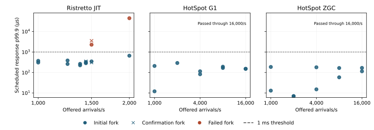

# Java roots workload under fixed arrivals

Ristretto passed at 1,437 arrivals/s. At 1,500 arrivals/s one of two fresh
processes exceeded the 1 ms scheduled-response p99.9 limit. Fresh pairs at
both endpoints reproduced those classifications. G1 and ZGC passed every
tested rate from 1,000 to 16,000 arrivals/s. The search stopped at its
configured maximum for both HotSpot collectors.

| Runtime | Scheduled p99.9 at 1,000/s, µs | Service p99.9 at 1,000/s, µs | Highest passing rate, arrivals/s |
|---|---:|---:|---:|
| Ristretto JIT | 370 / 306 | 149 / 227 | 1,437 |
| HotSpot G1 | 208 / 12 | 8 / 9 | ≥16,000 |
| HotSpot ZGC | 186 / 13 | 7 / 9 | ≥16,000 |

Each point used two fresh processes, five seconds of warmup and 60 seconds of
measurement per process. All 8,819,880 offered arrivals completed. At 1,437/s
Ristretto's initial pair recorded scheduled p99.9 of 319 / 284 µs and the
confirmation recorded 350 / 320 µs. At 1,500/s the initial pair recorded
2,272 / 347 µs and the confirmation recorded 307 / 3,520 µs. The 1,000/s
point was the sole tested rate that all three passed.

The driver targeted a 64 MiB managed heap with two workers. Each process
was confined to CPUs 4 and 6 and limited to two CPUs, 512 MiB cgroup memory
and zero swap. Each fork had to complete at least 10,000 arrivals, stay
within 1 ms scheduled p99.9 and 10 ms peak backlog, and finish its arrivals.
The CSV records both the process peak RSS and cgroup memory peak. The latter
includes memory charged to the cgroup beyond process RSS.

The runtime source was 5c6af2f3 and the benchmark driver source was 3e96ba7d.
The adaptive search selected rates based on results. Independent common-rate
replication and the million-completion tail gate remain open. GC observations
cover process lifetime. Global mutator pause duration was unavailable. This
comparison measures Java service capacity, separately from the native/WASI
complete-collection speedup gate.

[Individual forks](processes.csv) · [Source, schedule and output digests](provenance.json)
