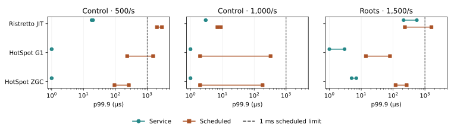

# Scheduled arrivals and service time on native Java

The arithmetic control at 500 arrivals/s exceeded 1 ms scheduled p99.9 in both Ristretto forks and one G1 fork. Its service p99.9 stayed at or below 20 µs on all three runtimes. At 1,000/s the control passed the scheduled limit in every fork. These observations show that a scheduled miss can occur with very little service work. They do not identify its cause or measure a GC pause.

| Workload and arrivals/s | Ristretto JIT scheduled p99.9 (µs) | G1 (µs) | ZGC (µs) |
| --- | ---: | ---: | ---: |
| Arithmetic control, 500 | 2,016 / 2,912 | 1,536 / 235 | 265 / 94 |
| Arithmetic control, 1,000 | 9 / 7 | 2 / 326 | 183 / 2 |
| Roots, 1,500 | 235 / 1,600 | 14 / 80 | 267 / 120 |

The 1,500/s roots screen used the JVM built from integrated revision `5c6af2f3`. Each fork completed all 90,000 arrivals under a 10 ms peak backlog. Ristretto exceeded the 1 ms scheduled p99.9 limit in one fork. Both G1 and ZGC passed both forks. Ristretto service p99.9 was 214 and 556 µs. This point does not qualify sustained operation.

Each measurement used an independent process, five seconds of warmup, 60 measured seconds, a 64 MiB Java heap, 512 MiB cgroup memory, disabled swap, two assigned CPUs and a two-core quota. The control used the candidate and CPU pair from the earlier [500/s and 1,000/s roots screen](../roots-capacity/README.md). The 1,500/s screen used a newer candidate and a different CPU pair. Compare runtimes within each row. The Java workload, fixed-arrival clock, JDK executable and module hashes match across all three rows. Collection counters cover the whole process.

[All 18 process results](processes.csv) · [Source, executable and schedule hashes](provenance.json)
