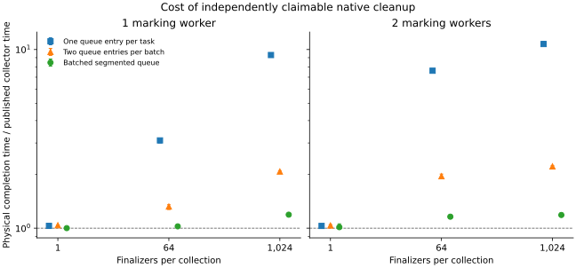
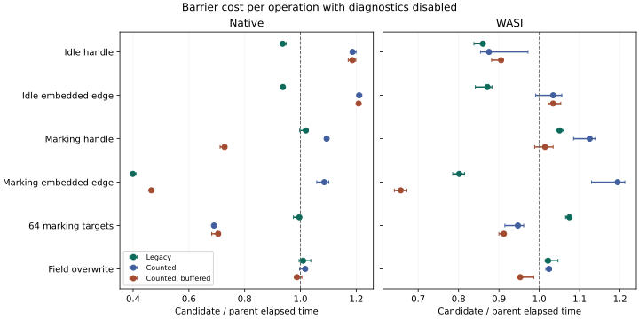
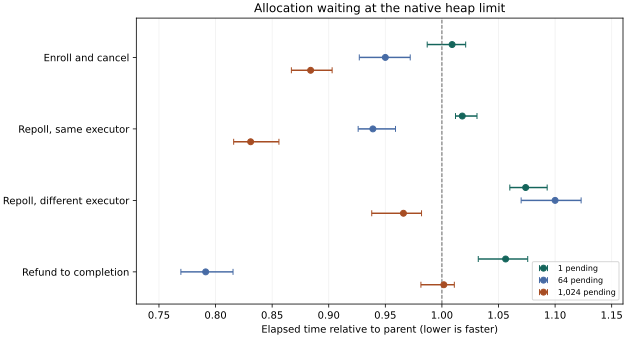
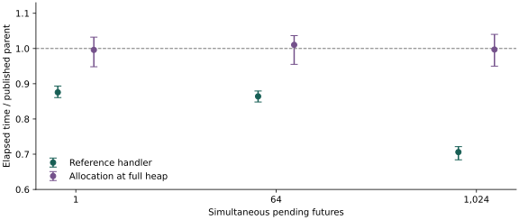
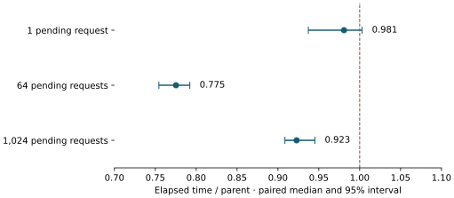

# Collection performance through the integrated collector revisions

Each revision, including the withheld experiment, ran the full 36-condition comparison against the same baseline collector at `f1daebeb`. The table shows the weakest of the individual paired bootstrap 95% lower speedup bounds. Every condition must reach 10×.

| Collector change | Revision | Schedule seed | Native | WASI | Passing conditions |
| --- | --- | ---: | ---: | ---: | ---: |
| Idle context root-page repair | `c8716a11` | 251126871 | 10.28× | 11.23× | 36 / 36 |
| Eight address cells per leaf | `22b87754` | 251126877 | 9.72× | 11.22× | 34 / 36 |
| Dense cells for deadline-free sweeps | `ca35c898` | 251126898 | 10.17× | 11.30× | 36 / 36 |
| Deadline-aware cells and buffered dirty-owner publication | `d683da11` | 251126683 | 9.97× | 11.20× | 35 / 36 |
| Bounded phantom cleanup and shorter phase publication | `899fdc20` | 251126899 | 9.60× | 11.40× | 33 / 36 |
| Recovery observation, scalar clearing and nursery sweep changes | `849b9f31` | 251126849 | 10.19× | 11.96× | 36 / 36 |
| Region evacuation epochs and nonblocking trim probes | `81594aad` | 251126815 | 10.18× | 11.68× | 36 / 36 |
| Owned source and destination checks during incremental copies | `1bd9360c` | 251126136 | 10.18× | 11.91× | 36 / 36 |
| Clean buffered edges while the target shard is parked | `74275197` | 251126742 | **10.11×** | **11.78×** | **36 / 36** |
| Experimental shared allocation credit (withheld) | `4302f9b7` | 251126602 | 10.07× | 11.69× | 36 / 36 |
| Waiting allocations publish context credit to the heap (migration failure) | `35e91dbf` | 251126935 | 10.26× | 11.61× | 36 / 36 |
| Shared credit across pending-future context changes | `ac047016` | 251126936 | 9.88× | 11.56× | 35 / 36 |
| Fresh mature edges counted on each marking queue | `b041f0c3` | 251126937 | **10.55×** | **11.76×** | **36 / 36** |
| Observe a fitting refund before the first allocation yield | `2b324c42` | 251126939 | **10.09×** | **11.62×** | **36 / 36** |
| Allocation refund observations while a registrar is parked | `42c37eb4` | 251126941 | **10.37×** | **10.73×** | **36 / 36** |
| Reserve physically released donor charges for waiting allocations | `a9242931` | 251126942 | **10.53×** | **10.63×** | **36 / 36** |
| Paged enrollment with a helpable commit | `5c05cc39` | 251126945 | **11.01×** | **11.38×** | **36 / 36** |
| Synchronous recovery at the managed heap limit | `ef490d09` | 251126947 | **10.88×** | **10.95×** | **36 / 36** |
| Public deferred selection, initial poll regression | `e8b0e6d2` | 251126951 | 10.43× | 11.01× | 36 / 36 |
| Terminal poll budget, eager grant records | `e5d1b3d5` | 251126953 | 10.57× | 11.20× | 36 / 36 |
| Per-donor physical claim and lazy grant preparation | `0a7993f0` | 251126959 | **10.17×** | **10.60×** | **36 / 36** |
| Reference handler registration and independent wake delivery | `93ea1b2b` | 251126972 | **10.76×** | **11.02×** | **36 / 36** |
| Cooperative regional descriptor and Java array returns | `ed3a9426` | 251126975 | **10.58×** | **10.28×** | **36 / 36** |
| Cooperative clearing through optional values | `f350e347` | 251126976 | **11.02×** | **10.50×** | **36 / 36** |
| Compiled helper-result heap ownership | `8b15e59c` | 251126980 | **10.65×** | **10.29×** | **36 / 36** |
| Reject retired same-heap compiled helper results | `89c0f698` | 251126985 | **10.77×** | **10.59×** | **36 / 36** |
| Allocation waiters and last-worker exit (withheld experiment) | `53c3f961` | 251126992 | **10.35×** | **10.35×** | **36 / 36** |
| Cooperative clearing of locked buffers | `d07426d1` | 251127009 | **10.43×** | **10.63×** | **36 / 36** |
| Executor registration and last-worker exit | `43ad8138` | 251127011 | **10.14×** | **10.81×** | **36 / 36** |
| Root implicit Java monitors across suspension | `480d279a` | 251127012 | **10.03×** | **10.50×** | **36 / 36** |
| Exact deletion and buffered barrier identity | `e920e1d3` | 251127022 | **10.61×** | **10.65×** | **36 / 36** |
| Retrace a buffered owner after its graph changes | `559296ae` | 251127105 | **10.10×** | **10.54×** | **36 / 36** |
| Exact primary remembered directory | `7ae61be7` | 251127106 | 7.93× | 10.43× | 28 / 36 |
| Bounded scan and isolated marking reservations | `3c49be32` | 251127108 | 8.70× | 10.15× | 28 / 36 |
| Parked remembered publishers and native worker retries | `b7eb6c4b` | 251127109 | **10.28×** | **10.58×** | **36 / 36** |
| Parked native cleanup and independent bounded storage | `a0eba4e2` | 251127124 | **10.39×** | **10.50×** | **36 / 36** |
| Exact Java Reference fields through hidden subclass members | `cdee5888` | 251127133 | **10.86×** | **10.61×** | **36 / 36** |

## Native allocation while a second host destructor is pending

The published collector can reclaim independent bounded backing while one native destructor is parked. An independent object with an arbitrary Rust destructor can still leave a waiting allocator out of memory. In an experimental version that pledged an opaque donor to a specific waiting allocation before destruction, two full collections finished while the allocation stayed pending behind a nonreturning destructor. The control returned out-of-memory on the same schedule. That experiment remains outside the release source.

A different experiment made each cleanup task available to two native consumers. With both parked and a third destructor queued, collection tickets continued to complete. Releasing one consumer allowed the third destructor to start. A waiting allocation could then spend physically returned bytes, and cancellation preserved the original charge. The published control timed out waiting for the second destructor to enter. In a separate unsynchronized test, the first two-consumer implementation funded the allocation in 411 of 500 independent processes. The other 89 returned out-of-memory.

Each timing below is the median paired ratio of physical collection completion time to the published implementation at `a0eba4e2`, using 15 randomized process pairs for each finalizer count and marking-worker count. Ratios above one took longer.

| Experimental queue | 1 finalizer, 1 worker | 64 finalizers, 1 worker | 1,024 finalizers, 1 worker | 1,024 finalizers, 2 workers |
| --- | ---: | ---: | ---: | ---: |
| One queue entry per task | 1.031× | 3.099× | 9.313× | 10.732× |
| Two queue entries per batch | 1.039× | 1.322× | 2.076× | 2.218× |
| Batched segmented queue | 1.001× | 1.024× | 1.190× | 1.185× |

All three queue designs remain experiments. Whether a waiting allocation can use an arbitrary donor still depends on when physical destruction finishes relative to its terminal decision. [Patches, schedules, raw process results, build receipts and bootstrap intervals](opaque-cleanup-experiments.json.gz)

## Java reference fields hidden by subclasses

A Java subclass of `WeakReference` can declare a strong field named `referent`. On the control, reading the base reference returned the subclass value, and clearing the base reference erased the strong field. HotSpot retained it through two collections. At `cdee5888`, linking resolves the JDK declaration and descriptor once for `referent`, `queue` and `discovered`. Native access and conditional tracing use the same referent slot. Before linking, a class with a JDK Reference ancestor matches the declaring field against the captured field layout by identity.

The Java 8 and 25 tests delivered both discovered references to their registered queue with the subclass fields intact. The Java 25 fixture also matched HotSpot in the WASI launcher for get, identity comparison, clear and retention through collection. All 104 repeated processes passed across the native Java fixtures, WASI launcher and native/WASI class layouts. The native execution-profile VM suite passed 1,008 tests with three ignored, and the native classloader passed 751 with nine ignored. The existing reference lifecycle test also passed on five JDK versions across 40 collector configurations. Strict native and WASI Clippy and the bare-Wasm VM check passed. [Oracle, process receipts and build fingerprints](java-reference-fields-tests.json.gz)

The 1,728 fresh complete-collection processes passed all 36 conditions against `f1daebeb`. The lowest individual 95% lower speedup bounds were 10.86× native and 10.61× WASI. This measurement covers the collector fixture. Whole-host pauses, hard-cap recovery with arbitrary destructors, and sustainable JVM performance remain open. [Per-process collection timings](java-reference-fields.csv) · [Source and binary provenance](provenance.json)

## Native collection during parked cleanup

At `a0eba4e2`, one registered native collector worker can complete a new collection while a host finalizer, ordinary clearing hook or Rust destructor is parked. A waiting allocation recovered an independent scalar, byte vector or optional string at the heap limit. The parked payload kept its full charge until destruction. A control with only live or privately held storage returned out-of-memory. An executor panic during notification no longer consumes a second waiter’s wake. The first shutdown call drains independent storage and reports a caught cleanup error. The WASI collector remains cooperative. A nonreturning host callback on a single-threaded executor can still block that executor.

The first implementation handed off each object separately. With 1,024 cheap registered finalizers this took 64.4% longer with one worker and 54.1% longer with two. Sending an already available, bounded run of cleanup tasks improved that result. Relative to the published source `8f0311bf`, final median time through physical refund fell **28.2% with one worker and 32.4% with two** for 1,024 objects. For 64 objects it fell 20.9% and 22.7%. For one object it rose 1.8% and 2.2%. The two-worker interval included parity. Each of six conditions used 15 randomized process pairs, 16 measured cycles per process and an explicit finalization-count and physical-refund check. [Timing graph](native-cleanup-cost.svg) · [Matched builds, fixture, schedule and process data](native-cleanup-cost.json.gz)

All 23 forced schedules passed in 100 fresh native processes each. The GC library passed 562 default native tests, 853 all-feature native tests and 327 WASI tests. Cargo verified the packaged collector. All 36 complete-collection conditions passed against `f1daebeb` with weakest individual 95% lower bounds of 10.391× native and 10.496× WASI. The ordinary cleanup controls first failed on the earlier sources. An additional test still returns out-of-memory when the independent donor itself needs an arbitrary user destructor queued behind the parked callback. Shared VM roots, native boundaries, process-wide pauses and sustained Java performance also remain open. [Collection samples](native-cleanup.csv) · [Regression controls, stress results and verification](native-cleanup-controls.json.gz)

## Collection with a parked remembered-set publisher

On the parent, a young collection exhausted 4,096 public steps while a writer held the only remembered shard. Both publication policies completed with the guard released. At `b7eb6c4b` both complete with the writer still parked, preserve the young child of a mature owner and reclaim unrelated garbage. Scans read an immutable directory keyed by the non-recycled object ID. Promotion and retirement can update exact membership while another publisher is stopped. A buffered writer orders its enrollment against young-cycle startup and schedules a fresh traversal when the cursor has already passed. The tests include late address reuse and a stream of new births beyond the scan’s initial cutoff.

All 1,100 forced native processes passed. The native library passed 558 default and 849 all-feature tests. The WASI library passed 327. Strict Clippy, the bare-Wasm build, and Cargo package verification passed. The first two candidates missed eight native collection conditions each. Native two-worker CPU profiles showed increased time in mark-work claims. Retaining some retry delay after a single success restored the complete-collection gate in all 36 conditions. Its lowest individual 95% speedup bounds were 10.278× native and 10.580× WASI across 1,728 processes. [Parked controls, tests, profiles and auditor responses](remembered-progress-controls.json.gz) · [Directory results](remembered-directory.csv) · [Bounded scan results](remembered-reservations.csv) · [Qualified results](remembered-cutoffs.csv)

In a separate native comparison against `559296ae`, the requester slept on its real executor waker and only registered workers performed the collections. Across 576 fresh processes, median complete-collection time with two workers was 0.770–0.952× the parent, depending on shape, publication policy and diagnostics. With one worker, the range was 0.956–1.048×. The one-worker gated mixed workload with diagnostics took 4.8% longer, with a paired 95% interval of 2.5–9.5% longer. The harness used sustained requests with short warmup. Sparse arrivals after a long idle interval and whole-host pause coverage remain open. [Worker-only timing graph](remembered-worker-only.svg) · [Matched fixture, process results and build fingerprints](worker-only-collection.json.gz)

## Retracing a buffered write after an earlier traversal

An older object can acquire a young child after the collector has traced its fields. On the parent revision, both explicit flushing and collector draining acknowledged that buffered write, then reclaimed the reachable child. Both paths now request a fresh traversal during young strong marking and keep the record pending until the work is visible. The two regressions preserve the child through a young collection and check its reclamation after the owner drops. Five progress and liveness tests passed in 100 fresh native processes each. The default native library passed 554 tests, the all-feature library passed 845 and the WASI library passed 325. Strict Clippy, the bare-Wasm build and Cargo package verification passed.

The complete-collection comparison used 24 process pairs per condition, 1,728 processes in total. The weakest individual 95% speedup bounds against `f1daebeb` were 10.096× native and 10.536× WASI. A separate public young-collection test still exhausts 4,096 steps while the primary remembered-set shard is parked. [Process measurements](buffered-rescan.csv) · [Failing controls, tests, stress runs and read-only audit](buffered-rescan-controls.json.gz)

## Exact identity during child deletion and deferred marking

At `e920e1d3`, clearing a leased parent shades its original live child even when another thread holds the child's object shard. When the original child has died, clearing its stale reference leaves a later allocation at the same address white. The original failures are documented below. The collector carries the stable object ID in deferred work and in its cache of completed barriers. A caller-protected raw handle captures the real ID when its public write barrier runs. A dirty owner enters the remembered set only when its exact descriptor is still present. The prepared drain can enroll a live owner while its object shard is parked.

The first implementation performed an optional completion check on an unrelated pending allocation and forced that allocation to retry publication. The new test submits stale records during actual publication. It verifies that they are acknowledged, leave remembered membership and certification untouched, and allow the new birth to complete on its first attempt. Seven schedules passed in 700 fresh native processes. The native library passed 552 default and 843 all-feature tests. The full all-feature suite, strict Clippy, 323 WASI library tests, the bare-Wasm build and packaged collector verification also passed. [Controls, tests and audit receipts](deletion-identity-verification.json.gz)

With diagnostics disabled, marking an embedded edge took 60.1% less operation time under native legacy publication and 53.5% less under native counted publication with buffering. Corresponding WASI reductions were 19.8% and 34.3%. On native unbuffered counted publication, repeating a barrier on one ordinary handle took 9.4% longer and the idle handle barrier took 18.7% longer. Checking the exact cached identity before the directory lookup removed most of the first candidate’s 3.40× repeated-handle cost. Each condition used nine paired processes with 100,000 operations per process. All 36 complete-collection conditions exceeded 10× against `f1daebeb`, using a separate 1,728-process comparison. [Per-process full-cycle measurements](deletion-barrier.csv) · [All barrier samples, compiler receipts and pilot results](deletion-barrier-costs.json.gz)

## Synchronized method receiver lifetime

On `d65e7802`, ordinary Java dispatch could reclaim the receiver of a synchronized instance method after the method cleared local variable zero, while the Java monitor was still held. The method guard now acquires an owning reference before awaiting monitor entry and releases the monitor before dropping that reference. The test transfers the embedding's sole reference into the call, clears the receiver local, forces two complete collections, and checks acquisition by a second thread and collection after release.

The regression ran on native and WASI for successful return, cancellation while holding the monitor, cancellation while waiting to acquire it, and cancellation after notification but before the next poll. Three existing compiled cooperation tests had assumed their first pending poll always reached a specific Java instruction. On the same executable their result varied by working directory. They now use the executor's waker and verify the class, method, frame depth and bytecode offset before testing ownership across suspension. The integrated native execution-profile VM suite passed 1,008 tests with three ignored. Strict VM Clippy passed. The complete-collection comparison retained the 10× gate across all 36 conditions. [Parent failure, native and WASI verification](method-monitor-verification.json.gz) · [Paired full-cycle samples](method-monitors.csv)

## Allocation waiters across executor changes and worker exit

At the heap limit, an allocation keeps its registered waker across polls on the same executor. A poll on a different executor replaces the callback. An eligible waiter can enter the ordered index while another publisher is parked. A peer observing the last worker’s exit can deliver the outstanding notification, even if the physical allocation request has since been cancelled. The previous experiment stranded a ticket waiter in that schedule.

Seventeen forced schedules each passed in 100 fresh native processes. They include cancellation, a refund racing the last worker’s exit, changed executor identity, and a callback claimed during executor replacement. The strict-provenance Miri regression uses a waker whose clone changes its representation. The all-feature native GC suite, 320 WASI library tests, strict Clippy, the bare-Wasm check and verification of the packaged collector passed. The complete-collection comparison used 24 pairs per condition against `f1daebeb`. [Full-cycle process measurements](executor-waiters.csv) · [Failing controls, stress runs, fixtures and paired samples](executor-waiter-verification.json.gz)

A read-only Neon review of the terminal callback transition identified the single-writer and ordering requirements for preventing a replacement after delivery. The forced migration tests exercise closure before replacement and during a subsequent replacement. Carbon rejected the requested effort level and its highest supported setting timed out.

The native cost comparisons use the immediate parent `f1b72c1f`, with one pinned CPU and the same fixture in each pair. Registration and repoll measurements include creation and cancellation of 16,384 pending allocations per process. There were 48 pairs per queue size for those operations and 64 for refund-to-completion. With 1,024 waiters, enrollment took 11.6% less time and same-executor repolls took 16.9% less. With one waiter, same-executor repolls took 1.8% longer and completing a refund took 5.6% longer. Changing executors took 7.4% longer with one waiter and 10.0% longer with 64. The intervals below are paired bootstrap 95% intervals for each condition.

## Deletion-barrier regressions before the identity fix

Two native tests fail at both `f1b72c1f` and `43ad8138`. A callback lease delays the retirement of a parent containing a child reference. In the first test, the original child is physically reclaimed and a fresh allocation receives the same verified address with a different object identity. Dropping the delayed edge marks the new allocation in the next full cycle. In the second test the original child is still present. Under counted publication the parent's clearing thread misses a one-second deadline while another thread holds the child's object shard. The test releases the shard and joins the clearing thread. These cases passed after the exact-identity change above. [Reproducible test patch, command and failing output](deletion-barrier-controls.json.gz)

## Cooperative clearing of locked buffers

On `d65e7802`, each of three lock wrappers around a region-backed buffer could strand an unrelated eight-byte allocation while a region registry was parked. The standard mutex, standard reader-writer lock and collector mutex now forward their inner clearing operation using exclusive access. A poisoned standard lock still propagates the original offset, budget and progress result. The unrelated allocation returned its rooted value before the parked thread resumed. All nine contention and clearing regressions passed in 100 fresh processes each.

All 36 collection conditions exceeded 10×, with weakest individual 95% speedup bounds of 10.43× native and 10.63× WASI. GC packaging, strict Clippy, native all-feature tests, 319 WASI GC tests and the bare-Wasm check passed. [Paired full-cycle samples](locked-buffers.csv) · [Failing parent regressions, stress runs and audit](locked-buffer-verification.json.gz)

## Withheld allocation-waiter experiment

On the release branch an allocation can remain asleep while an independent waiter is publishing. In the experiment at `53c3f961`, the allocation woke, returned a rooted value and unregistered before the publisher resumed. Fourteen forced schedules passed in 100 fresh native processes each. The experiment passed all 36 complete-collection comparisons. A subsequent test cancelled the allocation before a subthreshold refund, leaving only a ticket waiter. That waiter missed the last worker’s exit when the worker was parked before notification.

The paired comparison used the release source at `eecab7c4` and 1, 64 or 1,024 sleeping allocations on a full heap. Each registration run timed 16,384 public allocations through two or three polls and cancellation. The refund run timed the return of eight bytes through delivery of the eligible rooted value. Ratios below one mean the experiment took less time.

| Candidate / release median elapsed time | 1 waiter | 64 waiters | 1,024 waiters |
| --- | ---: | ---: | ---: |
| Two polls and cancellation, 32 process pairs | 1.035× | 1.003× | 0.884× |
| Three polls and cancellation, 32 process pairs | 1.519× | 2.375× | 2.148× |
| Refund to rooted allocation, 48 process pairs | 1.050× | 0.857× | 1.025× |

The implementation remains outside the release branch. Repeated executor polls and ticket-only wake delivery are open. [Source patch, fixtures, failures and per-process data](withheld-allocation-waiters.json.gz) · [Full-collection samples](allocation-waiter-exit.csv)

## Retired same-heap compiled helper results

A same-heap edge can retain an object's identity after collection reclaims its payload. On `8b15e59c`, passing such an edge through a compiled helper result panicked during promotion. At `89c0f698`, a failed promotion returns a VM error and leaves the compiled frame cache empty. An already rooted value can share its owning root. Promoting an edge requires the live allocation to match both its address and its identity.

The native VM library suite passed 1,007 tests with three ignored. The native all-feature GC suite, 319 WASI GC library tests, bare-Wasm build check, strict Clippy, and GC crate packaging passed. The weakest individual 95% lower speedup bounds across all 36 collection conditions were 10.77× native and 10.59× WASI against `f1daebeb`. [Matched collection samples](vm-retired-edge.csv) · [Regression, read-only audit and verification](compiled-retired-edge.json.gz)

## Compiled helper-result heap ownership

On `c12cf60f`, generated native `aaload` returned a foreign collector's handle through an array owned by the VM. Looking up the same handle directly in the VM's heap rejected it. At `8b15e59c`, the compiled result cache checks the typed handle's heap before either reusing a cached root or acquiring one. Synchronous and asynchronous array loads report a pending error and preserve the foreign owner's value. Same-heap results retain their ownership across frame cleanup and collection. The generated fixture uses experimental compiled dispatch.

The native execution-profile VM suite passed 1,006 tests with three ignored. The GC library passed 529 tests, and strict VM Clippy passed. The complete-collection comparison again cleared all 36 conditions, with weakest individual 95% speedup bounds of 10.65× native and 10.29× WASI. Broader compiled Java coverage, native boundaries, allocation-waiter progress and host pause qualification remain open. [Matched collector samples](vm-heap-ownership.csv) · [Failing control, audit and verification](compiled-reference-ownership.json.gz)

## Cooperative clearing through optional values

On the preceding regional collector an `Option<HeapBuffer<u8>>` blocked the registered worker in ordinary destruction, even after an independent global donor became available. At `f350e347`, a present value receives the original clearing offset and budget and retains ownership across a busy or incomplete return. An absent value completes immediately. Eight forced native schedules passed in 100 fresh processes each. The read-only Neon implementation audit confirmed the cursor and ownership forwarding. Native GC suites, WASI collector and recovery tests, the bare-Wasm check, strict Clippy and Cargo package verification passed. The fixed complete-collection comparison cleared all 36 conditions.

The tests cover a direct buffer and an optional buffer. General composite destruction and the allocation-waiter index still require progress work. [All 1,728 process measurements](optional-returns.csv) · [Forced schedules, parent failure and verification](optional-return-tests.json.gz)

## Cooperative regional descriptor and Java array returns

At a full heap, a native collection worker could block while freeing a descriptor or a buffer in a parked region registry. An unrelated allocator missed its one-second deadline even after a global donor became available. At `ed3a9426`, the collector keeps the outstanding range and its charge on a retryable retirement task. Other reclamation work can proceed. A separate test started the single production worker with `gc.start()` and recovered the global allocation before releasing the registry. Seven tests covering these schedules, interrupted clearing, abandonment and exact backing release passed in 100 fresh native processes each.

A partially copied array keeps ownership of every initialized element in the source until the copy commits. On cancellation a staging return cannot advance the count of reusable live payload bytes. Reference arrays retain their remembered cards until their values are cleared. The additional test at `9c393033` parked each registry during preparation and compaction, retried the return after the final element dropped, and checked every element's destruction counter. It passed on native, WASI and Miri. The read-only Neon audit identified this missing test. Carbon rejected the requested effort.

The collection comparison used 24 paired processes in each of 36 conditions. The lowest individual 95% speedup bounds against `f1daebeb` were 10.58× native and 10.28× WASI. The comparison times whole collections on its established workloads. The parked-registry tests separately exercise compaction and bounded allocation. Native GC library and all-feature tests, native classloader tests, WASI collector and array tests, bare-Wasm checks, strict Clippy and Cargo package verification passed. [All 1,728 process measurements](regional-returns.csv) · [Forced schedules, parent failures, audit and verification](regional-return-tests.json.gz)

An additional control on this revision wraps the same regional buffer in `Option`. Its default clearing hook still lets ordinary destruction block the only registered worker. The allocation-waiter index, other nested storage, integration boundaries and host-wide progress also remain open.

## Independent reference handler registration and delivery

At `93ea1b2b`, a Java reference handler can register, cancel and receive a wake while a thread holds the allocation-waiter mutex. The parent missed the one-second deadline. A separate test consumes the pending reference while the first callback is parked. A peer delivers the original notice across 130 handlers, spanning three pages. Repoll, cancellation and ticket exhaustion tests check exact callback ownership when a slot is reused. Six forced tests each passed in 100 fresh native processes. Native passed 520 default tests and 1,167 all-feature checks, WASI passed 332 checks, and Miri passed the three slot ownership tests. Strict Clippy, bare Wasm and Cargo package verification passed. [Validation, forced schedules and package checksum](reference-wait-evidence.json.gz)

Both enrollment benchmarks execute 16,384 public-API operations per native process on one pinned CPU, with 32 randomized process pairs per size. The reference benchmark polls each handler and drops it. The allocation benchmark parks the sole registered worker in a finalizer at the heap cap and polls each allocation twice. Outside the timed intervals it checks that the collector registered every waker and removed them all on cancellation. The earlier first-poll fixture yields before registration. Relative to `a9f3e401`, median paired reference time fell **12.4%, 13.6% and 29.4%** for 1, 64 and 1,024 outstanding waits. Allocation elapsed-time ratios were **0.996, 1.010 and 0.997**. All three allocation intervals include parity. A private allocation-index prototype took **1.44×, 2.35× and 2.58×** the parent's time in a separate 12-pair pilot. [Fixtures, build hashes and ordered process samples](reference-wait-evidence.json.gz) · [Complete-collection process records](reference-waits.csv)

A separate forced schedule on `93ea1b2b` parked the descriptor-region registry on a 24-byte heap. The sole registered worker attempted to return one regional descriptor. An asynchronous allocation missed its one-second deadline after an independent global donor became available. The general allocation-index stall and this regional return remain open. [Reproducer patch and observed failure](reference-wait-evidence.json.gz)

## Helping a stopped selector after lease release

At `0a7993f0`, four 8-byte requests spent one returned 32-byte donor while the original selector remained parked. The test stops the selector before binding, after binding, after a partial scan and immediately before the physical claim. Peer helpers retain the exact request generation across cancellation and reopening. One per-donor state transition gives a helper exclusive responsibility for physical release. Concurrent insertion of a second donor can postpone directory cleanup without revoking the first claim.

Ten regressions passed in 100 fresh native processes each. They cover preparations for ordinary and returned storage, cancellation between binding and cursor publication, four policy combinations for donor sharing, and an eligible request behind 4,096 oversized interests. The latter case checks at most one measured collection batch per poll. A separate test changes the caller's managed guard or available credit while the terminal poll is suspended. Native passed 516 default library tests and 1,161 all-feature checks. WASI passed 313 library tests and 16 allocation and recovery integration tests. Formatting, native Clippy with warnings denied, the bare Wasm build and verified Cargo packaging passed. [Tests, original failures, schedules and package hash](deferred-help-tests.json.gz) · [Complete-collection process measurements](deferred-help.csv)

The initial selection change passed all collection timing conditions but failed the existing async poll-budget tests. Eager allocation of grant records in the next revision increased full-heap registration and cancellation time by 66–70% versus `ef490d09`. Preparing a record only for a fitting request brought the median paired elapsed-time ratios to 0.978, 0.972 and 1.002 at one, 64 and 1,024 pending requests. The last interval included parity. Costs relative to the earlier `42c37eb4` control were 1.75×, 1.84× and 1.31×. [Enrollment comparison and 95% intervals](deferred-enrollment.svg) · [Initial collection timing](deferred-help-initial.csv) · [Poll-budget revision timing](deferred-help-poll.csv)

Coverage here is for directly transferable storage after callback lease release. A parked allocation-waiter index still blocks an unrelated full collection in the consolidated implementation. Region storage, finalizer paths, integrated VM semantics and host pause qualification remain open.

## Synchronous allocation recovery

At `ef490d09`, an 8-byte synchronous allocation can reclaim an unreachable 32-byte donor at the configured heap limit. The single-attempt constructor returns its unpublished value when the heap is full. The recovering constructor roots outgoing edges before helping its own collection ticket. A private donor must release its storage before a waiting allocation can spend the charge. On a single-threaded Wasm host the synchronous constructor drives collection on the calling turn. Callers that need to yield to the host can use the asynchronous constructor.

All 300 fresh native processes passed across three tests covering sleeping synchronous allocators, a parked native collector worker, and asynchronous donor sharing. The tests retained the resulting objects and checked the heap charge. Native passed 505 default library tests and 1,150 all-feature checks. WASI passed 311 library tests and 16 allocation and recovery integration tests. The initial all-feature run exposed a shutdown test reading its flag while a native worker could still own the collector. The verified test waits for destruction before checking finalization. Strict native Clippy, the bare Wasm build and Cargo package verification passed. [Test outcomes, original failures and package identity](sync-recovery-tests.json.gz) · [Paired collection samples](sync-recovery.csv)

A separate native test parked the allocation waiter index. A peer exceeded its one-second deadline to reclaim an unrelated object and finish its ticket. Independent wake delivery and deferred storage retirement remain open.

## Reclamation after a callback lease returns

On the consolidated source at `2fb3cb90`, three of four eligible 8-byte requests returned OOM while the second 32-byte donor was privately held for destruction. The test first retained a callback lease across collection. It then enrolled the competing requests either before lease release or between release and the first reaper claim. All 800 native schedules reproduced the three premature results across the two enrollment orders and four policy combinations.

A local prototype captured enrolled requests on the first reaper claim and retained that selection across bounded batches. It passed all 800 matched schedules, 507 native library tests and strict native Clippy. While a helper owns a partially scanned donor outside the queue, another helper cannot resume that particular scan. Suspension inside selection, independently available donors, native/Wasm qualification and the collection performance gate remain open for the prototype. [Matched process results, source patches and verification](leased-donor-trials.json.gz)

## Paged enrollment

At `5c05cc39`, the collector commits interests in chronological order. A peer can commit a linked slot while its owner is stopped. A donor sees precisely the positions below its cutoff and retains the original request order through cancellation. Cancellation during assignment leaves the full share available to a later request. Both forced races and the four-allocator test passed in 100 fresh processes each. The original four-allocator fixture passed in all 1,800 fresh processes. The native default library suite passed 503 tests, the native all-feature suite passed 1,146, and the WASI library suite passed 311. The bare Wasm build, strict native Clippy and verified Cargo package passed. [Schedules, process outcomes and build identities](paged-enrollment-tests.json.gz)

The allocation benchmark ran all three revisions on the same core with randomized order in 32 fresh process triples at each queue size. Relative to the first donor-grant revision, the time for registration and cancellation fell to 0.24× at one pending request, 0.17× at 64 and 0.17× at 1,024. Relative to the earlier revision without donor funding the corresponding ratios were 1.75×, 1.83× and 1.30×. Each process submitted and cancelled 32,768 futures against an already full heap. Actual collection had a separate 24-pair schedule per condition. Weakest median collection speedups were 11.69× native and 12.00× WASI. [Allocation cost and 95% intervals](paged-enrollment-cost.svg) · [Collection processes](enrollment-pages.csv) · [Validation and allocation samples](paged-enrollment-tests.json.gz)

## Allocation recovery with an independent donor

At `a9242931`, the two 32-byte donors filled a 64-byte heap. Four pending requests each needed eight bytes. A fresh full ticket completed while both reapers were parked before physical deallocation. The three competing requests remained pending, and a fifth request arriving after selection returned OOM. Releasing only the second donor let all four original requests acquire distinct rooted values. All 64 bytes remained accounted for until the first reaper resumed. Every run drained to zero. All four policy combinations passed in each of 100 fresh native processes. The original contention test also passed in all 1,800 fresh processes, compared with eight failing processes in its earlier run. [Forced schedules, original fixture reference and outcomes](retirement-grant-tests.json.gz)

Complete collections cleared all 36 conditions with 24 fresh matched pairs per condition. The weakest median speedups were 11.01× native and 10.99× WASI. On native, 499 default library tests and 1,142 all-feature tests passed. On WASI, 309 library tests passed, including cancellation on either side of payment and workerless help during partial selection. The bare Wasm build, strict all-target native Clippy and verified Cargo package passed. [Collection processes](retirement-grants.csv) · [Build and source identities](provenance.json) · [Validation and package hash](retirement-grant-tests.json.gz)

This correctness change increased allocation cost under pressure. The native comparison enqueued and cancelled 32,768 real allocation futures on an occupied eight-byte heap in each process, with 32 randomized process pairs per queue size. Median elapsed time relative to `42c37eb4` increased to 7.30× at one pending request, 10.86× at 64 and 7.59× at 1,024. The corresponding median times per request were 620, 862 and 939 ns. Reducing the cost of enrolment and cancellation remains an alpha task. [Timing distribution](retirement-grant-cost.svg) · [Fixture, samples and bootstrap intervals](retirement-grant-tests.json.gz)

Eligibility covers asynchronous requests enrolled at donor selection, direct global backing, and an exact match between layout size and charge. Finalizers, heap owners, clearing callbacks, drop glue, small-page and region storage, and deferred lease retirement have separate ownership rules. Additional qualification must cover those paths, synchronous callers, late arrivals during selection and the length of the wakeup scan on cooperative hosts.

## Earlier collection revisions

At `42c37eb4`, the lowest complete-collection medians were 11.01× native and 10.84× WASI. A native test held a registrar immediately before publication. A peer registered, cancelled an advisory request, observed a real refund and allocated the returned bytes before the registrar resumed. The parent timed out. A second test parked a refund after recording it for the current group. A later observer of the same size saw only the next refund. Each test and the cancellation ordering model passed in 100 fresh processes. Separate runs verified that 1,024 simultaneous 8-byte observers could share a group through repeated 1-byte refunds. The earlier independent-donor schedule still returned three terminal OOMs in all 400 attempts. [Collection processes](refund-groups.csv) · [Test patches, outcomes, timings and Cargo package identity](refund-observer-evidence.json.gz)

The allocation comparison used 32 randomized native pairs at each queue size. Each process submitted and cancelled 32,768 real allocation futures at their first suspension on an occupied 8-byte heap. Relative to parent `907522d7`, the median elapsed-time ratios were 0.981 at one pending request (95% interval 0.937–1.003), 0.775 at 64 (0.754–0.792) and 0.923 at 1,024 (0.909–0.945). The fixture measures enrolment and cancellation without servicing a full ticket. Refund delivery can still traverse multiple overlapping registration groups, and an observer records its opportunity when the collector announces the returned headroom. The measured interval does not bound time between physical return and that announcement.

At `2b324c42`, the weakest median speedups were 10.44× native and 11.75× WASI. With an 8-byte cap, a real allocation and an advisory request both received a refund during their first suspension. A competitor immediately took the bytes. The parent exhausted its recovery allowance after two tickets. The revised requests observed the refund and completed three tickets before returning OOM on the still-full heap. With no refund they completed two. Cancellation during the first yield released the observer and restored local allocation batching. The independent-donor case still requires a way to hand returned storage to existing requests. [All process results](first-yield.csv)

At `b041f0c3`, the weakest median speedups were 11.62× native and 11.95× WASI. The collector records each newly strong mature edge under its destination queue mutex, then sums the lane counts at full sweep. A two-lane diagnostic paused a real marking callback between marking its targets and recording their tally. Another helper kept making bounded calls, the ticket stayed open, and the next full collection reclaimed an unreachable mature object. All 200 forced schedules passed. [Test patches, process results, and Cargo packaging receipt](credit-and-census.json.gz)

Shared-context waiters can now spend prepaid bytes while the range cache is held. Their space observations make unused credit available to the heap through a real refund. The wake tests cover a parked collector, a stolen first refund, partial credit, cancellation, and futures that change attached contexts. The context suite passed in 100 fresh native processes. The intermediate `35e91dbf` missed context changes and `ac047016` missed the native counted two-worker tree with diagnostics enabled. [Waiting-credit processes](waiting-credit.csv) · [Migrated-credit processes](migrated-credit.csv) · [Integrated lane-census processes](lane-census.csv)

A direct comparison used 48 randomized native process pairs per tree condition against the immediate parent `ac047016`. With two workers and diagnostics disabled, median elapsed time decreased by 10.9% under gated publication and 6.4% under counted publication. Both individual 95% intervals excluded parity. With diagnostics enabled, both intervals included parity. The direct comparison does not establish that the census change alone improved diagnostic-enabled tree time. [Parent comparison, raw processes and per-condition intervals](lane-parent.json.gz)

The shared-credit experiment passed the timing gate and 100 repetitions of the context tests. A separate forced schedule exposed an allocation failure. One peer observed an empty context and bypassed a parked range cache. A second peer refilled the context and retained its 8-byte root. With 4,088 bytes now prepaid, the first peer returned OOM for 8 bytes. Subsequent revisions above qualify the corrected path. The diagnostic bundle includes both patches against the recorded base, the test command, and the failing result. [Diagnostic bundle](context-credit-witness.json.gz) · [Process records](context-credit.csv)

At `74275197`, the minimum paired medians were 10.33× native and 11.84× WASI. In 300 separate native processes, a clean buffered edge could be acknowledged with its target shard parked during collector draining, explicit flushing or a mutator's overflow. The collector retained the child graph. A consumer parked after claiming a record still kept its collection ticket open. The parent failed the collector-drain assertion. [Forced schedules and parent failure](barrier-schedules.json.gz)

Collector `1bd9360c` reached minimum medians of 10.83× native and 12.13× WASI. A separate public-buffer regression parked the source registry during both initial and continued partial copies into a different region. The test timed out on the parent and finished both copies and exact byte checks on this revision.

Collector `81594aad` cleared all 36 conditions with minimum medians of 10.42× native and 11.81× WASI. The core fixture does not enable region compaction. Separate forced tests exercise the new region transitions.

Collector `849b9f31` cleared the gate again. Its slowest medians were 10.92× native and 12.22× WASI. It includes the parked phase-statistics and retained phantom cleanup fixes, the independently registered refund observations, and the linked Java class layout change.

The earlier merged revision at `d683da11` had one interval crossing the gate, on the native mixed graph with two workers, gated publication and diagnostics disabled. Its paired median was 10.93×. The slowest median across all its conditions was 10.77× native and 11.34× WASI. Each revision used 1,728 fresh processes and 27,648 timed full cycles. All passed the correctness and managed-byte checks.

[Per-condition results](summary.json) · [Compiler, source, binary and host provenance](provenance.json) · Ordered process records for [context repair](context.csv), [eight-cell leaves](sparse.csv), [deadline-aware leaves](deadline.csv), [the merge](merged.csv), [phase changes](phase.csv), [recovery and sweep](recovery.csv), [region transitions](regions.csv), [source validation](copy.csv) and [clean buffered edges](clean-edges.csv).

Use the [original integrated protocol](../consolidated-complete/README.md) with the candidate revision and seed in the table. The collection benchmark measures elapsed time to mark, sweep and reclaim. The Java application uses time-limited steps and has separate latency and memory measurements.
