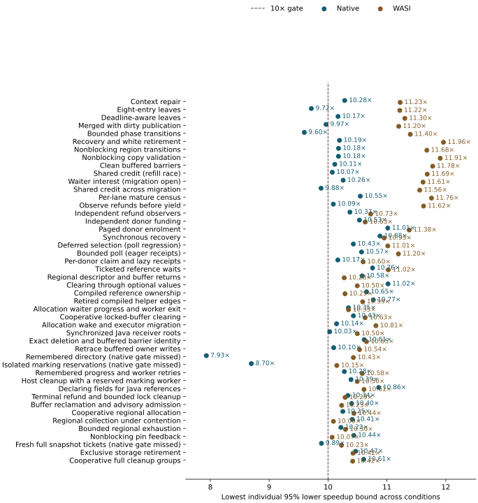

# Collection performance through the integrated collector revisions

Each revision ran the full 36-condition comparison against the same baseline collector at `f1daebeb`. The table shows the weakest of the individual paired bootstrap 95% lower speedup bounds. Every condition must reach 10×.

| Collector change | Revision | Schedule seed | Native | WASI | Passing conditions |
| --- | --- | ---: | ---: | ---: | ---: |
| Idle context root-page repair | `c8716a11` | 251126871 | 10.28× | 11.23× | 36 / 36 |
| Eight address cells per leaf | `22b87754` | 251126877 | 9.72× | 11.22× | 34 / 36 |
| Dense cells for deadline-free sweeps | `ca35c898` | 251126898 | 10.17× | 11.30× | 36 / 36 |
| Deadline-aware cells and buffered dirty-owner publication | `d683da11` | 251126683 | 9.97× | 11.20× | 35 / 36 |
| Bounded phantom cleanup and shorter phase publication | `899fdc20` | 251126899 | 9.60× | 11.40× | 33 / 36 |
| Recovery observation, scalar clearing and nursery sweep changes | `849b9f31` | 251126849 | 10.19× | 11.96× | 36 / 36 |
| Region evacuation epochs and nonblocking trim probes | `81594aad` | 251126815 | **10.18×** | **11.68×** | **36 / 36** |

Collector `81594aad` cleared all 36 conditions with minimum medians of 10.42× native and 11.81× WASI. The core fixture does not enable region compaction. Separate forced tests exercise the new region transitions.

Collector `849b9f31` cleared the gate again. Its slowest medians were 10.92× native and 12.22× WASI. It includes the parked phase-statistics and retained phantom cleanup fixes, the independently registered refund observations, and the linked Java class layout change.

The earlier merged revision at `d683da11` had one interval crossing the gate, on the native mixed graph with two workers, gated publication and diagnostics disabled. Its paired median was 10.93×. The slowest median across all its conditions was 10.77× native and 11.34× WASI. Each revision used 1,728 fresh processes and 27,648 timed full cycles. All passed the correctness and managed-byte checks.

[Per-condition results](summary.json) · [Compiler, source, binary and host provenance](provenance.json) · Ordered process records for [context repair](context.csv), [eight-cell leaves](sparse.csv), [deadline-aware leaves](deadline.csv), [the merge](merged.csv), [phase changes](phase.csv), [recovery and sweep](recovery.csv) and [region transitions](regions.csv).

Use the [original integrated protocol](../consolidated-complete/README.md) with the candidate revision and seed in the table. The collection benchmark measures elapsed time to mark, sweep and reclaim. The Java application uses time-limited steps and has separate latency and memory measurements.
