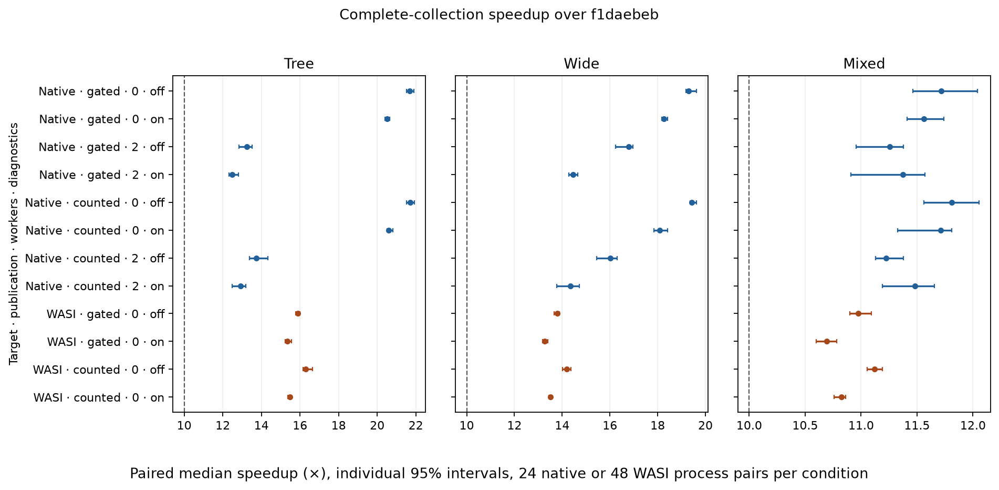
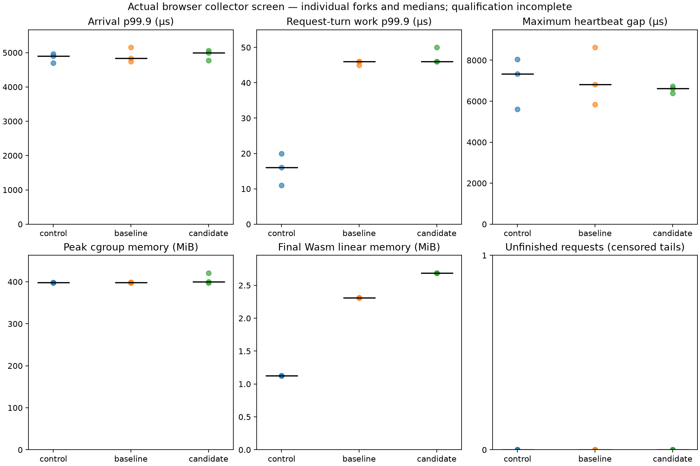

# Disposing of proposals from a completed collection

The alpha uses one `GarbageCollector` for the native JVM, WASI interpreter and browser. This change bounds how many obsolete root or graph proposals a public collector step releases. It covers proposals from publishers that started before closure and attempts made through a retained epoch after closure.

At `78ba05a3`, a test offered 512 or 4,096 roots through a retained, closed epoch. Dropping the last owner released all 512 or 4,096 in the same call on native and WASI. Ten fresh native processes reproduced those two counts. The control measures a forced backlog. Its frequency in application workloads is unknown. [Control patch](control.patch.gz) · [Native output](old-native.log.gz) · [WASI output](old-wasi.log.gz).

At `a5ad4aec`, new offers to a closed epoch are refused before queue storage is acquired. An admitted writer may finish after closure. The collector retains the exact epoch and discards at most one visible proposal per public step. Other helpers can access its siblings while a destructor runs. An empty queue with a parked writer can go idle. A subsequent public step can discover a newly visible item, and a finishing writer wakes the collector. Exact identity, type, phase certification and rollback remain on the normal acquisition paths.

| Candidate schedule | Observation |
|---|---|
| Real full cycle closes with 2,048 roots and 2,048 graph proposals | Each of the next 4,096 public steps released one proposal. A fresh full ticket completed within the first 1,024 steps. |
| A read-only caller retains the old epoch throughout disposal | Both kinds of post-close submission were refused. Dropping the retained epoch released zero additional root records. |
| Native root publisher pauses while owning a private slot | Both policies cleared 16 visible siblings, reached idle and completed another full collection before the publisher resumed. |
| Same publisher pauses after its queue entry becomes visible | An ordinary public step in gated mode or shutdown in counted mode removed the entry before producer notification. |

The two native tests each ran in 100 fresh processes. The portable test also ran in 20 WASI processes and with a smaller backlog under Miri. Every candidate test exercised both publication policies. A single destructor can still execute arbitrary user code. [Forced observations](forces.jsonl.gz) · [Suite, preview and packaging receipts](validation.json).

The native suite passed 985 tests with one previously ignored model. WASI passed 450 tests, and both native JVM reference-integration tests passed. Clippy passed on both targets, as did Cargo packaging and the external native and WASI archive consumers. Antigravity Carbon confirmed that a cleaner retaining an old directory snapshot cannot remove a newer writer signal by CAS. Neon independently reran the parked-publisher test. Carbon ran at its supported high effort after the CLI rejected xhigh and two broader reviews timed out.

## Complete collection and browser

Across 36 complete-collection conditions against frozen Ristretto `f1daebeb`, the minimum individual 95% lower bounds were **10.90× native** and **10.59× WASI**. There were 24 randomized pairs of fresh native processes per condition and 48 on WASI. All 2,304 processes passed their graph and reclamation checks. [Estimates](cycles/complete-cycles.csv) · [Build identities](cycles/cycle-provenance.json) · [Native observations](cycles/native.jsonl.gz) · [WASI observations](cycles/wasm.jsonl.gz).

Nine two-second Chromium trials offered 36,000 requests at 2,000 per second. 36,000 completed in their respective measurement windows. The collector arms returned managed bytes to zero after teardown. [Browser observations](browser.jsonl.gz).

## Remaining pause during Java reference delivery

On this revision, a native probe parks the collecting thread immediately before it registers a live Java reference owner as a queue root. In ten fresh processes, a replacement full ticket exhausted 2,048 public steps under both publication policies. Ordinary scalar allocation completed in both. Allocation of an owner whose attachment calls `GcWeak::set_owner` completed during the park only under counted publication. Under gated publication it completed after the registrar resumed. Both configurations subsequently delivered the original exact owner once. [Probe patch](notice-root-probe.patch.gz) · [Output](notice-root-control.log.gz) · [Ten runs](notice-root-observations.json).

The next progress gate is to prepare a queue node and an invisible root reservation outside the reference decision, then revalidate owner identity and liveness at commit. Whole-JVM throughput and scheduled latency against G1 and ZGC, plus three hour-long runs and a 24-hour soak, remain release gates. [Whole-JVM comparison](../../consolidated-java-followups/unified-heap-roots/README.md).
