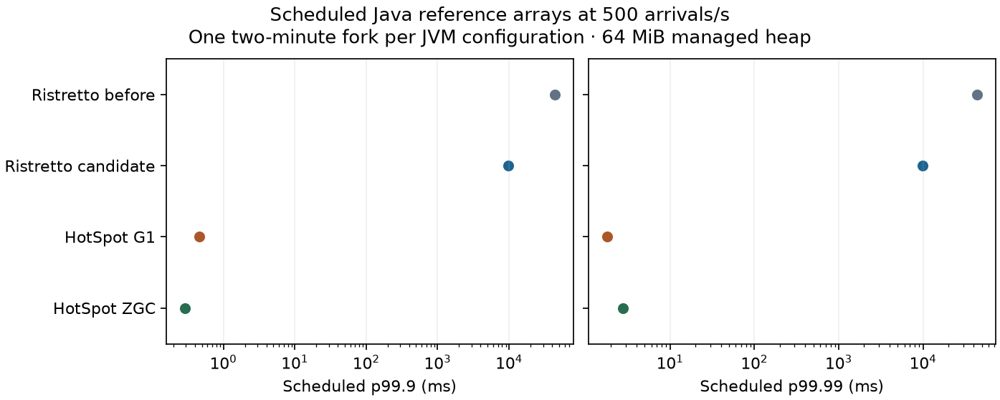
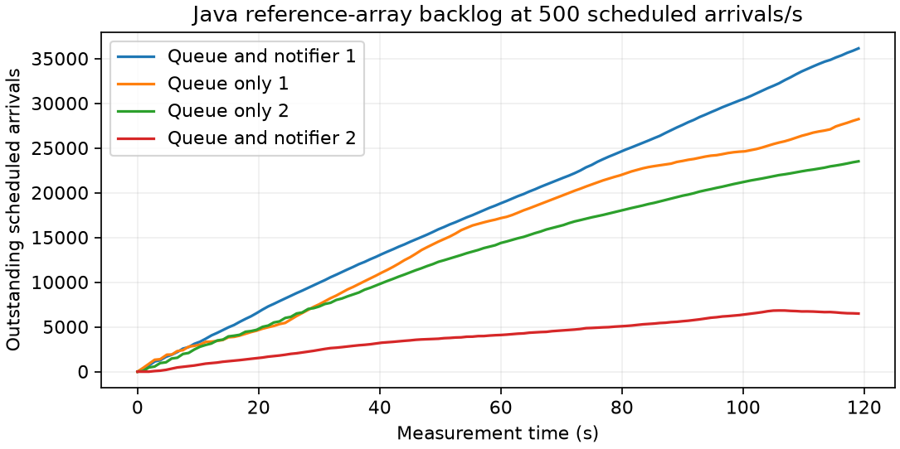

# Cold refund notification under contention

The shipping source at `ab7a3000` still uses its original notifier startup. On the parent implementation a caller parked during OS thread creation could hold the worker-generation mutex. A second capped allocation blocked inside its second poll, even after it had registered interest in available bytes. Both publication policies reproduced the stall. A real worker stop and restart also waited for the creator.

The candidate at `f7d32751` starts an unpublished notifier privately and installs it under the generation mutex only while delivery is needed. A losing caller closes and joins its own unpublished thread outside the mutex. For a workerless wait, the installer checks that the exact private donor still owes a refund. Its original poll rechecks both public headroom and private grant state after installation.

## Forced schedules

| Schedule | Original outcome | Candidate outcome |
|---|---|---|
| Second allocator waits, then a separate reservation refunds eight bytes | Second poll blocked under both policies | Refund funded the allocation before the first creator resumed |
| A live background worker stops, with or without restarting | Stop waited for the creator | Stop and optional restart finished while creation remained suspended |
| Workerless donor paid, abandoned or still private after stop | First private-spawn variant installed a notifier in all three cases | Only the live private donor installed one |
| Private donor paid or abandoned during a registered workerless poll | Tested on the corrected candidate | The original poll returned ready with zero public headroom in both cases |

The first three tests ran in 100 fresh processes, covering 700 forced schedules. The two original-poll cases passed in another 100 fresh processes. The allocation and grant tests checked the returned value or grant state and final byte accounting. The lifecycle test checked the installed notifier after shutdown. The allocator-contention test uses a real registration without a background collection racing the funding step. The lifecycle test uses a real worker. A live workerless donor can legitimately install a heap-owned notifier after stop. A settlement racing the final install can leave one idle notifier until the next stop or heap destruction. [Controls](cold-control.log.gz) · [Control fixture](cold-control.patch.gz) · [Settled-donor control](settled-control.log.gz) · [Candidate patch](candidate.patch.gz) · [One-poll test](one-poll-regression.patch.gz) · [Validation](validation.json).

## Release decision

The candidate cleared all 36 complete-collection conditions against `f1daebeb`. The lowest individual lower 95% bounds were **10.095× native** and **10.317× WASI**. All three browser candidate forks completed 4,000 of 4,000 requests. The three short Java candidate forks at 500 arrivals/s completed all 5,000 requests each. [Collection conditions](cycles/complete-cycles.csv) · [Browser results](browser/REPORT.md) · [Short JVM forks](java/forks.csv).

| Two-minute Java reference-array fork at 500 arrivals/s | Completed / offered | Scheduled p99.9 |
|---|---:|---:|
| Previous JVM at `46d0afec` | 38,271 / 60,000 | 43,516 ms |
| Queue and notifier candidate | 55,163 / 60,000 | 9,699 ms |
| HotSpot G1 | 60,000 / 60,000 | 0.460 ms |
| HotSpot ZGC | 60,000 / 60,000 | 0.289 ms |

The two-minute completion gate required all 60,000 arrivals. The candidate missed 4,837, with no cgroup OOM kills and no reported CPU throttling. The candidate completed 3,370 collections over the whole JVM process. The earlier queue-only candidate completed 1,914 collections in its successful two-minute fork. These counts include setup and warmup. The cause of the backlog remains unverified. The candidate remains withheld. [Release criteria](policy.json) · [Sustained forks](java/sustained.csv) · [Raw processes](java/sustained.jsonl.gz).

## Direct comparison with the published queue

Four further two-minute forks used the queue-only and notifier binaries directly
under the same limits. Queue-only completed 31,578 and 36,394 arrivals. The
notifier completed 23,560 and 53,553. All four forks fell short of 60,000.
The relative order reversed across pairs. The queue-only implementation's
earlier successful fork remains in its report. Sustained completion is still
unqualified on both revisions. [Individual forks](matched/forks.csv) ·
[Matched inputs](matched/inputs.json) · [Raw processes](matched/processes.jsonl.gz).

