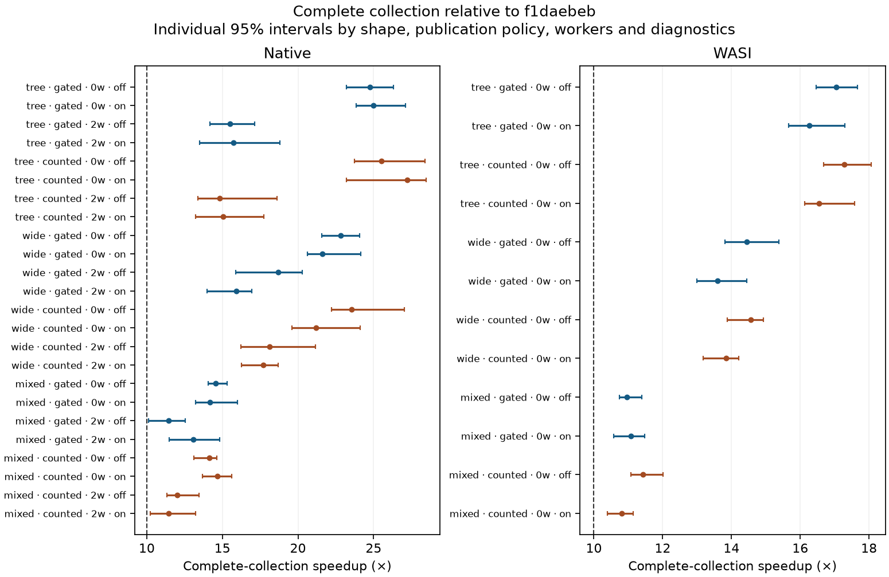

# Conditional-reference owner construction on the JVM collector

The JVM binds conditional reference slots to their containing managed objects during construction. A thread preparing temporary root storage for that binding previously held both publication admission and the slot decision. A peer spent 2,048 polls on a fresh full ticket in all six parent configurations. In a separate two-thread schedule, a passive observer of the same live slot also waited for the constructing thread. An explicitly cleared slot allowed the observer to return immediately. [Parent scheduling patch](threaded-parent.patch.gz) · [Observed outcomes](threaded-parent.log.gz).

At `ee80df21` construction reserves temporary root backing before taking either guard. Under admission it checks the original referent identity, both domains' weak decisions and logical retirement before publishing and shading an eligible referent. An unpublished owner remains tracked even if the referent was cleared during preparation. The existing TLS scope transfers and releases the exact temporary roots and pending-owner counts.

The 18 cooperative schedules covered new private slots and existing slots with retained or dropped donors, under both publication policies and all three owning-root storage configurations. Native, WASI and Miri ran the same test. A separate native thread parked inside backing preparation. The passive same-slot observation and full ticket both finished before resume in all six cases. A retained referent subsequently delivered its exact owner once. A cleared or collected referent stayed cleared. The final heap charge was zero. [Candidate scheduling patch](threaded-candidate.patch.gz) · [Ten control and 100 candidate processes](forced.jsonl.gz) · [Validation](validation.json).

The native interpreter, native JIT and WASI interpreter each reclaimed the same Java-mutated cycle and cleared both witnesses. The compiled lane recorded 25 entries and eight backedges. The packaged collectors built through external native and WASI consumers. Nine short Chromium collector trials completed 36,000 of 36,000 offered operations. [Release receipts](validation.json) · [Browser process records](browser.jsonl.gz).

## Complete-collection cost

All 36 conditions cleared the 10× complete-collection gate against Ristretto `f1daebeb`. The lowest individual 95% lower bounds were **10.125× native** and **10.391× WASI**. The matrix uses tree, wide and mixed shapes, both publication policies, diagnostics off and on, and on native, zero or two workers. Each condition has 24 native or 48 WASI pairs. Each of the 2,304 processes checked sixteen full cycles, a 4,095-node checksum and physical teardown. [Condition results](cycles/complete-cycles.csv) · [Benchmark settings and binary hashes](cycles/provenance.json) · [Native records](cycles/native.jsonl.gz) · [WASI records](cycles/wasm.jsonl.gz).

## Remaining admission during root removal

A construction callback that removes a manual root still prepares replacement protection under publication admission. A separate control at this revision exhausted 2,048 polls under both publication policies with tree, slot and context storage. After the callback returned, the weak witness cleared and the heap refunded its full charge. The next progress change must keep the removed root covered until its replacement is visible or the deletion barrier has completed. [Control patch](removal-control.patch.gz) · [Six observed schedules](removal-control.log.gz).
