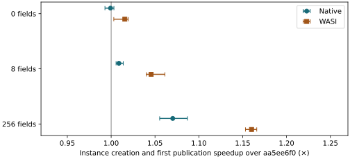

# Java instance initialization and first publication

Java initializes every instance field to a scalar zero or a null reference. A newly created instance now starts with empty remembered cards and no range of owning references to demote. The first attachment still records the real owner. Setting a field before attachment marks its slot. Building elements from arbitrary values still scans those inputs for reference cards.

The fixture times creation and first publication of 64 ordinary Java instances backed by the same class, with zero, eight or 256 reference fields. It checks all defaults and physical refund after each batch. A separate pre-publication store leaves a child reachable only through its parent and verifies it survives full collection. Each independent process takes the median of 16 timed batches following three warmups. There are 24 randomized process pairs per host and field count. Both arms use identical release settings and zero background workers.

| Host | Fields | Parent µs/batch | Candidate µs/batch | Candidate / parent [95% interval] |
|---|---:|---:|---:|---:|
| Native | 0 | 36.7 | 36.6 | 1.001 [0.997, 1.007] |
| Native | 8 | 44.7 | 44.4 | 0.991 [0.986, 0.994] |
| Native | 256 | 291.1 | 270.8 | 0.934 [0.920, 0.948] |
| WASI | 0 | 20.8 | 20.6 | 0.985 [0.981, 0.997] |
| WASI | 8 | 27.5 | 26.3 | 0.956 [0.942, 0.961] |
| WASI | 256 | 135.7 | 117.2 | 0.862 [0.858, 0.867] |

To reproduce, copy [the fixture](default_fields.rs) into `ristretto_classloader/examples/` on each [recorded revision](provenance.json). Build with `cargo build --release --locked -p ristretto_classloader --example default_fields`. On WASI add `--target wasm32-wasip2` and run with Wasmtime. Supply the field count as the single argument. [Native process samples](native-times.jsonl.gz), [WASI process samples](wasm-times.jsonl.gz), [summary CSV](collection.csv).
