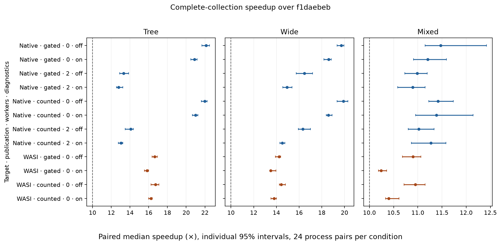

# Terminal allocation with an empty callback queue

A callback already claimed by a worker can keep its managed charge while it
is parked. At the hard heap limit, an allocator formerly requested a pressure
assistant dispatch even when that callback was the only job and the other
object was rooted. The allocator repeatedly woke itself waiting for the
assistant to inspect an empty queue. The shipping parent exhausted 2,048
runnable polls in one of 96 fresh processes.

At `6af915cb` the native pool counts batches that still have an unclaimed job.
Publication reserves the count before sending and rolls it back on send
failure. Taking the last item in a batch discharges its count. This lets an
allocator finish its exhaustion check when the primary worker is inside a
parked destructor and there is no work left for the assistant. The destructor
keeps its physical charge until release.

With the assistant deliberately parked before inspection, the parent required
a dispatch. The candidate returned out-of-memory with the heap fully charged.
Each of five schedules passed in 100 fresh processes, covering the original
poll-budget test, the forced empty queue, available work, a contended receiver,
and a cancelled allocation followed by a new request. A claimant parked with
other work behind the receiver mutex remains a separate progress issue.
[Schedules and test binary checksums](progress.json).

## Collection and callback costs

All 36 complete-collection conditions passed against frozen Ristretto
`f1daebeb`. The smallest individual 95% lower speedup bounds were **10.58×
native** and **10.18× WASI** (rounded down). Each condition used 24 randomized
fresh-process pairs on 4,095-node graphs with 16 measured cycles. Both
frozen baseline executable hashes matched. All 1,728 processes passed their
mark and reclamation checks.

The separate callback screen compared the pre-change shipping code with the
candidate in 24 paired processes for each combination of 1, 64 or 1,024 cheap
finalizers and one or two workers. Each process timed 16 cycles. Median
candidate/parent elapsed ratios ranged from 0.981 to 1.023. At 1,024 finalizers
and two workers, the individual 95% interval was 0.992–1.047. [Callback
estimates and executable identities](callback-cost.json) · [All 288 callback
processes](callback-times.jsonl.gz) · [Complete-cycle estimates](cycles/complete-cycles.csv)
· [Build identities](cycles/cycle-provenance.json) · [Native observations](cycles/native.jsonl.gz)
· [WASI observations](cycles/wasm.jsonl.gz).
