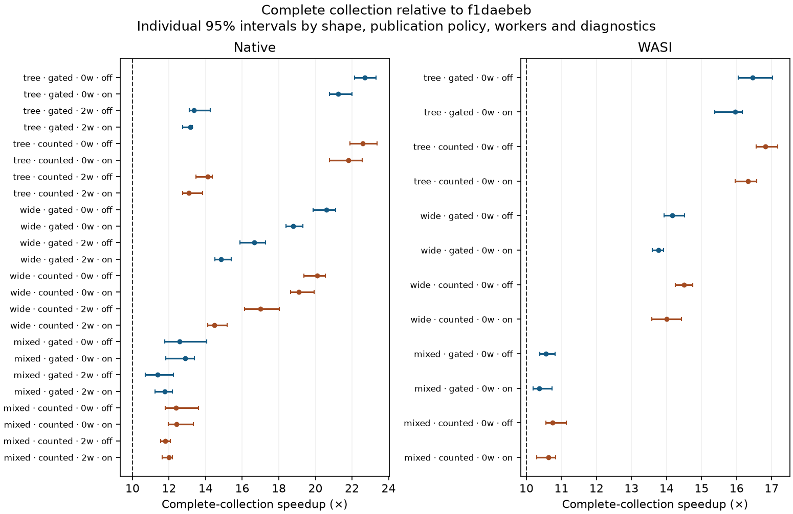

# Explicit root acquisition and incremental tracing through Option

A fresh full collection could exhaust 2,048 polls while a mutator prepared an explicit root. On the shipping collector, manual registration now reserves an invisible entry before taking publication admission. It revalidates the collector, address, original allocation ID and logical liveness under admission, publishes the root and shades both domains. An independent guard for an owning handle also prepares its backing before admission. Borrowed guards use the checked acquisition path. [Control patch](control.patch.gz) · [Observed outcomes on the parent](control-roots.log.gz).

A native test held the mutator at root preparation and let a peer collect. All 12 combinations of root storage, publication policy and donor retention allowed the peer to finish before resume. The resumed operation registered the original live identity or rejected the retired one. The test checked physical reclamation after the final release. The two root test binaries ran in ten fresh parent processes and 100 fresh candidate processes. A separate cooperative check ran inside preparation on native, WASI and Miri. [Repeated process outcomes](forced.jsonl.gz) · [Release and regression results](validation.json).

An optional payload now forwards the child's tracing budget, cursor, work hint and busy result. Previously a budget-one step visited 4,096 vector elements, and tracing a mutex held by the mutator blocked the collector thread. On the candidate each step visited at most one element. The collector returned from 2,048 steps while the mutator still held the mutex. Finishing that graph still requires access to the payload. Two additional parent processes and 100 candidate processes ran the three tracing controls. [Parent observations](control-tracing.log.gz).

## Complete collection

Across 2,304 fresh processes, all 36 measured conditions exceeded the 10× speedup gate against Ristretto `f1daebeb`. The lowest individual 95% lower bounds were **10.692× native** and **10.184× WASI**. Each process exercised sixteen complete cycles with 4,095 nodes. The mixed workload also checked reclaimed bytes and all workloads checked final heap teardown. Native used 24 pairs per condition and WASI used 48. The independently rebuilt binaries at `31537fbf` matched the timed `fc698c05` artifacts byte for byte. [All 36 intervals](cycles/complete-cycles.csv) · [Build identities and measurement policy](cycles/provenance.json) · [Native raw records](cycles/native.jsonl.gz) · [WASI raw records](cycles/wasm.jsonl.gz).

## Scope of the progress result

All three Java preview tiers cleared both weak witnesses after Java rewired the VM-owned cycle. Native and WASI external consumers built from normalized Cargo archives. Nine short Chromium trials completed all 36,000 offered operations across the collector policies and the harness control. These trials exercised the Rust collector in a browser. [Preview receipts and package checks](validation.json) · [Raw browser measurements](browser.jsonl.gz).

A separate control found another admission boundary. When `GcWeak::set_owner` prepared referent protection inside `Trace::attach`, a full collection consumed its 2,048 polls in all six combinations of root storage and publication policy at `51cac03b`. The reference subsequently cleared and delivered its owner exactly once. This bounds the progress claim to the explicit roots and tracing operations tested above. Whole-JVM latency, global pause coverage and sustained load remain release gates. [Construction control patch](construction-control.patch.gz) · [Six observed outcomes](construction-control.log.gz).
