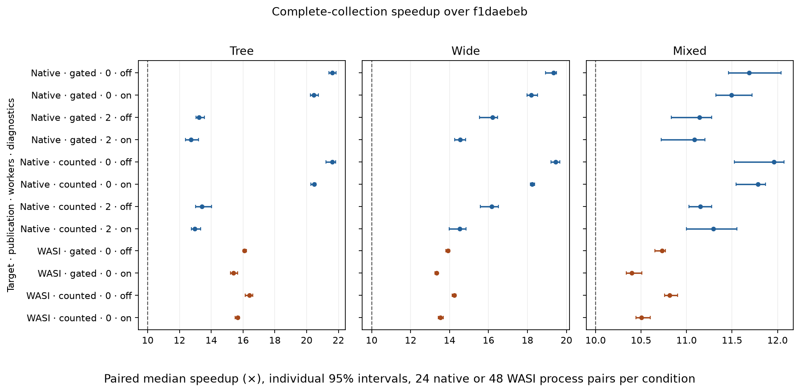
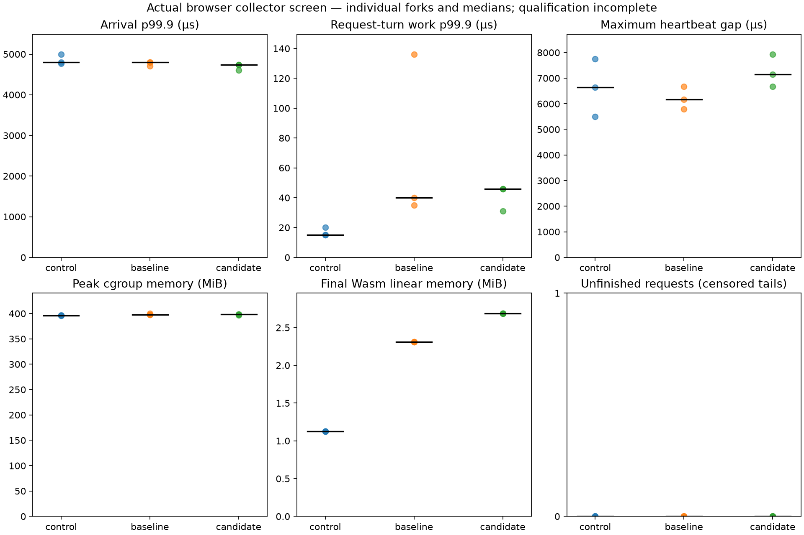

# Publication progress at idle, reference attachment and epoch teardown

At `64f6f736`, an idle call to `GarbageCollector::step()` returns while a publisher holds admission. A conditional Java reference can bind its owner while the referent's object shard is parked. A worker releasing a closed birth epoch allows a peer to begin and finish another full collection. All four regression tests passed in 100 fresh native processes each. Each test failed in all ten corresponding runs against `c90be6b4` with the same test instrumentation.

| Forced observation | Previous collector | Unified collector at `64f6f736` |
|---|---|---|
| 2,048 idle steps on the default heap | 2,048 exclusive publication acquisitions | Zero attempts and zero acquisitions |
| Idle step while a publisher holds admission | The default heap reports busy | Reports idle under both policies. Young, full and old-only requests then complete after release. |
| Conditional owner attachment with the mature referent's shard parked | Attachment and unrelated young destruction both waited under both policies | Both finish before shard release. The owner has its exact identity, the weak edge still refers to its target, and teardown returns all managed bytes. |
| Last birth-epoch owner parked during destruction | The legacy writer, coordinator and full-cycle cursor all remain held at gated completion. The coordinator and cursor remain held at counted completion and failed activation. | All three are available in all three schedules. A peer allocates a rooted value and completes a new full collection while destruction remains parked. |

The idle check reads the selected domain's ordinary and old-only request flags. An actual start still claims requests under the original phase protocol. Conditional attachment reads the published allocation descriptor for the slot's exact identity. It checks weak decisions in both domains and logical retirement before installing and shading the construction root. An explicit clear stores zero independently of the slot decision lock. Attachment can temporarily root the target it just observed, and never writes it back to the weak slot. Epoch detachment remains ordered with the phase transition. The last owner can still pay the cost of destroying the detached queues, including on a cooperative Wasm host.

[440 individual process outcomes](schedules.jsonl.gz) · [Test-only patch for the control](control-tests.patch.gz) · [Build identities, Java reports and verification](validation.json).

## Complete collection

All 36 conditions cleared the 10× gate against frozen Ristretto `f1daebeb`. The minimum individual 95% lower speedup bounds were **10.72× native** and **10.33× WASI**, rounded down. Both minima occurred on the mixed graph with gated publication and diagnostics enabled. The native minimum used two workers. Each of the 2,304 fresh processes measured 16 complete cycles on 4,095 nodes. Seed `251127517` selected randomized process pairs. A fresh build of each frozen control reproduced its binary hash.

[All 36 estimates](cycles/complete-cycles.csv) · [Native timings](cycles/native.jsonl.gz) · [WASI timings](cycles/wasm.jsonl.gz) · [Compiler and source identities](cycles/cycle-provenance.json).

## JVM, browser and release checks

The native GC suite passed 983 tests with one existing ignore. WASI passed 449. Strict all-target, all-feature Clippy passed for both. The Java reference lifecycle passed 40 combinations of JDK version (8, 11, 17, 21 and 25), compaction, publication and overlapping generations. A separate Java 8/25 test checked hidden referent fields. The native interpreter, native JIT and WASI interpreter returned 64 on the Java graph preview and each cleared both weak witnesses. Cargo verified the collector archive. Native and WASI external consumers built from normalized release archives and all 14 shipping graphs resolved the single collector.

Nine headless Chromium processes ran the bare-Wasm collector or its control for two seconds at 2,000 requests/s. Each completed all 4,000 scheduled requests. Both collector policies ended every trial with zero managed bytes. The shipping browser engine also passed its bare-Wasm build check.

[Browser process data](browser.jsonl.gz) · [Latest whole-JVM measurements against G1 and ZGC, at `b65722a0`](../../consolidated-java-followups/unified-heap-roots/README.md).

The Carbon source review confirmed the epoch drop order and identified the separate weak-liveness and retirement checks. Neon independently ran the destructor regression. The installed CLI accepted Carbon at high effort.

Global pause coverage and the hour- and day-long endurance gates remain open. Pending Java reference delivery still takes the default publication writer while linking an enqueue notification. A parked producer at that boundary is a separate progress test.
