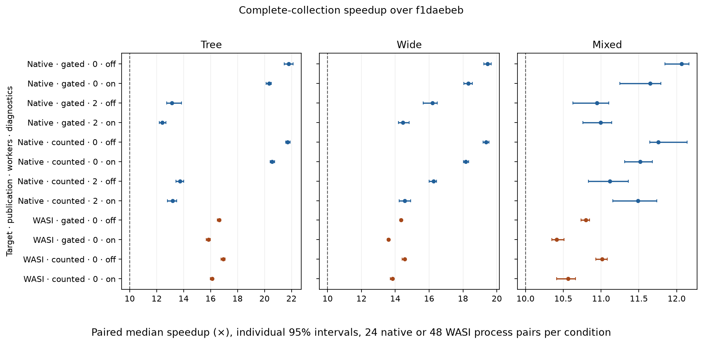
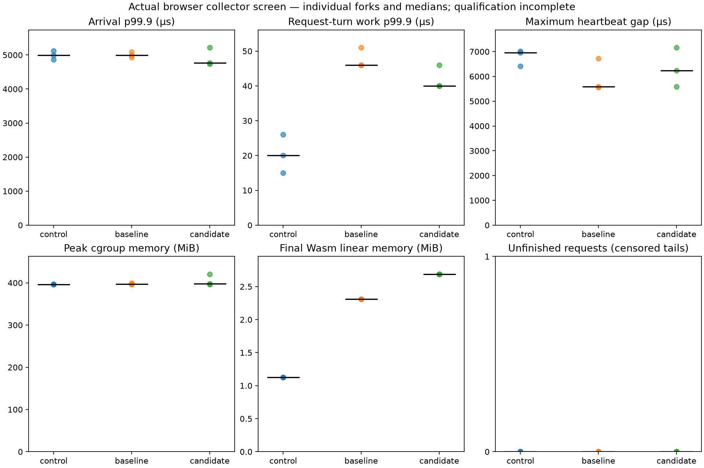

# Waking Java reference handlers after the queue drains

At `899d8a92`, the first of 130 registered Java handler callbacks can consume the only queued owner, run a full collection reentrantly, and park. A peer's public `step()` delivers the other 129 wakes before that callback resumes. If the last callback requests another collection, the peer reports work remaining. Otherwise it reports idle.

On `e0f2b29c`, the same heap had finished its collection and the queue was empty. All ten control processes left the delivered count at one. All 100 candidate processes delivered all 130 wakes under both publication policies, with and without a fresh request from the last callback. Miri also passed the four configurations. [Schedules](schedules.jsonl.gz) · [Parent test patch](control-tests.patch.gz) · [Verification details](validation.json).

Pending queue entries and a pending handler broadcast have different lifetimes. The directory can still have tickets to deliver after the queue has been consumed. At the end of an idle or contended collector turn the helper checks for that published broadcast. Existing ticket claims enforce single delivery, and the per-thread delivery guard lets a callback collect reentrantly. The idle result is sampled again after callbacks have had a chance to issue work. Carbon verified the ordering for a synchronous request. A concurrent request can still arrive after that final sample. Neon independently ran the reentrant handler test.

## Complete collection

All 36 complete-collection conditions used 4,095-node graphs and 16 cycles per process. The minimum individual 95% lower speedup bound against frozen Ristretto `f1daebeb` was **10.62× native** and **10.34× WASI**. Each native configuration ran 24 randomized process pairs and each WASI configuration ran 48, totaling 2,304 processes. [Intervals for every condition](complete-cycles.csv) · [Compiler and source provenance](cycle-provenance.json) · [Native process times](native.jsonl.gz) · [WASI process times](wasm.jsonl.gz).

The native and WASI GC tests, strict all-feature Clippy, ordinary Java Reference tests, three Java preview tiers and 14 shipping dependency graphs passed. Cargo verified the collector archive and normalized native and WASI consumers. The native JIT reported 25 compiled entries and eight compiled backedges, and each tier cleared both weak witnesses.

The nine two-second Chromium windows offered 36,000 requests at 2,000/s per trial and completed 36,000. All collector arms returned their managed heaps to zero. [Browser measurements](browser.jsonl.gz).

## Remaining synchronous work on WASI

A separate test held a real full-cycle epoch through completion, then submitted 512 or 4,096 stale root proposals directly to that retained epoch. On both native and WASI, releasing the final epoch owner synchronously released **all 512 or all 4,096 proposals**. The test counts actual references to a shared record. It deliberately constructs a backlog and does not estimate how often an application creates it.

A bounded implementation must hand off the actual last owner's populated queues, account disposal work in public polling and shutdown, and make the remainder available to a peer before invoking a potentially expensive destructor. Parked preparation of a queue root, whole-JVM performance versus G1/ZGC and hour- and day-long endurance remain open. [Exact test patch](epoch-probe.patch.gz) · [Native control output](epoch-probe-native.log.gz) · [WASI control output](epoch-probe-wasi.log.gz) · [Whole-JVM measurements](../../consolidated-java-followups/unified-heap-roots/README.md).
