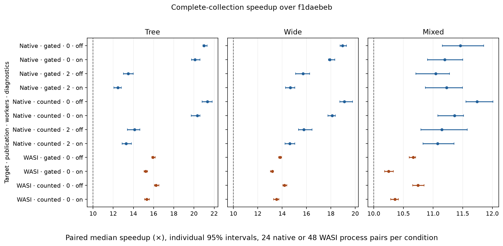
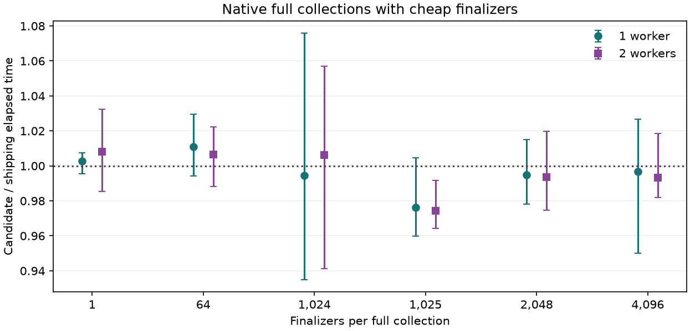

# Reclamation past a parked native callback claimant

At `29634965` a native worker can claim published callbacks and refund their
storage while another claimant is parked. Taking a job transfers exactly one
destructor obligation. Its bytes stay charged until destruction. The JVM,
compiled execution and cooperative WASM continue to use the same collector.

| Forced schedule | Result while the participant stayed parked |
|---|---|
| Immediately before one of 128 jobs is claimed | Peers destroyed all 128. |
| Immediately after one job is claimed | Peers destroyed 127. The claimant retained one charged job. |
| A capped allocator needs one of those jobs | A peer funded the allocation in both schedules. |
| A peer takes the last job after an allocator requests an assistant | The allocator reported exhaustion within 2,048 polls, with the heap still fully charged. Releasing the job produced exactly one refund. |

Each of ten candidate schedules passed in 100 fresh processes. The final
schedule above exhausted the poll budget in all 100 control processes at
`a0cdca24`. The tests also cover cancellation, an empty queue, shutdown
with an accepted suffix, an enrolled publisher, and a delayed assistant.
[Candidate schedules](candidate-forced.jsonl.gz) · [Control schedules](control-forced.jsonl.gz) ·
[Candidate executable](candidate-forced-summary.json) · [Control executable](control-forced-summary.json).

## Ownership and retained storage

Each native sweep worker publishes to its own lane. The first bank has 32
reusable slots. A publisher that reaches an occupied slot links a successor
and can grow to 1,024 slots per bank. Peers claim one published ticket at a
time and can advance the head when all tickets on a sealed bank have been
claimed. The winning consumer releases its slot after moving the job out.
Each persistent consumer cursor can retain one bank and rotates after 16 jobs
with competing lanes. Unit tests exercise slot reuse, ticket exhaustion, lane rotation,
and reclamation of intermediate banks with a parked
claimant or cursor.

A slot occupied 80 bytes on the measured x86-64 host. A lane that reaches
maximum capacity can keep 81,920 bytes of slot storage after it drains,
plus bank and lane bookkeeping. A parked cursor can also keep an older
bank alive. The forced progress counts apply to published jobs. A sweep
worker can still hold a private batch before publication.

An enrolled allocator rechecks its original pool for published, claimable
work. A peer claim can discharge the dispatch opportunity while every byte
of the claimed payload remains charged. An empty successor link cannot
extend that wait. The ordinary recovery loop rechecks grants and general
headroom before reporting exhaustion.

The native suite passed 975 tests with one existing ignore. WASI passed 448.
Two bounded Loom models check slot reuse and the sealed-bank recheck. Miri
ran three actual bank tests under eight seeds each. Both targets passed
strict Clippy and the normalized Cargo archive consumer builds. All three
Java previews returned 64, cleared two weak witnesses and refunded the full
managed charge. The native compiled tier recorded 25 compiled entries and
eight taken backedges. [Verification and preview receipts](validation.json).

## Collection time

All 36 conditions passed the 10× gate versus frozen Ristretto `f1daebeb`.
The smallest individual 95% lower speedup bounds were **10.70× native** and
**10.18× WASI**, rounded down. Each fresh process exercised 4,095 nodes over
16 measured cycles. The native comparison used 24 randomized pairs per
condition and WASI used 48. All 2,304 processes passed their mark, sweep and
teardown checks. [Estimates](cycles/complete-cycles.csv) · [Build receipts](cycles/cycle-provenance.json) ·
[Native observations](cycles/native.jsonl.gz) · [WASI observations](cycles/wasm.jsonl.gz).

In the separate native callback fixture, the six original cost intervals
all included parity with shipping `9758fe8c`. Across all 12 workloads,
median elapsed time ranged from 0.974× to 1.011× shipping. Each workload
used 24 randomized pairs on CPUs 4, 6 and 9, with 16 cycles per process.
The uncertainty is over paired process medians. The fixture checks the exact
cumulative destructor count. [Callback estimates](callback-cost.csv) ·
[All 576 processes](callback-times.jsonl.gz) · [Fixture and build instructions](../native-callback-inboxes/README.md#reproduction).

## Remaining executor wake-ups

The [subsequent wake-driven implementation](../terminal-dispatch-waits/README.md)
closed the parked-donor case measured below.

With one donor still published and the primary destructor and pressure
assistant both parked, a terminal allocator remained pending. Across 100
fresh native processes, each of 2,048 polls issued one immediate wake to its
executor. The donor stayed charged, then funded the allocation when the
assistant resumed. The probe alternated one CPU and three CPUs. This
measures runnable wake-ups under a forced delay.

A replacement wait must handle assistant dispatch, last-job claims by other
workers, independent physical refunds, cancellation and pool shutdown. A
claimant can stop between its successful claim and its next instruction.
A notification that only this claimant can send after the claim therefore
needs an independent way to wake the sleeping allocator.
[Probe patch for `3fb92fee`](dispatch-wakes.patch.gz) ·
[All 100 schedules](dispatch-wakes.jsonl.gz) · [Binary identity](dispatch-wakes.json).

## Earlier trials and reproduction

The fixed 32-slot ring took 7.054× shipping time at 1,024 finalizers and
two workers. Increasing it to 1,024 slots brought that median to 1.010×,
but at 4,096 finalizers and one worker it took 5.134×. The growing-bank
trial took 1.049× in the latter case. Caching the active bank while claiming
individual jobs brought it to 0.994× in development and 0.997× on the final
code. [Design trials](capacity-trials.json) · [Paired timings](capacity-times.jsonl.gz).

The first growing-bank candidate with a cursor, `a0cdca24`, passed all 24
native conditions. One of 12 WASI conditions missed the gate on its first
24 pairs with a 9.91× lower bound and a 10.54× median. A repeat of all 12
conditions with 48 pairs had a minimum lower bound of 10.06×. The shipping,
first-candidate and final WASI executable hashes were identical. The final
36-condition data above use fresh processes.
[First comparison](first-screen/complete-cycles.csv) · [WASI repeat](first-screen/wasm-repeat.csv) ·
[First raw WASI timings](first-screen/wasm.jsonl.gz) · [Repeat timings](first-screen/wasm-repeat.jsonl.gz).

To reproduce the fixed-capacity control, apply the [ring patch](../native-callback-inboxes/ring.patch.gz)
to `9758fe8c` and change `SLOTS` to 1,024. For the growing-bank trial,
apply the [page patch](../native-callback-inboxes/pages.patch.gz) and the
[growing-bank delta](growing.delta.gz). Apply the [cursor delta](cached-development.delta.gz)
for the cached development trial. For the last-job negative control, apply the
[test patch](last-claim-control.patch.gz) to `a0cdca24`. Run
`cargo test --locked -p ristretto_gc --lib native_callbacks` and
`cargo test --locked -p ristretto_gc --test callback_bank_model` on the final
code. The [ordinary Java capacity and tail-latency measurements](../../consolidated-java-followups/null-local-roots/README.md)
track the separate G1 and ZGC release gates.
