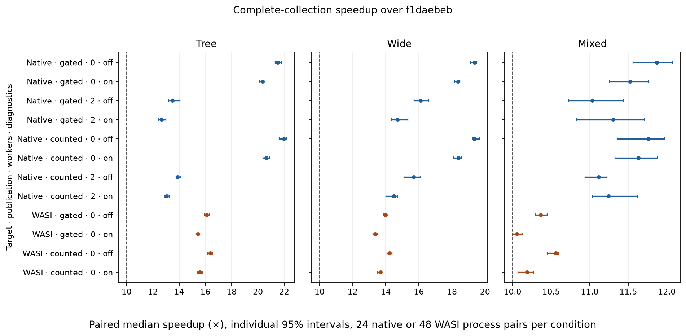
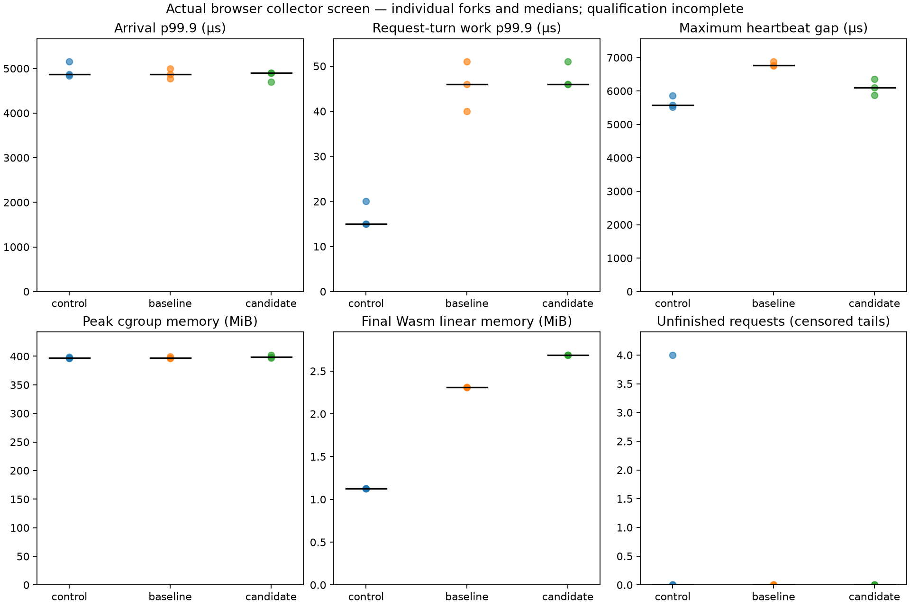

# Preparing Java reference queue roots without holding up collection

At `ae693278` a collecting thread can park while reserving a queue root and a peer can finish a fresh full ticket. At `6da00006` the same ticket exhausted 2,048 public GC polls under gated and counted publication. Gated publication also held up allocation of a new owner whose attachment calls `GcWeak::set_owner`. A scalar allocation completed in both controls. The test reports allocation completion before dropping the new handle. [Control patch](control.patch.gz) · [Control output](old.log.gz).

The first pass remembers the exact slot, owner identity, reference stage and cursor origin. Helpers reserve a numeric tree slot and a FIFO node outside collector guards. A reserved slot has generation zero and contributes no live root. The winning helper rechecks the request, epoch, slot, target and owner under the same decision guards used by the scanner before it publishes one root. An obsolete helper releases its own empty slot and unlinked node. Only a committed notice can reach the Java queue.

| Forced schedule | Observed result |
|---|---|
| Park before queue-root reservation | Under both policies, scalar allocation, conditional-owner allocation and a fresh full collection finished before the parked helper resumed. |
| Park after reservation, then rebind or remove a Weak or Final owner | The peer delivered the rebound owner once, or delivered nothing for an absent owner. Both objects were reclaimed while the losing reservation was still parked. |
| Final references arrive behind a wrapped scan cursor and the first slot's decision mutex stays held | The second owner was delivered within 32 public steps. The first owner was delivered once after its slot became available. |
| Hold the global coordinator during independent reference processing | A single public step prepared and linked a Weak or Final notice. This ran on native, WASI and under Miri. |

Ten fresh parent processes reproduced the control. A hundred fresh candidate processes each exercised 16 native schedules. Twenty WASI processes each exercised the four cooperative coordinator schedules. [Forced observations](forced.jsonl.gz) · [Validation, packaging and source identities](validation.json).

## Complete collection

The smallest individual 95% lower speedup bounds against frozen Ristretto `f1daebeb` were **10.73× native** and **10.004× WASI** across the 36 conditions. The comparison used 24 paired fresh processes per native condition and 48 per WASI condition. All 2,304 processes passed the graph and reclamation checks. [Condition estimates](cycles/complete-cycles.csv) · [Build identities](cycles/cycle-provenance.json) · [Native observations](cycles/native.jsonl.gz) · [WASI observations](cycles/wasm.jsonl.gz).

The native suite passed 989 tests with one previously ignored model. The WASI suite passed 451 tests. Both Clippy runs, Miri, 14 shipping dependency graphs, Cargo packaging and normalized native and WASI consumers passed. All three Java preview tiers returned 64 and cleared both weak witnesses. Antigravity Carbon checked the vacancy’s generation and occupancy invariants. Neon independently ran the four new native tests. Carbon's supported high effort was used after the CLI rejected xhigh.

The nine Chromium windows offered 36,000 requests at 2,000 per second and completed 35,996. Both collector arms returned managed bytes to zero after teardown. [Window measurements](browser.jsonl.gz).

These schedules cover queue preparation, rebinding, cancellation and delivery. The phase decision still uses short shared-state guards. The whole-JVM throughput and latency comparison against G1 and ZGC and the three one-hour trials and separate 24-hour run remain distinct release gates. [Whole-JVM measurements](../../consolidated-java-followups/unified-heap-roots/README.md).
