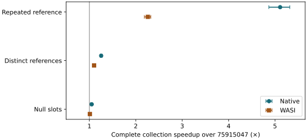

# Full collections of Java reference arrays

The ordinary JVM representation stores instance fields and reference-array elements in 32-slot cards. At `9a6e0f59` the scan traces each edge and looks up a child’s generation only while a complete dirty card on an old owner can still be removed during a young collection. Seeing a young child keeps the card. Full collections and partial-card scans skip the child-generation lookup.

A 4,096-slot Java reference array held one repeated child, a distinct child at every slot, or only nulls. Each child held a checked integer. Each fresh process performed three warmups and sixteen timed full collections with zero background workers. Live bytes remained constant during measurement, all slots were checked afterwards, and dropping the root returned managed bytes to zero. Each condition used 24 random-order pairs of fresh processes. Both arms used the same release fixture and Rust toolchain. The table reports process medians and paired speedups with individual 95% bootstrap intervals.

| Host | Contents | Parent µs | Candidate µs | Speedup [95% interval] |
|---|---|---:|---:|---:|
| Native | alias | 244.1 | 48.1 | 5.11× [4.87, 5.32] |
| Native | unique | 1206.2 | 964.0 | 1.25× [1.23, 1.28] |
| Native | null | 18.6 | 18.1 | 1.05× [1.02, 1.06] |
| WASI | alias | 167.7 | 76.1 | 2.26× [2.19, 2.32] |
| WASI | unique | 1584.8 | 1438.8 | 1.10× [1.08, 1.12] |
| WASI | null | 30.6 | 30.3 | 1.01× [0.98, 1.03] |

These measurements cover Java heap representations in the classloader. Interpreter dispatch, JIT execution and scheduled application latency require separate whole-JVM runs. The established tenfold matrix measures different graphs against an earlier Ristretto collector.

To reproduce, copy [the fixture](reference_card_scan.rs) into `ristretto_classloader/examples/` in clean checkouts of each [recorded revision](provenance.json). Build with `cargo build --locked --release -p ristretto_classloader --example reference_card_scan`. Add `--target wasm32-wasip2` on WASI and launch the resulting component with Wasmtime. Pass `alias`, `unique` or `null` to the executable. The raw [native](native-times.jsonl.gz) and [WASI](wasm-times.jsonl.gz) files contain all 288 process results. [Summary CSV](collection.csv).
