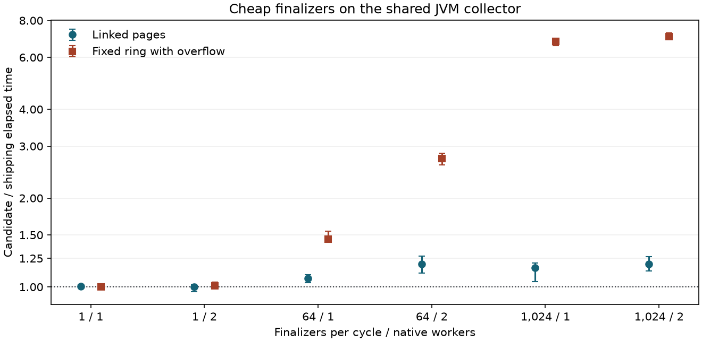

# Native callback progress and full-cycle cost

Both queue trials let another worker reclaim every available sibling while
a native callback claimant was parked. Both increased full-cycle time for
larger batches of cheap finalizers. The alpha keeps its existing callback
receiver. All three builds use the same Ristretto collector.

| Finalizers | Workers | Linked pages / shipping time | Fixed ring / shipping time |
|---:|---:|---:|---:|
| 1 | 1 | 1.004× | 1.000× |
| 1 | 2 | 1.001× | 1.011× |
| 64 | 1 | 1.067× | 1.453× |
| 64 | 2 | 1.195× | 2.724× |
| 1,024 | 1 | 1.160× | 6.807× |
| 1,024 | 2 | 1.195× | 7.054× |

Each trial used the same shipping executable from `9758fe8c`. For each row,
24 randomized pairs of fresh processes each measured 16 full cycles on CPUs
4, 6 and 9. The estimate is the median of paired process-median elapsed-time
ratios. The 95% intervals use 4,096 bootstrap resamples of the pairs. Each
fixture checked the exact cumulative destructor count. These are native
callback-heavy workloads. [Estimates and intervals](elapsed.csv) ·
[All 576 timing processes](timings.jsonl.gz) · [Build identities](provenance.json).

## Parked claimants

Linked pages use 32 individually claimable entries per page and notify the
primary consumer when it arms its wait. The ring reuses 32 slots per
publisher. When a slot is still occupied, it sends subsequent jobs through
the existing linked publication queue. The measurements cover the combined
protocols. They do not isolate how much time was spent in overflow.

Each trial ran four forced schedules in 100 fresh processes per schedule.
With the claimant parked immediately before taking a published job, peers
destroyed 128 of 128 objects. Immediately after the claim, peers destroyed
127 and the outstanding job retained its charge. Separate allocation tests
obtained a real reservation under a hard heap cap in both schedules. The ring
also exercised a stopped claimant in overflow and ticket exhaustion in its
unit tests. [All 800 forced runs](parked-claims.jsonl.gz).

## Reproduction

Apply either the [page patch](pages.patch.gz) or the [ring patch](ring.patch.gz)
to a clean checkout of `9758fe8c` with `gzip -dc PATCH | git apply`.
Run `cargo test --locked -p ristretto_gc --lib native_callbacks`. The two
allocation tests match `capped_allocation_progresses`; the two exact
destruction tests match `independent_callbacks_remain_available`.

For the timing executable, copy the [callback fixture](../parked-claim-qualification/callback_cost.rs)
to `src/main.rs` in a separate Cargo project named `callback-cost` at version
`0.0.0` with edition 2024. Depend on `ristretto_gc` by path to the checkout
and copy the [fixture lockfile](fixture.lock) to `Cargo.lock`. Set the release
profile to one codegen unit, LTO, optimization level 3, and panic abort.
Build each checkout with `cargo build --release --locked`. Invoke each
executable as `taskset -c 4,6,9 BINARY FINALIZERS WORKERS`. The timing rows
preserve the process order within each trial.
