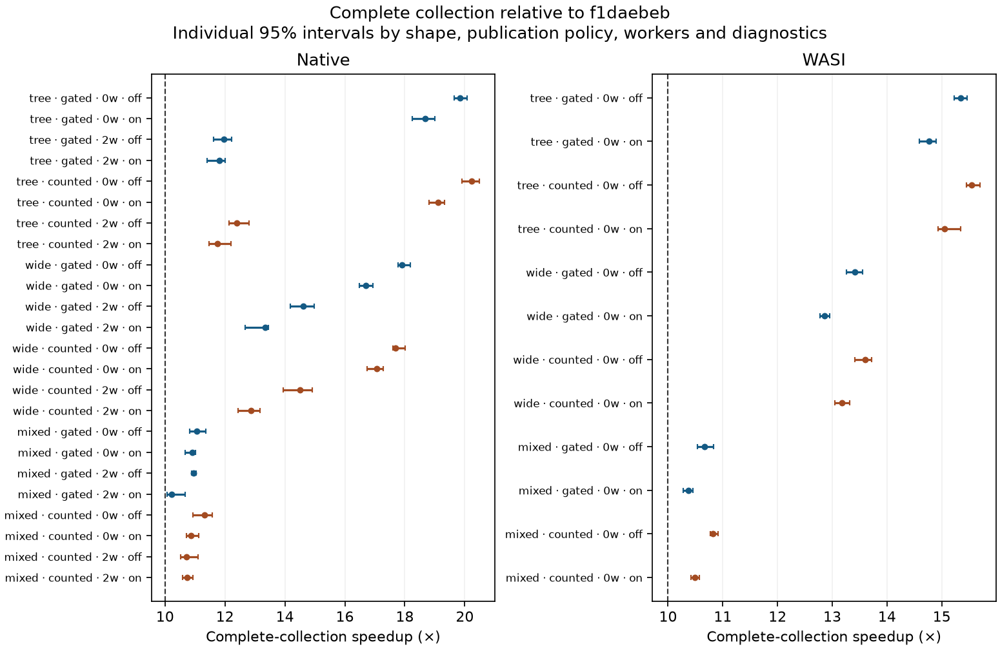
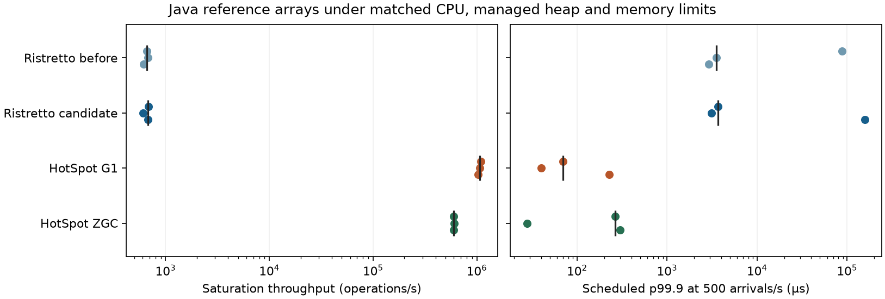

# Full collection while a pressure observer or sampler is parked

The finite-heap pressure predictor is enabled in the native and WASI JVM comparison configurations. Previously, a public scheduling-statistics reader or an allocation sampling the predictor could hold its model mutex. Full-cycle start and completion then waited for that thread. In the three-object capped heap, all four control schedules stalled with an unreachable donor available. [Regression added to the parent](parent.patch.gz) · [Control failures](control.log.gz).

At `d1cab313`, the collector publishes the advisory model and its next sample threshold together. A sampled allocation gets one chance to publish against the version it read. If a competing update wins, cumulative allocated bytes still include that allocation. Full-cycle start, first reclamation and completion retry against the current version. An observer can retain its original snapshot throughout.

Most allocations compare their cumulative byte count with a cached lower bound. The authoritative threshold remains in the model. A full collection that sees the cumulative byte counter wrap can lower its threshold below the last winning floor. It disables the fast comparison before publishing that change. A suspended older sampler cannot restore the obsolete floor. The first cached-threshold implementation failed the wrap control. [Counterexample](wrap-control.patch.gz) · [Observed failure](wrap-parent.log.gz).

## Progress and cost

A sampler parked while publishing the third rooted scalar, or a reader parked at capacity, left the peer able to finish a fresh full ticket and acquire the fourth scalar from the donor's space. The regression checks exact managed refund, weak clearing, both surviving owners, and a new predictive request after subsequent growth. Both publication policies passed in all 100 fresh processes, with 4,096 polls available per schedule. A separate native test suspends a winning pre-wrap sampler until a later collection and predictive request complete. [Process receipts](final-forced.jsonl.gz) · [Verification](validation.json).

In a separate allocation-recording benchmark, each fork warmed up for two million events, then measured three batches of two million. Each batch took 15 actual pressure samples. Twenty-four interleaved forks per arm gave these medians.

| Predictor | Nanoseconds per recorded allocation |
| --- | ---: |
| Former mutex model | 17.95 |
| Immutable model read on every allocation | 27.56 |
| Immutable model with conservative threshold | 18.05 |

The final-to-former paired elapsed ratio was 1.0054 with an individual 95% interval of [0.9947, 1.0151]. The recording fixture exercises publication accounting without constructing a Java payload. [Probe](allocation-events/probe.rs) · [Distributions](allocation-events/summary.json) · [Processes](allocation-events/processes.jsonl.gz).

Pressure prediction still incurs a per-cycle allocation cost. With prediction enabled, 256 rooted integers and 64 warmed full collections took 1,216 steps in each of 12 forks per arm. The previous predictor made 64 host allocation requests for 4,608 bytes. The final predictor made 192 for 35,328 bytes. Reusing predictor model storage remains a concrete opportunity. [Probe](allocation-events/collection-probe.rs) · [All 36 observations](allocation-events/collection-allocations.jsonl.gz).

## Collection and shipping checks

All 36 established complete-collection conditions cleared 10× versus `f1daebeb`. The lowest individual paired 95% speedup bounds were **10.073× native** and **10.272× WASI** across 2,304 fresh processes. This fixture uses the collector's ordinary configuration for predictive scheduling. The separate pressure probes above exercise the finite-heap predictor. [Per-condition results](cycles/complete-cycles.csv) · [Provenance](cycles/provenance.json).

The native suite passed 1,032 tests with one ignored, and WASI passed 467. All eight focused Miri predictor tests, strict native/WASI Clippy, browser collector check and the verified Cargo archive passed. Fourteen shipping graphs and two external packaged consumers resolved to the same collector. Each of the interpreted native, compiled native and WASI previews reclaimed both weak witnesses. The ordinary native and WASI JVMs ran the 8,192-allocation reproducer to completion.

On the Chromium main thread, all nine short forks completed 4,000 of 4,000 scheduled requests per fork with teardown and content checks. In the three candidate forks, p99.9 request-turn work was 40, 60 and 46 µs. Maximum heartbeat gaps were 5.965, 6.400 and 5.530 ms. These measurements include browser scheduling. [Forks and scope](browser/REPORT.md) · [Graph](browser/browser.png) · [Raw histograms](browser/raw.jsonl.gz).

Antigravity Neon confirmed the rollover recovery rule and pointed out the sequential scope of the first wrap test. The additional suspended-winner test passed independently under its verification runner. The CLI rejected Carbon `xhigh`, and the Carbon `high` audit timed out. Commit `f5bdd2e7` supplied the tested build. The Rust sources and manifests match the consolidated runtime at `d1cab313`. [Revisions and audit results](validation.json).

A paused pressure reader or sampler at the tested model-acquisition point now permits bounded peer recovery. Individual lifecycle writers can still retry. A publisher suspended between winning an advisory request and notifying the collector is a distinct schedule. Global pause freedom and whole-JVM throughput and tail superiority remain open release criteria.

## Matched Java forks

On the 64 MiB reference-array workload, the 24 fresh forks used five seconds of warmup and ten seconds of measurement. The two Ristretto executables were frozen from their respective source trees, and all four runtimes used the same classfiles, two cores of quota and 512 MiB cgroup limit. Every fork completed its scheduled arrivals.

| Runtime | Saturation, operations/s | Scheduled p99.9 at 500/s |
| --- | ---: | ---: |
| Ristretto before predictor change | 659 | 3,520 µs |
| Ristretto with parked predictor progress | 672 | 3,680 µs |
| HotSpot G1 | 1,065,537 | 70 µs |
| HotSpot ZGC | 600,447 | 264 µs |

These are medians of three forks per condition. The broader spread in the [earlier two-minute comparisons](../statistics-snapshot-progress/README.md#two-minutes-at-500-arrivals-per-second) illustrates the limits of short tail screens. [Individual forks](java/forks.csv) · [Raw histograms](java/processes.jsonl.gz) · [Binary and classfile identities](java/provenance.json).

