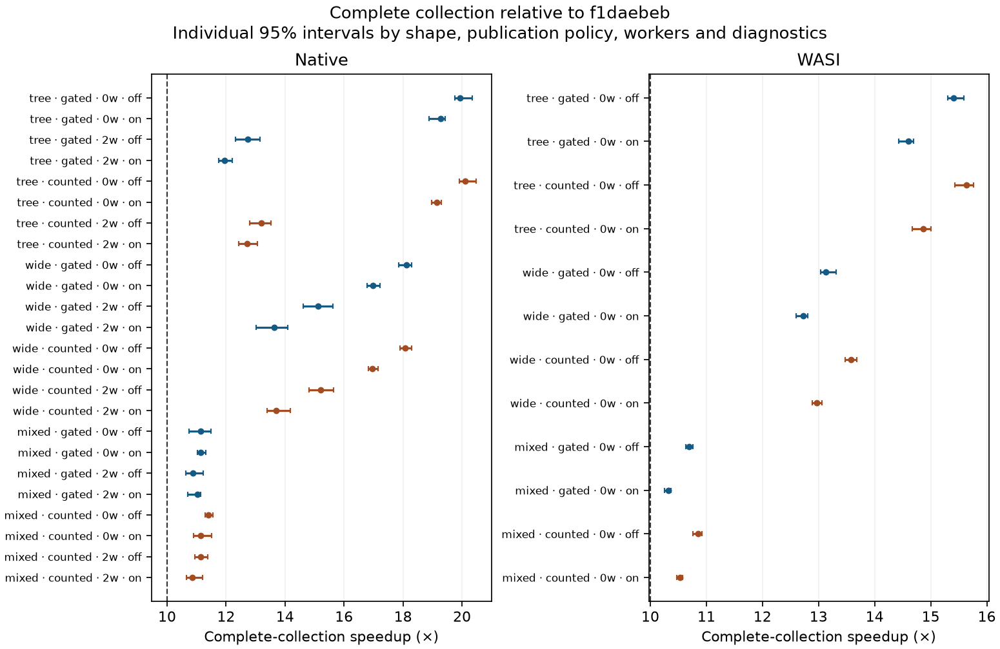
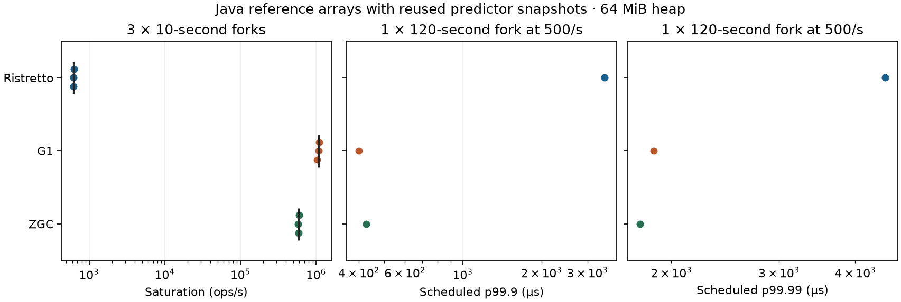

# Reusing pressure-predictor snapshots on the unified JVM heap

Full-collection lifecycle updates to the pressure predictor each allocated a replacement immutable model at `d1cab313`. At `a0f40eac`, an updating thread can reuse a displaced model once it has exclusive ownership. It copies the whole currently published model before applying the update. This matters when a thread serves two heaps with different limits or retries against a newer model. An observer can retain an earlier version. The optional allocation sampler still gets one publication attempt.

## Allocation cost

The finite-heap probe keeps 256 integers rooted and drives 64 warmed full collections. All twelve fresh processes per arm completed in 1,216 steps. The change removed 128 host allocation requests and 30,720 requested bytes in every trial. A pinned reader or a competing writer can still require a fresh allocation. Each updating thread can retain one spare model and one spare statistics snapshot, both containing only values. [Fixture](../predictive-scheduling-progress/allocation-events/collection-probe.rs) · [All 36 observations](collection-allocations.jsonl.gz).

| Predictor | Host allocation requests | Bytes requested |
| --- | ---: | ---: |
| Original mutex | 64 | 4,608 |
| Immutable model at `d1cab313` | 192 | 35,328 |
| Reused model at `a0f40eac` | 64 | 4,608 |

On the separate allocation-recording probe, the preceding and reused predictors took 18.023 and 18.181 ns per event. Across 24 interleaved fresh processes per arm, the median paired elapsed ratio was 1.004 with a 95% interval of [0.989, 1.015]. The upper selection limit was 1.05. [Fixture](../predictive-scheduling-progress/allocation-events/probe.rs) · [Processes](allocation-events.jsonl.gz) · [Summary](validation.json).

## Collection and integration

All 36 complete-collection conditions cleared the 10× gate against `f1daebeb`. The lowest individual paired 95% speedup bounds were **10.625× native** and **10.251× WASI**. The speedups measure a complete collection against the earlier Ristretto collector. [Per-condition results](cycles/complete-cycles.csv) · [Provenance](cycles/provenance.json).

All 800 forced schedules passed across two sets of 100 fresh processes. In one set a scheduling reader or allocating sampler held an old version. In the other a statistics reader remained parked. A peer could finish its full collection and recover enough space for its capped allocation under both publication policies. A separate test holds an original model across full lifecycles on two heaps with different limits. [Pressure schedules](pressure-schedules.jsonl.gz) · [Statistics schedules](statistics-schedules.jsonl.gz).

Native testing passed 1,033 tests with one ignored. WASI passed 468, and Miri passed all 11 focused tests. Strict Clippy passed on native and WASI. Fourteen dependency graphs resolved to the one workspace collector, the verified Cargo archive built in external native and WASI consumers, and the ordinary Java reproducer completed 8,192 allocations on each. The native interpreted, native compiled and WASI previews each cleared both weak witnesses and refunded the managed bytes. Carbon reviewed the design at high effort and Neon checked the final implementation, including the pinned-reader and failed-retry paths. The installed Carbon CLI rejected xhigh, and its post-edit high-effort run timed out. [Source identity, previews and audit receipts](validation.json).

## A predicting publisher parked before notification

A separate native regression parks the third allocating publisher after it commits a model that predicts a collection and before it requests that collection. The public scheduling counter has risen from zero to one, the three-object heap is full, and the background worker count is zero. A peer polls only a fourth allocation. In 100 fresh processes under both publication policies it reclaimed the unreachable donor and acquired the replacement within 4,096 polls, before the publisher resumed. The donor's weak reference cleared, the three surviving rooted values matched, and the heap charged exactly three objects. This establishes independent demand-driven recovery across this particular notification gap. [Test and build receipt](notification-handoff.json) · [All 200 schedules](notification-handoff.jsonl.gz).

## Browser screen

At 2,000 scheduled arrivals/s, two candidate Chromium forks completed all 4,000 arrivals and one completed 3,996 before the deadline. Candidate p99.9 request-turn work was 40–46 µs, and the largest heartbeat gap was 5.595 ms. The completed-request latency distribution excludes those four unfinished arrivals. Browser JVM latency and zero global pauses remain unqualified. [Per-fork results](browser/REPORT.md) · [Graph](browser/browser.png) · [Raw processes](browser/processes.jsonl.gz).

## Whole-JVM reference arrays

The same Java classfiles ran on the native Ristretto JVM and JDK 25 G1 and ZGC. Each process had a 64 MiB managed heap, two CPUs and a 512 MiB process memory limit. All three JVMs completed their 60,000 scheduled arrivals without an OOM kill in the two-minute run. Saturation is the median of three independent ten-second forks. The latency and backlog columns come from one separate 120-second fork per JVM at 500 arrivals/s, measured from scheduled arrival to completion.

| JVM | Saturation (operations/s) | Scheduled p99.9 (ms) | Scheduled p99.99 (ms) | Maximum sampled backlog |
| --- | ---: | ---: | ---: | ---: |
| Ristretto | 625 | 3.488 | 4.480 | 2 |
| G1 | 1,076,274 | 0.401 | 1.872 | 1 |
| ZGC | 583,313 | 0.428 | 1.776 | 3 |

This workload still has a large whole-JVM throughput and latency gap. The long run has one observation per JVM. It establishes neither a between-fork tail distribution nor how much time the collector stopped application work. [Per-fork measurements](java/forks.csv) · [Raw scheduled runs](java/two-minute.jsonl.gz) · [JVM, classfile and binary identities](java/two-minute-inputs.json).

