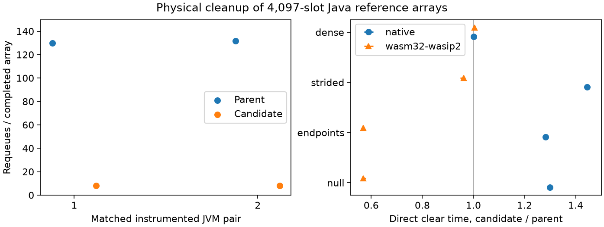
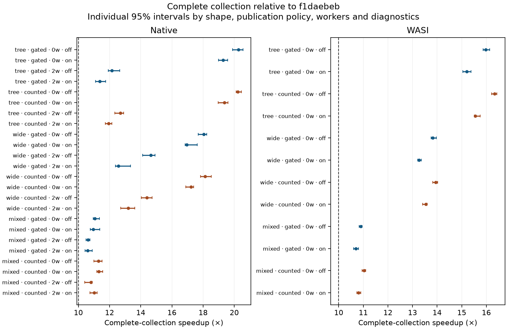
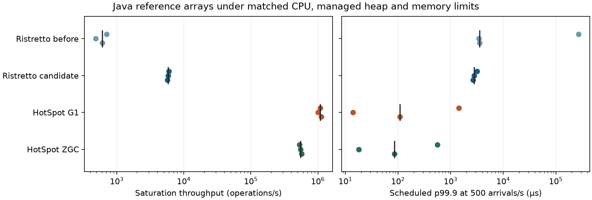
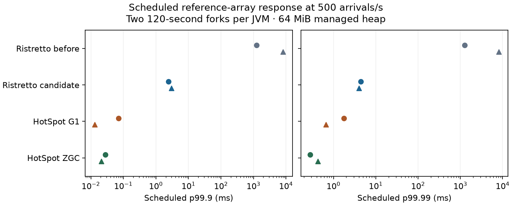
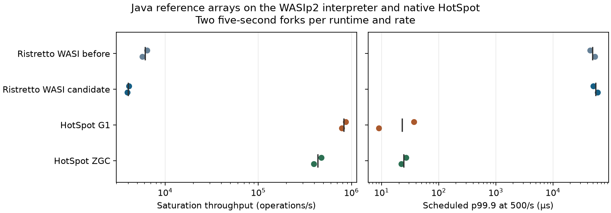

# Prepared dirty owners and bounded Java array retirement

The JVM, source preview and browser use the same collector. Two commits on the consolidated branch change how it publishes dirty vector owners and how Java reference arrays return their backing storage. The measured revision is `58fe2949`. Native Java saturation throughput rose 9.66× on this workload. WASIp2 interpreter throughput fell 34.0% in a separate short comparison. Both used a 64 MiB managed heap.

## Publication and physical reclamation

A managed vector can certify its write while every incoming edge still owns its registration. The collector publishes the exact owner and mutation version before demotion. A busy remembered shard sends that membership to the versioned overflow. Later unlink checks the same birth. Saturated versions are exempt from pruning. Values that cannot certify their incoming edges still use the ordinary dirty barrier.

On the parent a parked dirty-owner flusher blocked a full ticket and an independently funded allocation for 2,048 polls and collector steps under both publication policies. With the prepared write both completed, including with the remembered shard held and the mutation version at its maximum. The exact child witnesses survived and subsequently cleared. The managed charge returned to zero. Five schedules exercised 800 configurations in 200 fresh native processes. [Failing control](validation/dirty-control.log.gz) · [Configurations](validation/forced-summary.json) · [Individual runs](validation/forced-schedules.jsonl.gz)

Array retirement can now clear up to 512 additional contiguous Java nulls immediately before the ordinary suffix. Owning values stay subject to the existing work budget. The same storage primitive drops the suffix, returns its backing region and refunds the charge. Tests place real rooted values on either side of the scan boundary and cover both host and regional storage.

Instrumenting the actual native callback queue showed 129.86 and 131.94 republications per array finishing its value clear in two parent processes. The matching batched runs measured 8.01 in both. Each returned physical memory. The standalone 4,097-slot probe required 129→8 turns for null arrays, 129→9 for two endpoints, 129→125 for strided arrays and 129→129 for dense arrays. Native exclusive cleanup took 28–45% longer on the three sparse shapes and was essentially flat on dense arrays. WASI used about 57% of the old time for null and endpoint shapes. These direct calls exclude rescheduling between turns. [Native callback counters](retirement/native-callbacks.csv) · [Per-shape timings with intervals](retirement/direct-cleanup.csv) · [Probe builder](retirement/build.py) · [Instrumented processes](retirement/instrumented-processes.json.gz)

## Complete collection versus f1daebeb

Each randomized run covers 24 native and 12 WASIp2 conditions across tree, wide and mixed graphs, both publication policies and diagnostics settings, with zero or two native workers and zero WASI workers. Every process builds 4,095 nodes and runs 16 complete collections. Each condition has 24 native or 48 WASI pairs. The two runs use different seeds and the same verified executables. Some builds shared CPUs during the first run. The confirmation followed the main Java measurements.

| Run | Native minimum individual lower 95% bound | WASI minimum individual lower 95% bound | Fresh processes |
|---|---:|---:|---:|
| First | 10.746× | 10.754× | 2,304 |
| Confirmation | 10.411× | 10.607× | 2,304 |

[First run and intervals](cycles/complete-cycles.csv) · [Confirmation and intervals](cycle-confirmation/complete-cycles.csv) · [Control, candidate and compiler receipts](cycle-confirmation/provenance.json)

## Native JVM under scheduled load

All four runtimes used the same Java classfiles and JDK, two CPUs, a two-core quota, a 64 MiB heap and a 512 MiB cgroup with swap disabled. The parent executable came from `729aea8f`. Its GC, class loader, VM sources and dependency lockfile match the PR parent `df71e5a2`. The short screen used three fresh ten-second processes per runtime and rate after five seconds of warmup. At 500 arrivals/s the sustained screen used two 120-second processes per runtime after ten seconds of warmup. Each long fork offered 60,000 requests. Tails in a fork with unfinished requests describe completed requests.

| Runtime | Short saturation median ops/s | Short scheduled median p99.9 ms | Long completions, forks 1 / 2 | Long scheduled p99.9 ms, forks 1 / 2 |
|---|---:|---:|---|---|
| Ristretto before | 608 | 3.552 | 59683 / 55992 | 1,245.184 / 8,060.928 |
| Ristretto candidate | 5,868 | 2.816 | 60000 / 60000 | 2.432 / 2.976 |
| HotSpot G1 | 1,088,884 | 0.108 | 60000 / 60000 | 0.071 / 0.013 |
| HotSpot ZGC | 550,164 | 0.086 | 60000 / 60000 | 0.028 / 0.021 |

The candidate passed the predeclared native completion, capacity and long-tail thresholds. HotSpot leads on both throughput and scheduled tail latency. In a separate instrumented JVM invocation, `GcBench.operation` entered the interpreter 29,054 times and `checkReferenceArray` 29,118 times. Both recorded zero compiled entries. The counts include startup, warmup and reporting. [Gate](validation/gate.json) · [Decision](validation/java-gate.json) · [Short forks](java/forks.csv) · [Sustained forks](java/sustained.csv) · [Method counts](java/hot-methods.json)

## Optimized WASIp2 JVM under the same heap and CPU limits

The workerless WASI interpreter used release builds in separate empty Cargo targets with fresh compiler artifacts for the GC, class loader, VM and launcher. G1 and ZGC used native HotSpot on the same CPU pair and envelope. Each of the 16 fresh processes warmed up for two seconds and ran for five seconds. The two scheduled forks per runtime each offered 2,500 arrivals.

| Runtime | Saturation median ops/s | Scheduled median p99.9 ms | Completions, forks 1 / 2 |
|---|---:|---:|---|
| Ristretto WASI before | 6,061 | 49.408 | 2500 / 2500 |
| Ristretto WASI candidate | 4,000 | 55.808 | 2500 / 2500 |
| HotSpot G1 | 828,571 | 0.023 | 2500 / 2500 |
| HotSpot ZGC | 433,636 | 0.025 | 2500 / 2500 |

The initial shared Cargo target linked the control module for both arms. Its results are excluded. The isolated candidate and control have distinct module hashes. The WASI comparison measures both commits together. It leaves WASI throughput qualification open. [Forks](wasi-java/forks.csv) · [Frozen binaries and Java class hashes](wasi-java/provenance.json) · [Control build](wasi-java/before-build.json) · [Candidate build](wasi-java/after-build.json)

## Shipping checks and remaining progress obligations

Native GC and class loader tests passed 1,834 cases with 15 ignored. WASIp2 passed 1,235 with nine ignored. Strict Clippy passed on both. The collector packaged and verified, both normalized Cargo consumers passed, and the shipping dependency checks found the single collector. Native interpreted, native compiled and WASIp2 interpreted Java previews each returned 64, cleared two exact witnesses and reclaimed their charges. All nine short Chromium trials completed. The three candidate trials served 4,000/4,000 arrivals with request-turn p99.9 of 46, 60 and 75 µs. [Suites](validation/suites.json) · [Package](validation/gc-package.log.gz) · [Shipping graphs](validation/graphs.log.gz) · [Compiled preview](validation/native-compiled.json) · [Browser forks](browser/REPORT.md)

A protected raw embedding handle can still leave a private clean record while its flusher is parked. The traced edge completes the identical forced schedule. Raw-handle progress, general unprepared writes, later collector phases and sustained HotSpot parity remain open. [Raw-handle control](validation/raw-control.patch.gz) · [Observed assertion](validation/raw-control.log.gz)
