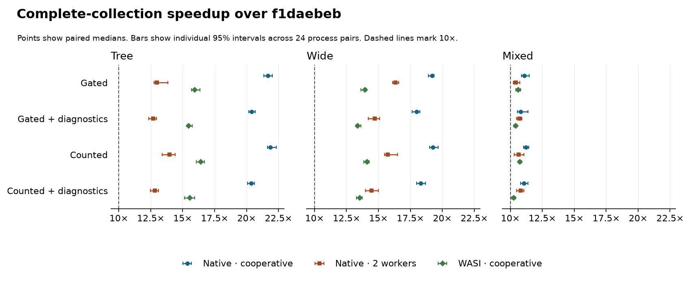

# Terminal allocation and native callback dispatch

A native allocation at the heap cap could exhaust both recovery cycles while its pressure worker was runnable with a donor still queued. At `2ec923ac` the allocator can request one acknowledged attempt to take a job. Each poll rechecks real headroom. The assistant acknowledges before entering an arbitrary destructor and uses a nonblocking receiver probe. Cancellation removes the demand. Shutdown or failure to start the optional assistant ends the wait. A runnable assistant must eventually be scheduled. A callback already running can stay parked indefinitely and keep its storage charged.

## Forced schedules

| Schedule | Observed outcome |
|---|---|
| Older destructor parked, pressure worker delayed after notification | The parent denied the request in 100/100 fresh processes. The candidate stayed pending in 100/100. After the donor's physical refund, all 100 allocations succeeded. |
| Cancel a request with a dispatch outstanding, submit another | In 100/100 processes the old demand disappeared, the new demand stayed open, and the donor's physical refund funded the new allocation. |
| Hold the ordinary shared receiver across the terminal decision | All 100 requests completed with out-of-memory while both objects remained charged. After release and shutdown, all charges returned to zero. |
| Two parked destructors and an independent donor, an arbitrary destructor at the head of a batch, or shutdown observing callback failure | Each existing integration test passed in 100 fresh processes. |
| Ordinary scheduling without the delayed-worker hook | Both arms completed all 600 public-API trials each, split equally between one and twelve CPUs. |

The forced schedules alternate a single CPU and a three-CPU set. To reproduce the delayed-worker control, apply the [test-only patch](control.patch.gz) with `gzip -dc control.patch.gz | git apply` at `c5d9e643`. Run `cargo test --locked -p ristretto_gc --lib terminal_allocation_observes_pressure_service_before_denial` against each checkout. The candidate's cancellation and contended-receiver tests are included at `f6b44299`. All changes to the GC after the timed revision through that commit are within its native test module.

The shipping queue still has a shared receiver. A participant parked while holding it can prevent another consumer from claiming an independent donor. The contended test pins down the resulting bounded denial and preserves the physical accounting. [Independent-claim candidate and costs](../parked-claim-qualification/README.md).

## Complete collection and callback cost

Across 36 complete-collection conditions against frozen Ristretto `f1daebeb`, the smallest individual 95% lower speedup bound was **10.24× on native** and **10.12× on WASI**. Each condition used 24 paired processes. The metric includes all collection phases and their waits. Java request latency has a separate [fixed-rate comparison with G1 and ZGC](../../consolidated-java-followups/reference-cards/README.md).

The callback fixture timed full cycles over 1, 64 and 1,024 cheap finalizers with one or two workers, using 24 paired processes per condition and 16 samples per process. Median candidate/parent elapsed-time ratios ranged from 0.992 to 1.006. All six individual paired 95% intervals included 1.00. The widest interval was 0.976–1.028. The two-worker, 64-finalizer ratio was 0.995 [0.971, 1.013].

[All complete-cycle estimates](cycles/complete-cycles.csv), [frozen inputs](cycles/cycle-provenance.json), [native](cycles/native.jsonl.gz) and [WASI process samples](cycles/wasm.jsonl.gz). [Callback fixture](../parked-claim-qualification/callback_cost.rs), [cost intervals](callback-cost.csv), [raw callback timings](callback-cost.jsonl.gz).

[Delayed dispatch controls](delayed-dispatch.jsonl.gz), [cancellation and receiver contention](cancellation-and-contention.jsonl.gz), [destructor and shutdown schedules](destructor-and-shutdown.jsonl.gz), [public-API fixture](ordinary-scheduling.rs.gz), [ordinary scheduling trials](ordinary-scheduling.jsonl.gz), [build identities](provenance.json).
