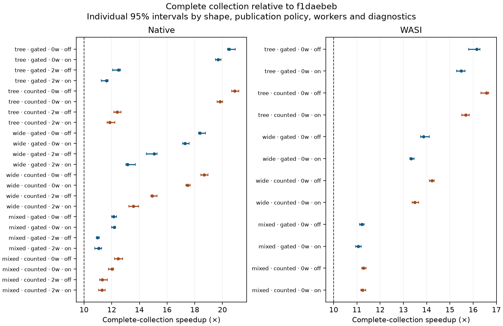
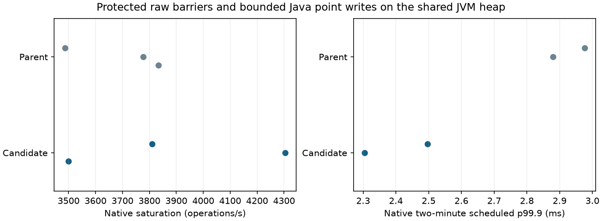
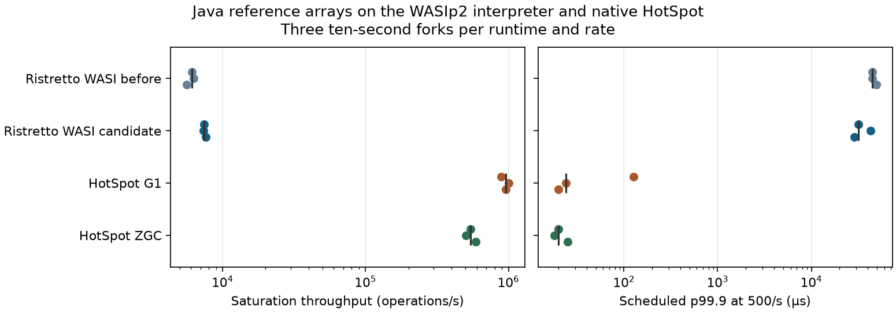
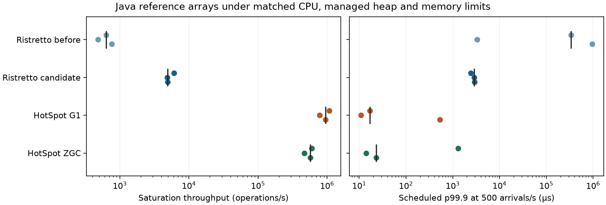

# Protected raw barriers and bounded Java array writes

The integrated revision `f97f8a99` uses the same JVM collector as its
parent `58fe2949`. It passed the native Java gate. The two edits address
distinct ways a suspended publisher could hold up a peer.

A protected raw embedding handle carries an address and a zero sentinel.
On a buffered ordinary heap its deletion barrier resolves the exact
live descriptor under the caller's lifetime guarantee. It publishes the
descriptor to the receiving strong epoch. A collector can claim the
committed proposal or cancel an incomplete one. The fallback takes fresh
admission. Heaps configured for old-only passes retain their original
raw handoff. The registry lookup, other phases and admission fallback still
need progress qualification. The JVM's numeric object handles use their
separate typed identity lookup.
[Failing parent control](../prepared-writes-array-retirement/validation/raw-control.log.gz) · [Post-edit audit](validation/raw-audit.json)

The Java array write guard can certify a nonempty changed range of at
most 32 contiguous slots if the array remains attached to the same owner
and each value in that range is scalar, null or owns its registration.
The collector enrolls the owner while the changed edges are still rooted.
A traced gap, wider range or whole-array rebind falls back. The class loader
tests exercise a rooted foreign input, unwind and replacement. A deterministic
parent probe had one outstanding private dirty record under each policy.
[Parent assertion](validation/point-control.log.gz) · [Point-store audit](validation/point-audit.json)

Four native schedules exercised 640 configurations in 160 fresh processes.
The clean and dirty flusher controls check independent capped allocation and
full-ticket completion. A producer parked after the raw proposal was linked
allowed two fresh full tickets and an allocation. A separate check claimed
the exact raw child before ordinary parent traversal, and exercised the prior
old-only raw behavior. [Schedules](validation/forced.json) · [Individual outcomes](validation/forced.jsonl.gz)

## Collector and JVM results

All 36 complete-collection conditions exceeded 10× versus `f1daebeb`
at their individual lower 95% bounds. The minima were 10.780× on native
and 10.953× on WASIp2. The nine short Chromium trials included 4,000/4,000
arrivals for each candidate fork. The baseline and control each missed arrivals
in one fork. [Complete cycles](cycles/complete-cycles.csv) · [Browser per-fork results](browser/REPORT.md)

Native Java compared the two release executables on the same two CPUs,
64 MiB managed heap, 512 MiB process limit and benchmark class files.
Three short forks measured saturation and 500 scheduled arrivals/s.
Two 120-second forks at 500/s offered 60,000 requests apiece.

| Native Java | Parent | Candidate |
|---|---:|---:|
| Median saturation ops/s | 3,778 | 3,810 |
| Short scheduled arrivals unfinished | 0 | 0 |
| Long completions per fork | 60000 / 60000 | 60000 / 60000 |
| Long scheduled p99.9 ms per fork | 2.976 / 2.880 | 2.496 / 2.304 |

The minimum capacity ratio was 0.95 and the maximum sustained p99.9
ratio was 1.10. The observed ratios were 1.009
and 0.820. The intermediate point-store
revision `45123789` measured 0.952 and 0.989 in its own direct parent
comparison. [Declared policy](jvm/policy.json) · [Integrated decision](jvm/decision.json) · [Native short forks](jvm/short-java.csv) · [Native sustained forks](jvm/long-java.csv)

On the optimized workerless WASIp2 interpreter the three ten-second forks
measured 5,429 → 6,920 median ops/s.
Scheduled median p99.9 was 66.560 →
34.304 ms. The parent missed 44
scheduled arrivals and the candidate missed 0.
[WASI forks](jvm/wasi.csv) · [Independent release build](jvm/wasi-build.json)

The combined native GC and class loader suites passed 1,837 cases with
15 ignored. WASIp2 passed 1,237 with nine ignored. Strict Clippy, both
normalized Cargo consumers and collector packaging passed. All three Java
preview tiers cleared two witnesses and returned 64. The compiled tier executed
25 compiled entries and eight compiled backedges. [Native tests](validation/native-full-suite.log.gz) · [WASIp2 tests](validation/wasi-full-suite.log.gz) · [Compiled preview](validation/native-compiled.json)

Sustained workerless WASI performance and whole-JVM HotSpot parity remain
alpha gates. Production hot-loop coverage and progress for unprepared owners,
metadata contention, weak decisions and later collection phases remain open.
[Whole-JVM controls and WASI follow-ups](../prepared-writes-array-retirement/README.md)

## A parked flusher on heaps configured for old-only passes

The progress control was repeated with the same live child, rooted parent,
reclaimable donor and 2,048-poll budget. The test requests a precise full cycle
or an actual old-only pass and verifies which one entered marking. Under each
configuration it uses the managed child or constructs a protected raw wrapper.
The table reports whether both the fresh full ticket and capped peer allocation
completed with the flusher still parked. The result held for both edge forms
in each of 24 fresh processes, totaling 288 configurations.

| Old interval | Pass in marking at publication | Legacy publication | Counted publication |
|---:|---|---|---|
| 0 | Full | Both completed | Both completed |
| 4 | Full | Both stalled | Both stalled |
| 4 | Old-only | Both stalled | Both completed |

The interval-four heap stores managed children as numeric edges to preserve the
old-to-young handoff. All stalled cases retained one pending context record.
The weak identity and zero-charge checks passed after resuming the flusher.
This reproduces a progress obstruction on the configuration used by the Java
benchmark even though the measured JVM workload made progress.
[Reproducer against the measured revision](old-generation/control.patch.gz) ·
[Original assertion](old-generation/control.log.gz) · [All repetitions](old-generation/repeated.json.gz)

## Direct WASIp2 comparison with the original PR baseline

The workerless interpreter also ran directly against `df71e5a2` with native
HotSpot G1 and ZGC on the same two CPUs and under the same heap and process
limits. Three ten-second processes per runtime and rate used the same Java
class files after four seconds of warmup. The integrated candidate cleared the
declared 95% baseline capacity and complete scheduled-arrival screen.

| Runtime | Saturation median ops/s | Scheduled median p99.9 ms | Completions per fork out of 5,000 |
|---|---:|---:|---|
| Ristretto WASI before | 6,090 | 44.544 | 5000 / 5000 / 5000 |
| Ristretto WASI candidate | 7,392 | 32.000 | 5000 / 5000 / 5000 |
| HotSpot G1 | 960,302 | 0.024 | 5000 / 5000 / 5000 |
| HotSpot ZGC | 542,163 | 0.020 | 5000 / 5000 / 5000 |

[Per-fork results](wasi-baseline/forks.csv) · [Receipts](wasi-baseline/provenance.json) · [Decision](wasi-baseline/decision.json)

## Direct native comparison with the original PR baseline

All four runtimes used the same Java classes, JDK, 64 MiB managed heap,
two CPUs and 512 MiB cgroup. Each of the 24 fresh processes warmed up
for five seconds and measured ten seconds. The candidate achieved
7.75× the parent's median saturation and completed all 15,000
scheduled requests across the three 500/s forks.

| Runtime | Saturation median ops/s | Scheduled median p99.9 ms | Total unfinished scheduled requests |
|---|---:|---:|---:|
| Ristretto before | 635 | 335.872 | 0 |
| Ristretto candidate | 4,918 | 2.848 | 0 |
| HotSpot G1 | 948,740 | 0.017 | 0 |
| HotSpot ZGC | 572,312 | 0.023 | 0 |

The parent executable came from `729aea8f`; its runtime sources match
`df71e5a2`. The four-build WASIp2 experiment also reproduced a throughput
cost for bounded null retirement alone, while the integrated WASIp2 JVM
above improved against the original baseline. Longer WASIp2 runs remain open.
[Native forks](native-baseline/forks.csv) · [Executable and class hashes](native-baseline/provenance.json) · [Four-build WASI comparison](../prepared-writes-array-retirement/README.md#four-build-comparison-on-one-cpu-pair)

[Resolve numeric edges during precise full marking](precise-full-numeric/README.md).
