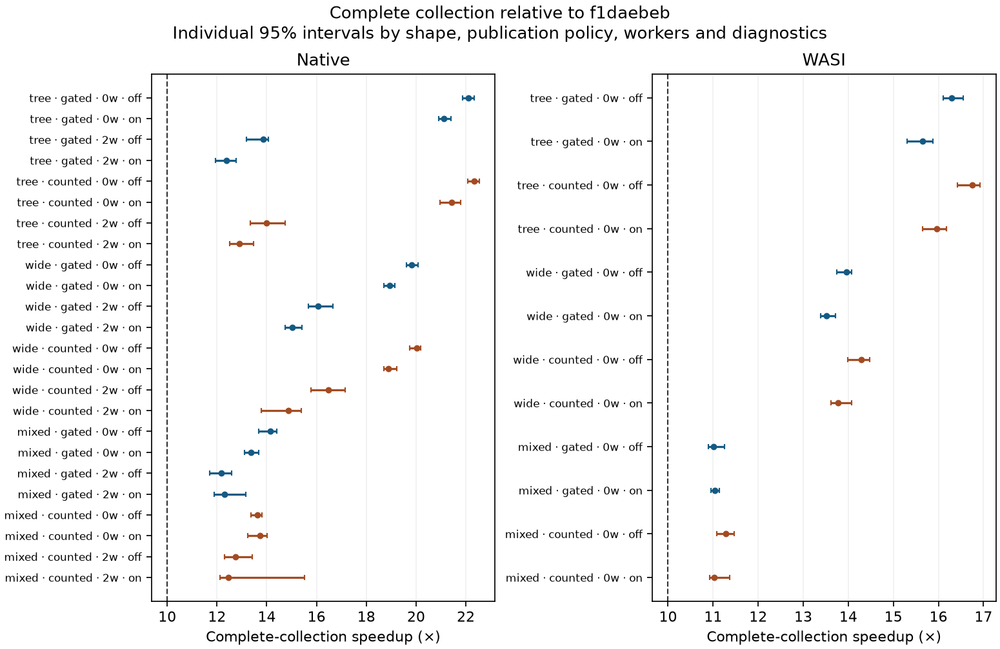
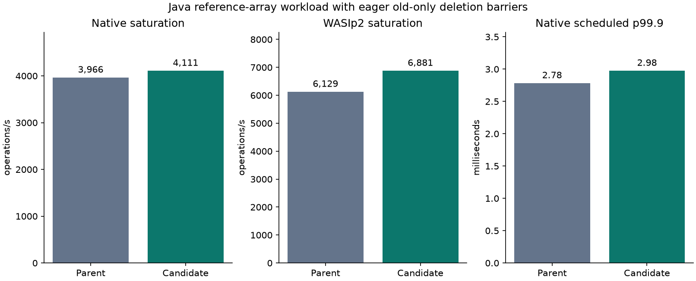
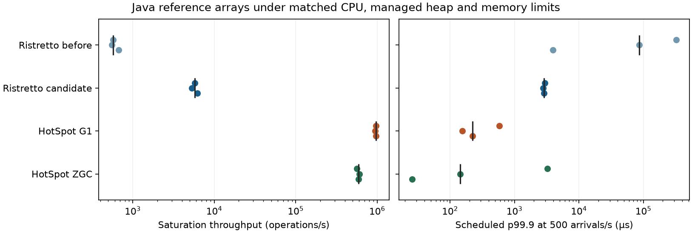

# Eager deletion during an old-only pass

The candidate at `379ad59a` is **qualified for the consolidated alpha PR**. On a buffered heap with
the old-generation interval set to four it applies the exact same-heap
numeric deletion while holding fresh publication admission. This removes
the private flusher dependency for a promoted, initially white child.
A registered managed edge still matches its object identity and address.
An unsafe raw wrapper still requires the caller to keep the original birth live.

The forced schedules suspended the flusher and polled a funded peer allocation
and fresh full ticket 2,048 times. Both completed in the mature-child, true
old-only cases on both publication policies. All 960 checks passed across
120 freshly started native test processes. They include precise full marking,
old marking, both edge representations and producer cancellation across epochs.
[All schedules](validation/schedules.json.gz) · [Previously blocked mature-child control](../precise-full-numeric/mature-control/test.log.gz)

## Handoff to a young collection

A deletion before the old cursor reached an existing young child made its
strong old retention visible immediately. A child born after the old snapshot
kept its black old mark and absent old retention. With a young collection
also active, another post-snapshot child's deletion established strong young
retention while leaving its old retention absent. The young collection
finished with the old cursor held. Both publication policies passed.
The read-only post-edit auditor confirmed the before/after-snapshot
distinction and identified the remaining admission window.
[Audit](validation/audit.json) · [Native suite](validation/native-full-suite.log.gz)

## Producer suspended inside admission

The probe parks the actual deletion producer immediately after it obtains the
fallback publication guard, before it shades the promoted target.
In 96 cases, both the fresh full ticket and the capped allocation exhausted
their 2,048-poll budget with **zero** pending context records. Releasing the
producer allowed exact liveness checks and physical reclamation to finish.
This reproduces a remaining obstacle to zero collector-wide pauses.
The next change must let a peer finish that same ticket and allocation while
the deletion producer remains suspended. A candidate for mature targets can
use the captured old epoch's cancellable traversal proposal because a young
collection excludes promoted objects. A proposal for an initially young
target must also be visible to a new young snapshot before its cross-root scan
passes the target. Validation must cover consumer cancellation, epoch turnover,
a post-snapshot birth, both publication policies and exact final reclamation.
[Probe](admission-control/probe.patch.gz) · [Output](admission-control/probe.log.gz) · [All repetitions](admission-control/repeated.json.gz)

## Collection and whole-JVM measurements

Across 36 established full-collection conditions and 2,304 fresh processes,
the minimum individual lower 95% speedup versus `f1daebeb` was
11.695× native and 10.892× WASIp2.
[All conditions](cycles/complete-cycles.csv) · [Inputs](cycles/provenance.json)

The direct JVM control is the shipped `f97f8a99` runtime. Short forks
measured ten seconds at saturation or 500 scheduled arrivals/s. Long forks
measured two minutes at 500/s. Each arm used the same two CPUs, 64 MiB heap,
512 MiB process limit and Java classes within a comparison. Native used
CPUs 20 and 22. WASIp2 used 8 and 10 with no background collector workers.
Scheduled p99.9 is the median of the per-process response quantiles.

| Experiment | Revision | Ops/s | Scheduled p99.9 ms | Scheduled completions by fork | Failed forks |
|---|---|---:|---:|---|---:|
| Native, 10 s | Parent | 3,966 | 2.528 | 5000 / 5000 / 5000 | 0 |
| Native, 10 s | Candidate | 4,111 | 2.816 | 5000 / 5000 / 5000 | 0 |
| WASIp2, 10 s | Parent | 6,129 | 39.936 | 5000 / 5000 / 5000 | 0 |
| WASIp2, 10 s | Candidate | 6,881 | 40.960 | 5000 / 5000 / 5000 | 0 |
| Native, 120 s | Parent | — | 2.784 | 60000 / 60000 | 0 |
| Native, 120 s | Candidate | — | 2.976 | 60000 / 60000 | 0 |

The native saturation and two-minute p99.9 ratios were
1.036 and 1.069.
WASIp2 saturation was 1.123 times the control.
[Original baseline, G1 and ZGC](../README.md#direct-native-comparison-with-the-original-pr-baseline) · [Policy](jvm/policy.json) · [Decision](jvm/decision.json) · [All native short forks](jvm/short-java.csv) · [Native sustained](jvm/long-java.csv) · [WASIp2](jvm/wasi.csv)

The native GC and class loader suites passed 1,838
tests and WASIp2 passed 1,238. Strict Clippy and
normalized Cargo consumers passed on both platforms. All 59 release launcher
graphs selected the one collector. The ordinary Java test completed 8,192
allocations on both targets. Native interpreter, native JIT and WASIp2 each
rewired the Java graph and cleared its two exact weak witnesses.
[Package](validation/gc-package.log.gz) · [Release launcher checks](validation/launcher-graphs.log.gz) · [Compiled tier](validation/native-compiled.json) · [Actual Chromium main-thread results](browser/REPORT.md)

## Direct native comparison with HotSpot

All four runtimes ran the same Java classfiles on CPUs 8 and 10 under a 64 MiB managed heap and 512 MiB cgroup. Each had three saturation forks and three scheduled forks, with five seconds of warmup and ten seconds of measurement. The earlier alpha baseline executable came from `729aea8f`, which shares its runtime sources with `df71e5a2`.

| Runtime | Saturation ops/s | Scheduled p99.9 ms | Failed forks | Unfinished scheduled requests |
|---|---:|---:|---:|---:|
| Ristretto before | 572 | 86.016 | 0 | 0 |
| Ristretto candidate | 5,799 | 2.848 | 0 | 0 |
| HotSpot G1 | 960,807 | 0.222 | 0 | 0 |
| HotSpot ZGC | 593,619 | 0.143 | 0 | 0 |

[Individual forks](native-baseline/forks.csv) · [Binary, source and class hashes](native-baseline/provenance.json)

Cargo recorded the measured revision in the verified GC archive. All 134 packaged Rust source and example files matched the measured checkout byte-for-byte. The package contained zero retired catalog, pool, adapter or diagnostic module paths. [Package source identity](validation/package-source.json)
