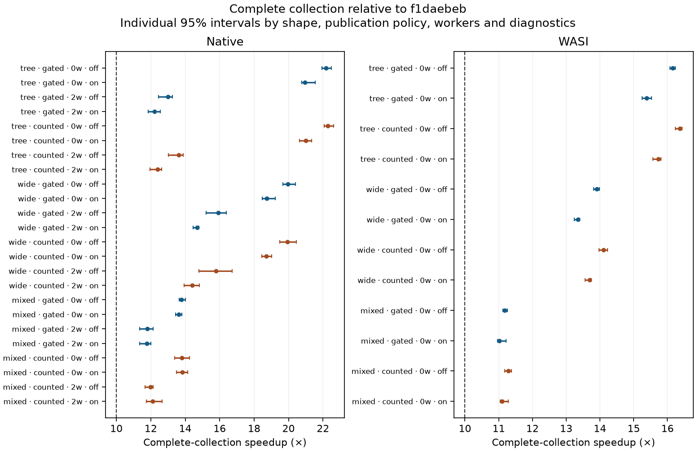
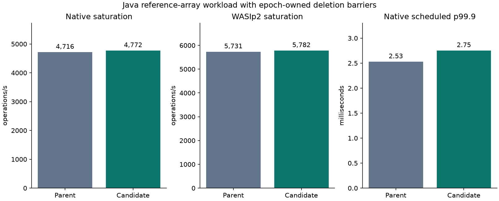
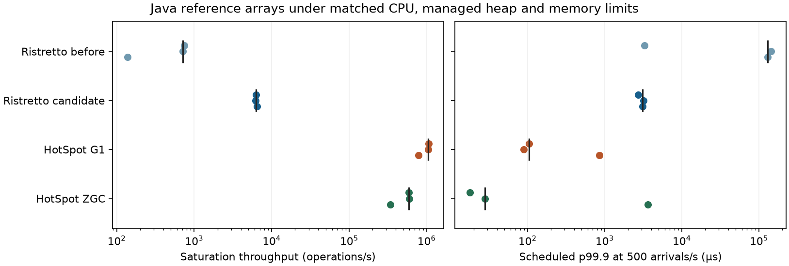

# Registered deletion across old and young collection epochs

The implementation at `6f577187` passed the original PR screen. A later two-minute WASIp2 comparison missed its scheduled-latency limit. [Sustained WASIp2 results](wasi-sustained/README.md). Its parent runtime is
`379ad59a`. Both managed and protected raw numeric deletions now let a peer
finish two fresh full collections and receive its funded allocation with the
producer parked after linking an old-only mark for a promoted white child.
Both publication policies passed. The parent exhausted the allocator's and
collector's 2,048-poll budgets with its producer parked at fresh admission.
[Parent reproducer](../eager-old-deletion/admission-control/probe.patch.gz) · [1,200 forced configurations](validation/schedules.json.gz)

A deletion resolves a managed edge by exact address and identity. A raw
wrapper requires its caller to keep the original allocation live. Strong
traversal belongs to the captured receiver epoch. Each publication shares a
cancellable decision across its proposals. For a young target present before
an old-only snapshot, the producer makes the old retention visible, then
samples the receivers again. A young cycle that started and passed the child
between the commit and this publication receives its own traversal. A
post-snapshot black birth keeps its absent old retention. A later phase,
cancelled proposal or full inbox uses the admitted fallback.

The crossing test held the old cursor, stopped the producer immediately
after the commit and advanced a real young collector through its cross-root
scan. The corrected code returned with strong retention visible in both
epochs. Omitting the second sample lost the young mark in 24 fresh processes.
[Failing variant](no-resample/probe.patch.gz) · [Assertion](no-resample/probe.log.gz) · [Repetitions](no-resample/repeated.json.gz) · [Read-only auditor response](validation/audit.json)

## A full marking inbox

An independent promoted child filled a one-entry inbox before deletion of its
white sibling. A producer parked inside the resulting fallback guard still
prevented the funded allocation and the fresh full ticket from completing
within 2,048 polls in all 96 configurations. Pending private context records
were zero. Exact weak liveness and the final zero managed charge passed after
the producer resumed. This keeps the zero-global-pause gate open.
[Reproducer](full-inbox/probe.patch.gz) · [Output](full-inbox/probe.log.gz) · [All repetitions](full-inbox/repeated.json.gz)

## Complete collection and Java workload

All 36 established conditions passed 10× against `f1daebeb` across 2,304
fresh processes. The lowest individual lower 95% speedup bounds were
11.345× native and 10.962× WASIp2.
[All conditions](cycles/complete-cycles.csv) · [Inputs](cycles/provenance.json)

Each Java arm used the same reference-array class files, 64 MiB managed
heap, two CPUs, 512 MiB process cap and zero swap. Short measurements lasted
ten seconds with three forks at each rate. Two fresh forks per runtime measured
two minutes at 500 arrivals/s. WASIp2 used the workerless interpreter. Tail
latencies include queueing from the scheduled arrival.

| Experiment | Revision | Saturation ops/s | Scheduled p99.9 ms | Completions by fork | Failed forks |
|---|---|---:|---:|---|---:|
| Native, 10 s | Parent | 4,716 | 3.136 | 5000 / 5000 / 5000 | 0 |
| Native, 10 s | Candidate | 4,772 | 2.880 | 5000 / 5000 / 5000 | 0 |
| WASIp2, 10 s | Parent | 5,731 | 39.424 | 5000 / 5000 / 5000 | 0 |
| WASIp2, 10 s | Candidate | 5,782 | 35.840 | 5000 / 5000 / 5000 | 0 |
| Native, 120 s | Parent | — | 2.528 | 60000 / 60000 | 0 |
| Native, 120 s | Candidate | — | 2.752 | 60000 / 60000 | 0 |

The native short capacity ratio was 1.012, the
native two-minute p99.9 ratio was 1.089, and the
WASIp2 short capacity ratio was 1.009. The direct native comparison with G1 and ZGC follows below.
[Policy](jvm/policy.json) · [Native decision](jvm/decision.json) · [Short native](jvm/short-java.csv) · [Sustained native](jvm/long-java.csv) · [WASIp2](jvm/wasi.csv)

## Runtime and package checks

The class loader and GC suites passed 1,839 native
tests and 1,238 WASIp2 tests. Both strict Clippy runs and
normalized package consumers passed. All 59 release launcher configurations
resolved the single collector. Native interpreted, native compiled and WASIp2
Java returned 64 and cleared both weak witnesses. The ordinary Java workload
completed 8,192 allocations on both targets.
[Package](validation/gc-package.log.gz) · [Launcher checks](validation/launcher-graphs.log.gz) · [Compiled tier](validation/native-compiled.json)

The first Chromium screen served all 4,000 candidate arrivals in each of the
three forks. Its candidate request-turn p99.9 values were 2,208, 60 and 70 µs.
One baseline fork missed two arrivals. Matched reruns used the same seed, CPU
pair, limits and browser on freshly started sessions for each revision.
[First screen](browser/REPORT.md) · [Parent rerun](browser-repeat/parent/REPORT.md) · [Candidate rerun](browser-repeat/after/REPORT.md)

The read-only audit also raised young-epoch closure before the fallback. In a separate test the first young cycle started and finished while the producer was parked between its old commit and publication. Tracing the still-protected object graph installed physical old retention. A second young collector scanned that retention before the producer resumed. Exact weak identity and final reclamation passed in 48 configurations across 24 fresh processes.
[Turnover schedule](young-turnover/probe.patch.gz) · [Output](young-turnover/probe.log.gz) · [Repetitions](young-turnover/repeated.json.gz)

The matched browser rerun completed all offered arrivals in every fork. The three parent request-turn p99.9 observations were 51, 65 and 66 µs. Candidate observations in the matched rerun were 46, 40 and 55 µs. Endurance qualification remains open.

A subsequent experiment allowed peer progress with a saturated marking inbox. At 2,048 distinct targets its first visit requested 373,184 host bytes versus 19,712 with the admission fallback. The patch was withheld. [Forced progress, allocation measurements and graph](overflow/README.md)

## Direct native comparison with HotSpot

All four runtimes ran the same Java classfiles on CPUs 8 and 10 under a 64 MiB managed heap and 512 MiB cgroup. Each had three saturation forks and three scheduled forks, with five seconds of warmup and ten seconds of measurement. The earlier alpha baseline executable came from `729aea8f`, which shares its runtime sources with `df71e5a2`.

| Runtime | Saturation ops/s | Scheduled p99.9 ms | Failed forks | Unfinished scheduled requests |
|---|---:|---:|---:|---:|
| Ristretto before | 712 | 129.024 | 0 | 0 |
| Ristretto candidate | 6,322 | 3.072 | 0 | 0 |
| HotSpot G1 | 1,053,376 | 0.105 | 0 | 0 |
| HotSpot ZGC | 585,742 | 0.028 | 0 | 0 |

[Individual forks](native-baseline/forks.csv) · [Binary, source and class hashes](native-baseline/provenance.json)

The packaged collector at `6f577187` matched all 134 Rust source and example files in its measured checkout. Its archive contained no retired modules or canonical feature. Commit `2a92c22b` keeps both young-receiver schedules in the unit suite. All 657 native library tests and strict all-target Clippy passed after integrating the regression. [Package identity](validation/package-source.json) · [Integrated tests](young-turnover/integrated-tests.log.gz) · [Clippy](young-turnover/integrated-clippy.log.gz)

The production Chromium Java worker at the same revision completed 13 guest collections, reclaimed 10,473,075 bytes and returned checksum 799864 in each of three fresh processes. All 227 scheduled worker pings received a response during Java execution. [Browser JVM receipts and component identity](browser-jvm/README.md)

A dedicated pool-only continuation queue also failed a separate public foreground progress test in 24/24 trials. The heap retirement queue allowed a foreground refund in all 24 controls. [Native callback experiment and shipping regression](native-callback-continuation/README.md).
