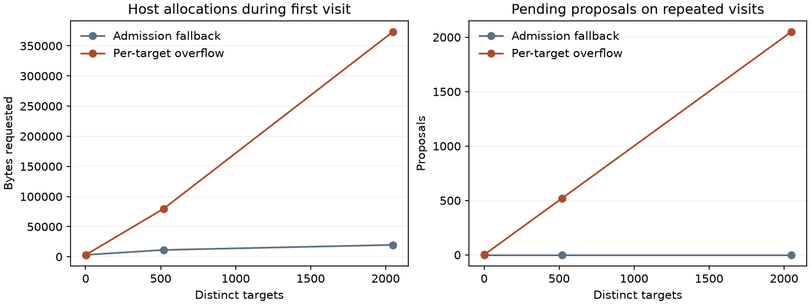

# Saturated old-epoch inbox experiment

A one-entry marking inbox can put a parked deletion producer back in charge of peer progress. The experimental patch at `003b650a` lets a registered numeric deletion enqueue a strong traversal past that limit and lets repeated visits to the same target recognize its committed traversal. With the producer stopped between commit and witness publication, the funded peer allocation and two fresh full cycles finished. Exact weak liveness and physical reclamation passed for managed and protected raw handles under both publication policies. Across four test families, 80 fresh processes passed 440 forced configurations. A frozen inbox with 520 targets also exercised publication across the 512-slot boundary.
[Experimental patch](candidate.patch.gz) · [Forced runs](forced.json.gz) · [Read-only audit](audit.json)

The counted-allocator fixture held collection stationary and revisited 2, 520 or 2,048 distinct mature targets eight times. Both revisions ran all cases under both publication policies. Sixty fresh native debug processes yielded 480 measured visits. The host allocations were outside the collector's managed byte count. At 2,048 targets, first-visit requests increased from 22 to 7,693 and bytes requested from 19,712 to 373,184 under both policies. Pending proposals stabilized at 2,049 on repeated visits. The managed byte count stayed constant throughout the visits. Final collection released the charge.

The experiment remains outside the shipping collector. A replacement must give a peer an independently discoverable way to finish or cancel the published work while bounding host memory as the number of distinct identities increases. The timing columns describe this debug fixture. Release performance for the overflow variant is unmeasured.
[Per-pass counters](passes.csv.gz) · [Medians](summary.csv) · [Fixture](fixture.rs.gz) · [Source and executable hashes](identity.json)

## Next experiment

**Hypothesis.** A fixed pending-bit word owned by an old collection epoch could cover a group of mature object IDs when the normal inbox is full. The identity index supplies an address hint. The helper must resolve the exact live ID at that address before tracing. Only an atomic change from an empty word to a permanently sealed word may close the receiver. When publication wins that race, a helper must claim the bit under the existing marking reservation before closure. A different ID group needs an explicit fallback.

The first test should fill the normal inbox, park the producer on each side of the overflow publication, and make a peer trace a detached child and grandchild. A pre-existing weak handle would itself be an old-generation root in this fixture. Observe exact birth identities and trace counters before creating a weak handle. Then test closure racing the final bit, a same-number replacement epoch, a group collision, and host allocations across repeated visits. This protocol has no implementation or qualification results.
