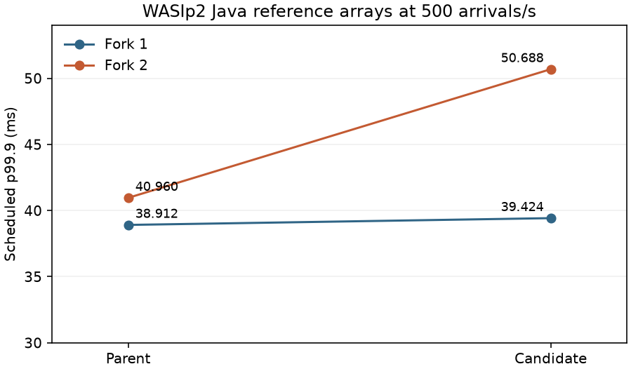

# Sustained workerless WASIp2 Java workload

The epoch-owned deletion revision `6f577187` missed the scheduled-latency gate against its immediate runtime parent `379ad59a`. Both runtimes served every arrival. The per-fork p99.9 median rose from 39.936 to 45.056 ms, a 12.8% increase against a 10% limit set before the runs. The earlier ten-second WASIp2 screen had passed. The two-minute result keeps WASIp2 latency open for the alpha.

| Revision | Fork 1 scheduled p99.9 | Fork 2 scheduled p99.9 | Arrivals completed per fork |
|---|---:|---:|---:|
| Parent | 38.912 ms | 40.960 ms | 60,000 / 60,000 |
| Candidate | 39.424 ms | 50.688 ms | 60,000 / 60,000 |

Each fresh process had ten seconds of warmup and 120 seconds of measurement. All used the same reference-array classfiles, Wasmtime 50.0.1, CPUs 8 and 10, a 64 MiB managed heap, a 512 MiB process limit and zero swap. The runtime and source hashes matched the frozen inputs. All four processes recorded zero CPU quota throttles and zero OOM kills. These four forks do not identify the cause of the tail difference.
[Predetermined limits](policy.json) · [Decision](result.json) · [Forks](wasi.csv) · [Hashes and configuration](wasi-inputs.json) · [Raw process results](wasi.jsonl.gz)

