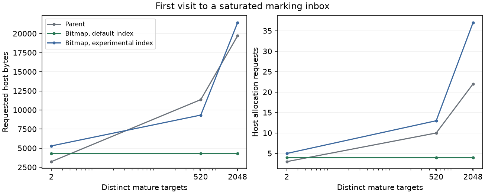
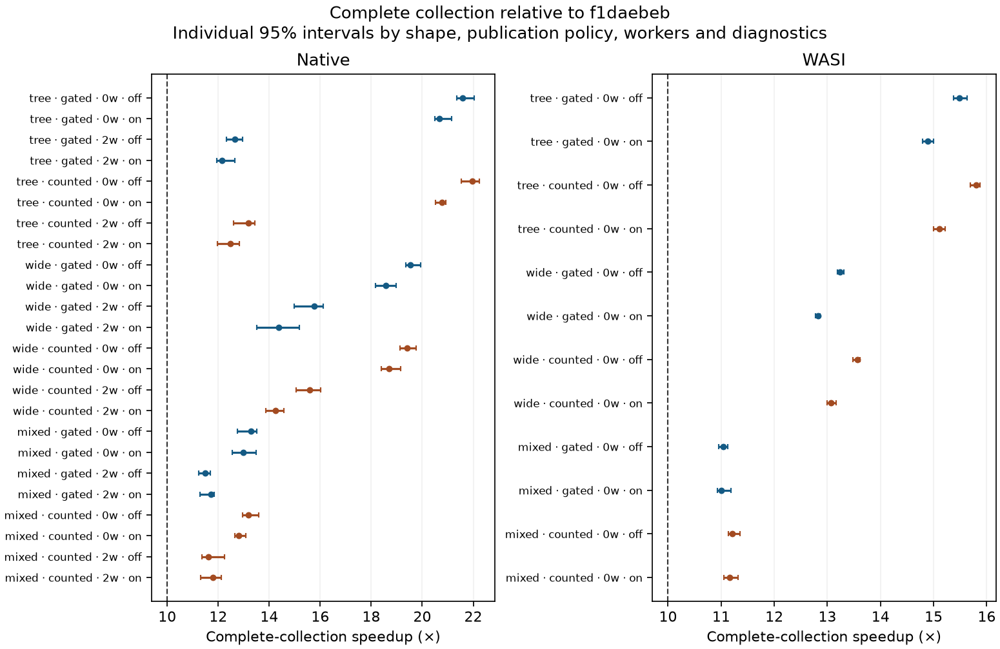
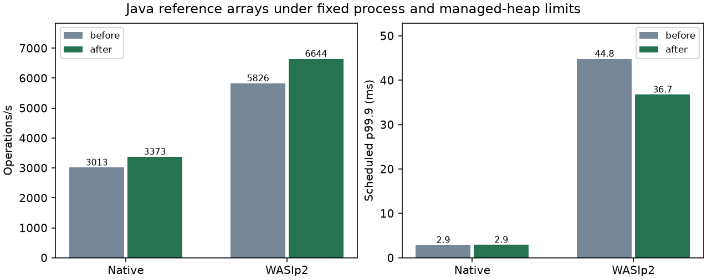
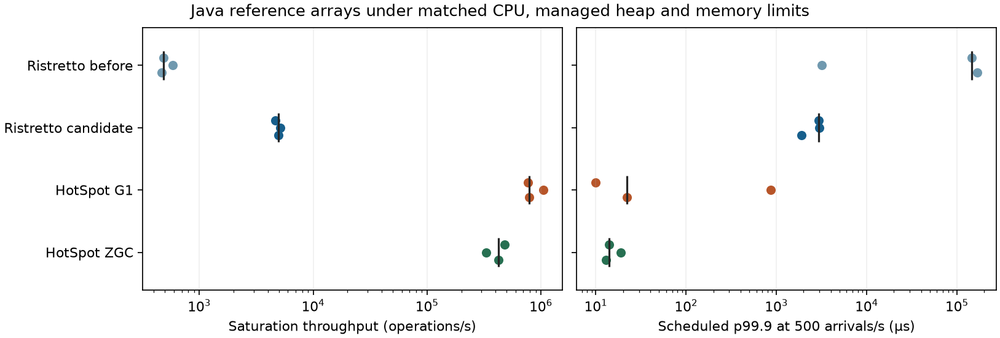

# Mature deletion under a saturated marking inbox

The alpha PR includes the mature deletion bitmap at `f462e61c`. It passed the complete-collection and whole-JVM regression screens. A producer parked on the 65th sparse identity group can still block its peers.
[Gate results](decision.json)

## Publication, tracing and progress

When the ordinary old-only strong marking inbox fills, a mature numeric deletion may publish its object ID in one of 64 groups, each holding 63 identity bits. Publication and sealing of an empty group contend on the same atomic word. The consumer claims a bit under marking admission, validates the exact live birth and transfers its graph traversal to the existing marking batch. Weak processing seals all groups before strong marking ends. A later old receiver is reconsidered after publication.

Both a funded peer allocation and two fresh full tickets completed while the producer stayed parked after successful publication, for managed and protected raw edges under both publication policies. A real Java-style edge deletion kept the detached child and its grandchild through the receiving old epoch. A matched control detached at idle was reclaimed in that epoch. In the following full collection both treatment identities disappeared. A mutation that marks the child but discards its traversal lost the grandchild in all 24 trials.

Parking a marking claimant after it cleared the bit and before it reserved its batch left the mark gate held, the child marked and its grandchild white. After 2,048 peer steps strong marking was still open. Resuming the claimant preserved the subgraph. The schedule passed under both publication policies in 24 fresh processes. A separate producer parked under fresh admission with **65 distinct pending identity groups** exhausted both peer budgets in all 96 cases. Resumption completed reclamation. Together these fixtures establish where progress still depends on a suspended thread.
[Randomized trials](validation/schedules.json.gz) · [Sparse schedule](validation/sparse.patch.gz) · [Mark claim interlock](validation/claim-gate.patch.gz) · [Discarded-traversal control](validation/no-traversal.patch.gz)

A [sparse overflow experiment](sparse-overflow/README.md) let both peers progress at 65 and 129 groups. Its per-target proposals raised host allocation requests to 361,936 bytes at 2,048 sparse targets. The PR retains the bitmap and the same-number epoch regression.

## Allocation cost

At 2,048 dense targets, the default identity index requested **4,288 bytes in 4 host allocations** on first visit, compared with 19,712 bytes in 22 on the shipping parent and 373,184 bytes in 7,693 on the earlier per-target experiment. The experimental index used 21,432 bytes in 37 requests. The bitmap requested zero bytes on the second and steady passes in both builds. On the default index, steady 2,048-target traversal in this debug fixture took 12.62 ms versus 5.94 ms. These are host allocator requests inside the fixture. The release throughput screens below use optimized binaries.
[960 visits](allocations/visits.csv) · [Instrumented fixture](allocations/fixture.rs.gz) · [Binary identities](allocations/identity.json) · [Earlier experiment](../epoch-visible-deletions/overflow/README.md)

## Complete collection

All 36 native and WASIp2 conditions cleared 10× versus `f1daebeb` across 2,304 processes. The lowest individual lower 95% speedup bounds were 11.228× native and 10.934× WASIp2.
[All conditions](cycles/complete-cycles.csv) · [Artifact hashes and policy](cycles/provenance.json)

## Whole-JVM release screens

The reference-array workload used identical class files, a 64 MiB managed heap, two CPUs and a 512 MiB process memory limit. The short screen measured three ten-second forks per arm and rate. The sustained screen measured two two-minute forks per arm at 500 arrivals/s. The p99.9 includes time waiting from the scheduled arrival. Each screen uses its own interleaved control and CPU pair. Other qualification work on the host used separate affinity sets for the timed runs.

| Screen | Reference | Candidate | Candidate / reference | Gate |
|---|---:|---:|---:|---|
| Native short capacity, ops/s | 3,013 | 3,373 | 1.120 | pass |
| WASIp2 short capacity, ops/s | 5,826 | 6,644 | 1.140 | pass |
| Native sustained p99.9, ms | 2.864 | 2.896 | 1.011 | pass |
| WASIp2 sustained p99.9, ms | 44.800 | 36.736 | 0.820 | pass |

Both capacity floors are 0.95. Sustained p99.9 must be at most 1.10 times its control with 60,000 completions per fork and no OOM kills. Short native, short WASIp2 and sustained native use the previous runtime at `6f577187`. Sustained WASIp2 uses `379ad59a`, the reference from the previous failed WASIp2 gate.
[Native and WASI screen policy](java/policy.json) · [Native sustained forks](java/long-java.csv) · [WASIp2 sustained forks](wasi-sustained/wasi.csv) · [WASIp2 sustained decision](wasi-sustained/result.json)

In a separate matched native run, median saturation was 4,970 ops/s for this candidate, 486 for the original alpha, 788,498 for G1 and 421,540 for ZGC. Per-fork latency, completions and process outcomes are retained alongside throughput.
[HotSpot comparison](hotspot/forks.csv) · [Input identity](hotspot/provenance.json)

## Shipping collector identity

The normalized GC package matched all 136 tracked Rust source and example files. All 21 workspace and 59 release launcher graphs resolved the single collector. The native interpreted, native compiled and WASIp2 Java graph returned 64 and cleared two weak witnesses. The GC and class loader suites passed 1,844 tests native and 1,241 on WASIp2, including doctests. Both strict Clippy runs passed. Each of three fresh production Chromium workers completed 13 guest collections, reclaimed 10,473,075 managed bytes and answered all worker pings. Nine separate Rust/Chromium trials served 4,000/4,000 arrivals each. Global pause duration was unmeasured.
[Cargo package](validation/package-receipt.json) · [Launcher checks](validation/launcher-graphs.log.gz) · [Test counts](validation/suites.json) · [Production Chromium](browser/worker.json) · [Independent publication audit](validation/post-short.json)

The [playground packaging control](browser/artifact-paths/README.md) verified the merged release build with stale files in the checkout and a custom Cargo target directory. The WASI command passed on all five JDKs.
