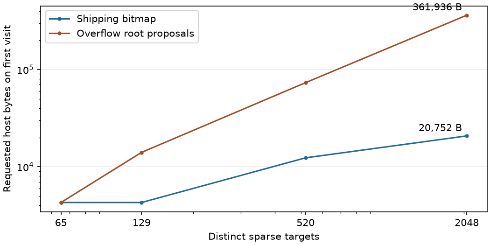

# Sparse overflow experiment

An experimental change to the same collector used its existing epoch root proposal when a mature deletion exceeded the 64-group bitmap. The producer linked an exact birth descriptor and committed its traversal before publishing a witness. An incomplete record could be cancelled and retried under fresh admission. The experiment remains outside the alpha PR because of the first-visit cost for sparse workloads.

At 65 and 129 pending identity groups a parked producer allowed a peer to finish both a fresh full collection and a funded allocation within 2,048 polls. The post-commit schedule passed all 192 combinations of fork, group count, publication policy and managed or protected raw access. In a second 96 cases, the peer cancelled the pending proposal before commit, finished both operations, and the resumed producer took the ordinary shading path. The exact weak witness and physical reclamation checks passed after resumption in both fixtures.
[Candidate patch against f462e61c](candidate.patch.gz) · [After-commit schedule](post-commit.patch.gz) · [Before-commit schedule](pre-commit.patch.gz) · [Cancellation outcomes](sparse-cancel-progress.json)

The allocator fixture consumed 64 unused identity numbers between adjacent real objects. Each process made eight passes over its targets. The first target enters the regular inbox. With 65 total targets, the remaining 64 fit in the bitmap. When 2,048 targets were spread across distinct groups, the default index with gated publication requested 361,936 bytes in 7,438 allocations on first visit, versus 20,752 bytes in 23 allocations on the shipping bitmap. The experiment left 1,984 ordinary proposals pending versus one on the shipping version. The measured managed charge stayed constant during publication. Counts are medians across three fresh processes for each policy and size.
[All 384 visits](visits.csv) · [Fixture](allocator-fixture.rs.gz) · [Inputs](identity.json)

The read-only audit raised a same-number epoch replacement with an untouched witness slot. The shipping regression now parks an old writer after it validates its epoch, replaces the epoch, then resumes it with and without an intervening new mark. The old strong witness stays invisible in the new epoch, and a subsequent new mark succeeds. Removing the owning-epoch identity check made the test expose the old strong witness. The experimental GC passed all 661 native unit tests and strict Clippy.
[Audit](audit.json) · [Witness regression](same-number.log.gz) · [Broken identity comparison](stale-witness.patch.gz) · [Failing control](stale-witness.log.gz)

A remaining design obligation is to publish discoverable traversal for arbitrary sparse identities while bounding both helper work and host allocation. The measurements above rule out an ordinary per-target proposal as a cheap general fallback.
