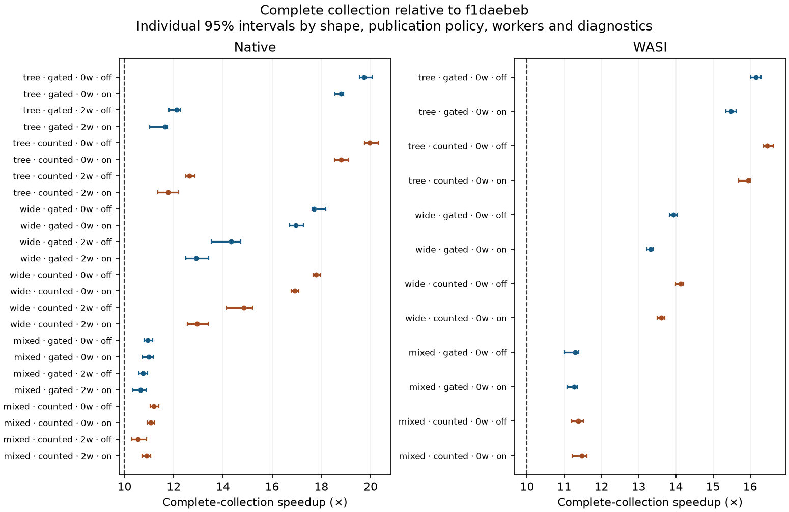
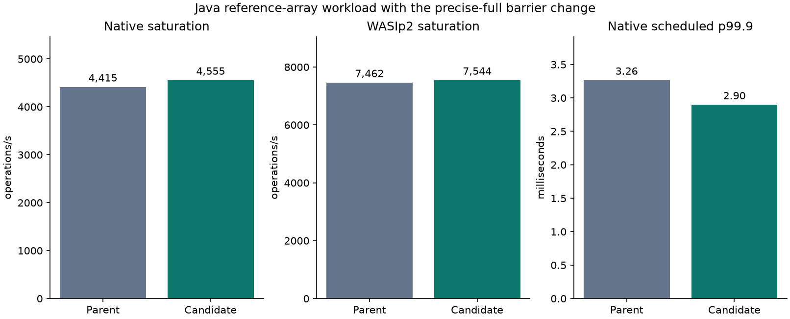

# Numeric deletion barriers during precise full marking

The measured change at `2c93df61` is **qualified for the consolidated alpha PR**. The parent is
`f97f8a99`. During a precise full collection with the old-generation interval
set to four, both a funded peer allocation and a fresh full ticket completed
within 2,048 polls while a registered context flusher was suspended. On the
parent, each operation exhausted its budget under both publication policies.

A same-heap numeric edge is resolved by its exact address and object identity.
For an unsafe raw wrapper, the caller must keep the original allocation live
until the barrier captures its descriptor. A proposal binds to the precise
full collection's queue before its epoch and phase are revalidated. A consumer
can cancel a pending proposal. The producer then takes fresh publication
admission and routes the deletion to the receiving domains. The registered
edge and protected raw paths share this logic on native and WebAssembly.

The progress suite repeated 26 configurations in each of 30 rounds. It includes
both publication policies, an intervening old-only cycle while the producer
is suspended, exact descriptor checks, weak identity and physical reclamation.
The read-only auditor flagged the liveness check on the admitted fallback.
The first check in `barrier_inner` rejects a retired birth, the queue's old-only
flag is immutable, and the resubmission test exercises consumer cancellation.
[Parent control](../README.md#a-parked-flusher-on-heaps-configured-for-old-only-passes) · [780 schedules](validation/schedules.json.gz) · [Audit](validation/audit.json)

## Remaining old-only stall

With a genuinely promoted, initially white child, a true old-only pass kept one
exact context record outstanding. Suspending its flusher after claiming it
blocked both the fresh full ticket and the funded allocation for 2,048 polls.
All 96 configurations reproduced the stall across managed and protected raw
edges and both publication policies. The rooted parent preserved the exact
child, and after release the test reclaimed all managed bytes. A weak witness
installed before the old pass pre-marks its referent, so this control installs
the witness after checking the stall.
[Probe against the measured source](mature-control/test.patch.gz) · [Output](mature-control/test.log.gz) · [All repetitions](mature-control/repeated.json.gz)

## Complete collection

All 36 established graph, publication, diagnostics and worker configurations
passed the 10× target against `f1daebeb`. The lowest individual 95% bounds
were **10.304× native** and **11.004× WASIp2** across 2,304 fresh processes.
[Every condition](cycles/complete-cycles.csv) · [Frozen inputs](cycles/provenance.json)

## Whole JVM

The reference-array benchmark used a 64 MiB managed heap, two CPUs and a
512 MiB process limit. Each short arm ran three fresh forks per rate. The
two-minute run used two forks per revision at 500 scheduled arrivals/s.
The WASIp2 interpreter ran with zero background workers. Scheduled p99.9
is the median of the individual forks and includes queueing delay.
Capacity is the median from independent saturation forks.

| Experiment | Revision | Ops/s | Scheduled p99.9 ms | Scheduled completions by fork | Failed forks |
|---|---|---:|---:|---|---:|
| Native, 10 s | Parent | 4,415 | 2.688 | 5000 / 5000 / 5000 | 0 |
| Native, 10 s | Candidate | 4,555 | 2.720 | 5000 / 5000 / 5000 | 0 |
| WASIp2, 10 s | Parent | 7,462 | 37.376 | 5000 / 5000 / 5000 | 0 |
| WASIp2, 10 s | Candidate | 7,544 | 36.352 | 5000 / 5000 / 5000 | 0 |
| Native, 120 s | Parent | — | 3.264 | 60000 / 60000 | 0 |
| Native, 120 s | Candidate | — | 2.896 | 60000 / 60000 | 0 |

The native capacity ratio was 1.032 and the
native two-minute p99.9 ratio was 0.887.
Their declared limits were 0.95 minimum and 1.10 maximum respectively.
WASIp2 capacity was 1.011 times the parent's.
The direct baseline, G1 and ZGC comparisons for the parent are available
in the [parent report](../README.md#direct-native-comparison-with-the-original-pr-baseline).
[Policy](jvm/policy.json) · [Native decision](jvm/decision.json) · [Measured medians](jvm/metrics.json) · [Native short](jvm/short-java.csv) · [Native sustained](jvm/long-java.csv) · [WASIp2 short](jvm/wasi.csv)

## Runtime and package checks

The GC and class loader suites passed 1,837 native
tests and 1,237 WASIp2 tests, with
15 and 9 ignored respectively.
Strict Clippy passed on both. Cargo verified the GC package and the normalized
native and WASIp2 consumers. The 21 workspace graphs and all 59 release
launcher graphs resolved the same collector. The native interpreter, native JIT
and WASIp2 interpreter returned 64 on the Java graph and cleared both exact
weak witnesses. Each ordinary Java workload completed 8,192 allocations.
All nine Chromium forks served 4,000/4,000 arrivals. The three candidate
request-turn p99.9 values were 55, 66 and 66 µs. This is a short, main-thread
Rust collector measurement.
[Suite counts](validation/suites.json) · [Shipping graphs](validation/graphs.log.gz) · [Launcher graphs](validation/launcher-graphs.log.gz) · [Compiled tier](validation/native-compiled.json) · [Chromium forks](browser/REPORT.md)
