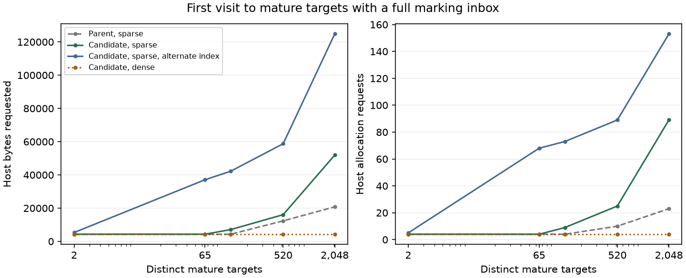
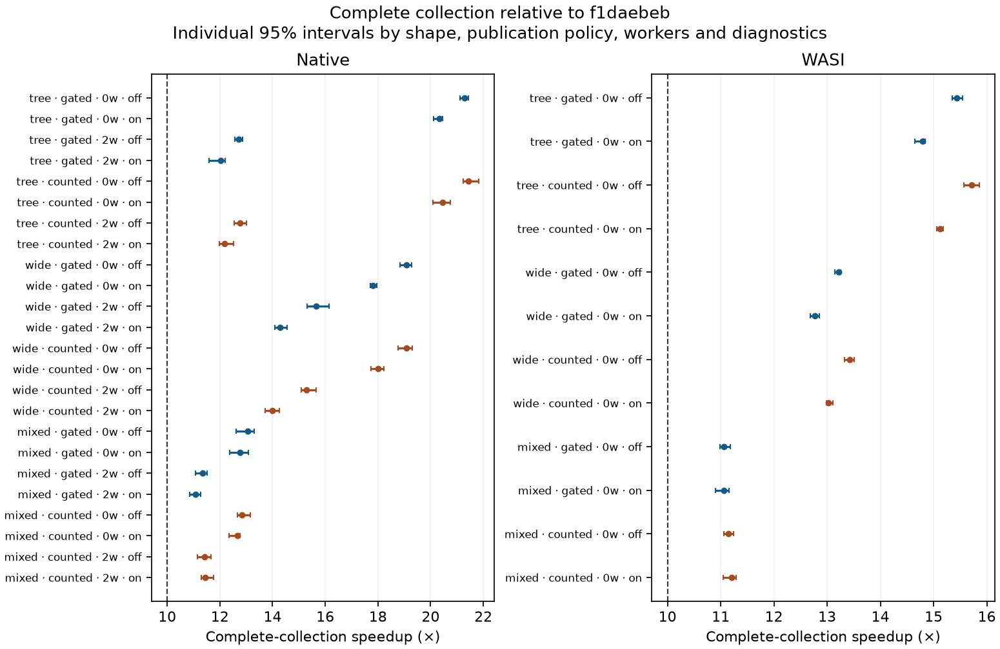
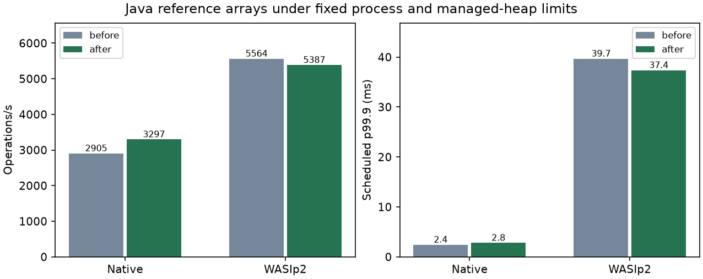
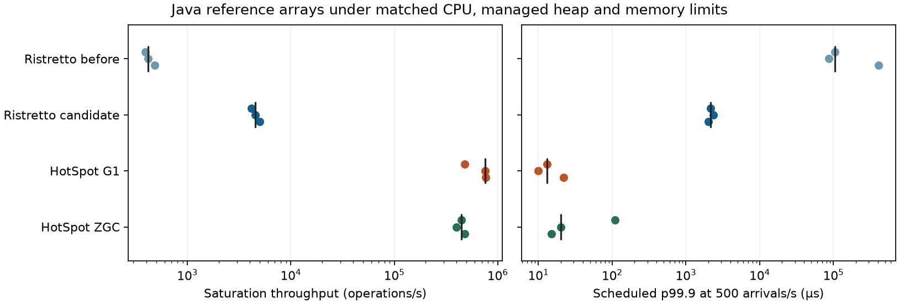

# Mature deletions across sparse object identities

**Withhold the sparse spill. The production PR keeps the dense bitmap from f462e61c. [Candidate diff against dd8c2f98](candidate.patch.gz)** The candidate uses the existing JVM collector. The measurements below describe the archived candidate.
[Gate decisions](decision.json) · [Thresholds fixed before measuring](java/policy.json)

## Suspended publishers and claimants

A promoted target whose ordinary marking inbox is full can publish a deletion in a dense group of 63 IDs. Once all 64 groups belong to other IDs, the candidate stores each additional ID in a 59-slot page. Four child links route by successive pairs of identity bits. Each installed ID is permanent for that epoch. Publication sets the target bit and then each ancestor bit, including on duplicates. The root accepts the publication only while open. A helper consumes the parent bit before descending and restores it if the child still holds work. The marker rechecks the exact identity and live birth before scheduling traversal. Shutdown tombstones empty links before unlinking their parent.

A producer parked after publishing the 129th distinct group allowed a funded allocation and two fresh full tickets to finish. This held for managed and protected raw edges under both publication policies. The shipping parent exhausted the allocation and ticket budgets at 65 groups under all four configurations in 24 fresh processes. A separate old-generation collection retained a detached child and its grandchild while reclaiming an idle-detached control. The following full collection reclaimed the treatment. Suppressing traversal after marking the child lost the grandchild in 24/24 negative trials. Across both identity index configurations, the six candidate schedules ran in 288 fresh processes.
[Randomized schedules and binary hashes](validation/schedules.json.gz) · [Discarded traversal](validation/no-traversal.patch.gz) · [Mutation results](validation/no-traversal.json)

A marker parked after taking the **exact treatment child** but before reserving its traversal still held the marking reader. The child was physically marked, its grandchild was white, and in-flight work counted zero. In the funded variant, 2,048 mutator turns left the requested full ticket and asynchronous allocation incomplete. Resumption let both finish. This reproduced for dense and sparse targets, both publication policies, and both identity indexes. The 96 processes cover 384 schedules, half with the funding request. The two-stage experiment without the request checked that resumption retained the subgraph for precisely its receiving epoch.
[Exact-claim fixture](validation/claim-exact.patch.gz) · [Per-process observations](validation/claim-exact-results.json.gz)

The focused Loom model allowed the collector to close over a completed publication when the producer skipped a same-value parent RMW. The unconditional acquire-release RMW passed the same model. Antigravity Neon independently identified the missing synchronization edge. The CLI rejected Carbon at xhigh, and its high-effort retry timed out. Antigravity also lacked command approval for the additional disposal test. The native and WASIp2 receipts record the direct Cargo executions.
[Model fixture](validation/hint-model.rs.gz) · [Failing weakened ordering](validation/model-skip.log.gz) · [Passing model](validation/model-positive.log.gz) · [Auditor responses](validation/audits.json)

A separate design model explored a potential handoff that publishes an exact ID before clearing its source. Selecting one of two lanes by ID parity preserves all 64 identity bits. In the one-target model a peer could finish an occupied lane after sealing the source. Reversing publication and source removal let a peer close over the untraced target. Integration still needs exact-epoch admission, fair discovery alongside ordinary marking, safe handling of sibling bits, and the existing cross-generation callback interlock. The model assumes a stable target and excludes actual Java or Rust callbacks.
[Experimental model](validation/transfer-model.rs.gz) · [Passing schedules](validation/transfer-model.log.gz) · [Rejected ordering](validation/transfer-model-early.log.gz)

A five-page fixture, with its epoch pinned, released one populated page per foreground collector turn. Explicit stop drained a detached epoch. Dropping the last heap owner drained a still-installed epoch even though its weak collector reference could no longer be upgraded. Both modes passed on native and WASIp2. A separate native test parked the first installer for a child page and confirmed that resumption could not regrow the unlinked parent. [Parked child installer](validation/child-installer.log.gz) · [Shutdown and installer test additions against c051ed39](validation/disposal-tests.patch.gz).
[Native integration tests](validation/native-disposal-suite.log.gz) · [WASIp2 integration tests](validation/wasi-disposal-suite.log.gz)

## Cost of publishing 2,048 deletions

| Index and spacing | Parent first visit, bytes / requests | Candidate first visit, bytes / requests |
|---|---:|---:|
| Default, dense | 4,288 / 4 | 4,304 / 4 |
| Default, sparse | 20,752 / 23 | 51,904 / 89 |
| Experimental, dense | 21,432 / 37 | 21,448 / 37 |
| Experimental, sparse | 53,520 / 87 | 124,792 / 153 |

For all 2,048-target repetitions the second and later candidate visits made zero host allocation requests. At smaller sizes some second visits allocated. All steady sparse visits used zero allocations. The ordinary inbox held one proposal after each candidate visit. The earlier per-target sparse fallback requested 361,936 bytes in 7,438 allocations on the default index. Under the default index and legacy publication policy, median steady sparse visit time in this debug fixture increased from 5.64 ms to 28.09 ms. The optimized JVM capacity and latency runs below measure the cost at the application boundary.
[3,200 allocator samples](allocations/visits.csv) · [Group medians](allocations/summary.csv) · [Fixture](allocations/fixture.rs.gz) · [Binary identities](allocations/identity.json)

Two follow-up lookup optimizations missed the predeclared timing screen. Bounding sparse-page searches reduced the steady 2,048-target visit time by 16–18% across the two publication policies. [Interleaved comparisons and patches](lookup-cost/README.md).

## Complete collection and whole-JVM screens

All 36 complete-collection conditions cleared 10× versus `f1daebeb` across 2,304 processes. The lowest individual lower 95% bounds were 10.849× native and 10.906× WASIp2. These numbers cover the collection driver.
[All conditions](cycles/complete-cycles.csv) · [Provenance](cycles/provenance.json)

The Java reference-array workload used a 64 MiB managed heap, two CPUs and a 512 MiB process limit. Each capacity screen had three ten-second forks per arm and rate. Each sustained screen had two two-minute forks per arm at 500 arrivals/s. Each pair compares against `f462e61c`. Scheduled p99.9 includes waiting from the offered arrival time.

| JVM screen | Parent | Candidate | Ratio | Limit |
|---|---:|---:|---:|---:|
| Native saturation, ops/s | 2,905 | 3,297 | 1.135 | ≥0.95 |
| WASIp2 saturation, ops/s | 5,564 | 5,387 | 0.968 | ≥0.95 |
| Native scheduled p99.9, ms | 2.432 | 2.800 | 1.151 | ≤1.10 |
| WASIp2 scheduled p99.9, ms | 39.680 | 37.376 | 0.942 | ≤1.10 |

Sustained candidate completions were [60000, 60000] on native and [60000, 60000] on WASIp2, out of 60,000 per fork. Both short candidate arms completed all 5,000 scheduled arrivals per fork. The long runs recorded 0 candidate OOM kills.
[Short native forks](java/short-java.csv) · [Short WASIp2 forks](java/wasi.csv) · [Sustained native forks](java/long-java.csv) · [Sustained WASIp2 forks](wasi-sustained/wasi.csv)

The separate matched native JVM comparison measured median saturation of **4,534 ops/s** for this revision, 414 for the original alpha, 752,955 for G1 and 445,620 for ZGC. The 10× collection-driver result therefore coexists with a substantial whole-JVM throughput gap.
[All direct comparison forks](hotspot/forks.csv) · [Binary and class file provenance](hotspot/provenance.json)

## Shipping identity and coverage

The collector package verified and matched all 138 tracked Rust source and example files. The 21 workspace and 59 release-launcher dependency graphs resolved the single collector. The normalized native and WASIp2 consumers passed. Native interpreted, native compiled and WASIp2 Java each returned 64 and cleared two weak witnesses. The GC and class loader passed 1,848 tests on native and 1,242 on WASIp2, including doctests. Strict Clippy passed on both. The production WASI launcher ran Java 8, 11, 17, 21 and 25 with an external Cargo target directory. Each of three fresh Chromium Java workers completed 13 collections, reclaimed 10,473,075 managed bytes and answered all worker pings. Nine separate Rust Chromium trials also passed. Global pause duration and endurance remain unqualified.
[Archive identity](validation/package-receipt.json) · [Release launcher graphs](validation/launcher-graphs.log.gz) · [Suite totals](validation/suites.json) · [Production browser and WASI evidence](browser/production.json)
