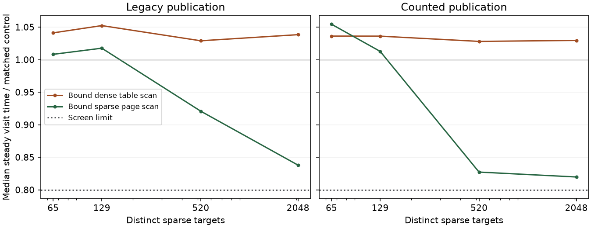

# Bounding unsuccessful lookups

Two follow-ups independently tried to reduce the cost of searching for a mature target once a table had filled. Each records the maximum distance from the home slot after a successful insertion. Once all installers have reported, an unsuccessful search may stop there. An installer suspended between the tag CAS and reporting leaves the original full search available. The first variant changes the 64 dense groups. The second changes only the 59 slots in each sparse page.

Each variant ran against its own interleaved control built from `c051ed39`, on the same two CPUs, with five process forks per configuration. Each comparison sampled 1,280 visits in 160 native debug processes. All steady visits requested zero allocations. At 2,048 sparse targets the first variant took **1.038×** and **1.030×** the control time on the legacy and counted policies. The second took **0.838×** and **0.820×**. Both missed the predeclared 0.80 screen and were withheld. These ratios measure instrumented barrier visits. Neither follow-up ran the two-minute Java or 36-condition complete-collection qualification.

[Dense variant medians](probe/trial.json) · [Dense raw samples](probe/visits.csv.gz) · [Sparse variant medians](page-probe/trial.json) · [Sparse raw samples](page-probe/visits.csv.gz) · [Screen policy](page-probe/policy.json) · [Antigravity ordering reviews](audits.json)

To reproduce, apply the [sparse candidate](../candidate.patch.gz) to `dd8c2f98`, the [test additions](../validation/disposal-tests.patch.gz), and either the [dense patch](probe/candidate.patch.gz) or [sparse patch](page-probe/candidate.patch.gz). Both passed the targeted native tests and strict all-feature Clippy. The [allocator fixture](../allocations/fixture.rs.gz) records the visits.
