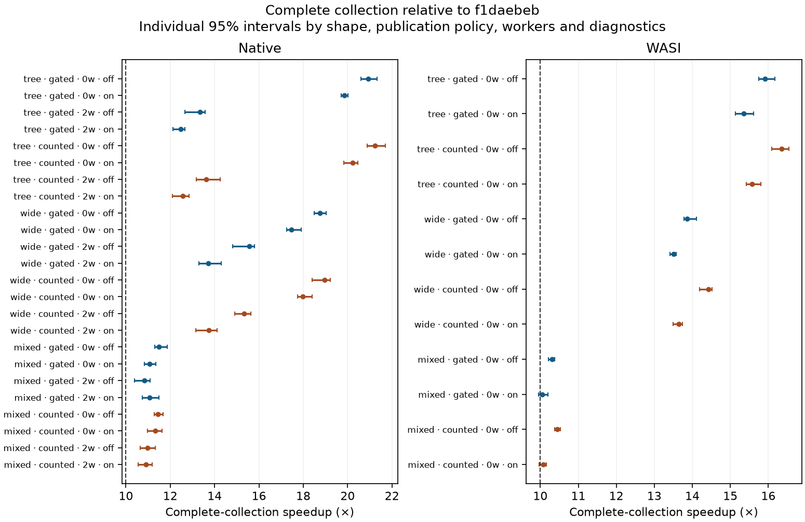
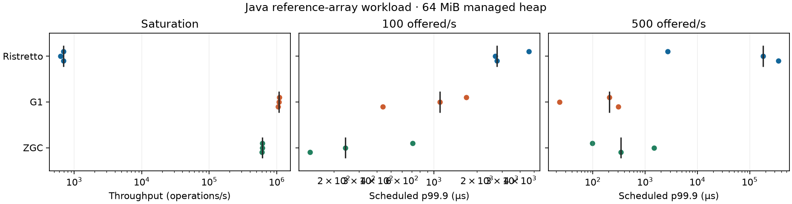

# Reference-array reclamation on the shared JVM heap

An escaping Java `Object[4097]` exhausted the 64 MiB heap after 401 completed
allocations at `41aae6ea`. At `f4cdf10f`, the same program finished 8,192
allocations on native debug, native release and WASI. It rotated 32 arrays,
stored the same marker at both ends, and made no explicit collection requests.
The interpreter and native JIT used the production JVM collector.
[Original Java source and control](../root-handoff-and-array-progress/README.md) ·
[Builds, runtime counters and functional checks](logical/validation.json).

## Physical and managed space

1. The parent cleared array elements across full collections. Its destroyed
   byte count rose from 2,396,704 to 5,262,880 while its returned-range counter
   stayed at 93,374. At `b9d5e953`, a partially destroyed regional buffer
   could return its destroyed suffix while its live prefix remained at its
   original address. A busy registry or free-range index left both ownership
   and accounting intact. The range-reuse regression passed in 100 fresh
   processes. [Parent trace](physical/parent-physical-progress.log.gz) ·
   [Range reuse](physical/reuse-processes.jsonl.gz).
2. That change completed the 1,024-allocation reproducer on native and WASI.
   All nine longer Ristretto comparison forks still raised Java heap OOM.
   In a separate instrumented run, one allocation requested 131,400 bytes
   with only 101,792 bytes of managed headroom. The allocator held no managed
   guard. [Longer reproductions](physical/longer-witnesses.jsonl.gz) ·
   [Allocation trace](physical/managed-pressure.log.gz) ·
   [All Java forks](physical/java/processes.csv).
3. At `f4cdf10f`, actual partial returns can buy additional collection retries
   while the remaining prefix retains its entire managed charge. Each waiter
   limits these extensions to one starting heap footprint. The allocator
   still needs an ordinary reservation. Tests on both targets covered
   all-live exhaustion, relocation storage and suffixes that never produce
   managed headroom. Miri exercised both the retry budget and the ownership
   of the retained prefix. [Validation](logical/validation.json).

## Complete collection

The control is `f1daebeb`. Each matrix uses 36 conditions, three graph shapes,
4,095 nodes, 16 collections per process and 2,304 fresh processes. Intervals
are individual paired 95% intervals. The native and WASI results measure a
whole collector cycle. The Java workload below measures the application.

| Revision | Lowest native 95% bound | Lowest WASI 95% bound |
| --- | ---: | ---: |
| Physical suffix return, `b9d5e953` | 11.20× | 10.60× |
| Bounded managed-space retry, `f4cdf10f` | 10.92× | 10.50× |

These paired screens overlapped other host work. They used fixed affinities,
frozen executables, identical compiler controls and the same published
baseline. [Physical results](physical/cycles/complete-cycles.csv) ·
[Managed retry results](logical/cycles/complete-cycles.csv).

A second matrix ran the frozen native and WASI executables sequentially
after all builds, tests and Java comparison forks had completed. 34 of 36
individual lower bounds exceeded 10×. The lowest was 10.39× on native
and 9.95× on WASI. [All conditions](logical/serial-cycles/complete-cycles.csv) ·
[Binary and compiler provenance](logical/serial-cycles/provenance.json).

## Whole-JVM progress

All 27 Java processes completed at `f4cdf10f`, including all nine Ristretto
forks. All three runtimes finished every scheduled operation at 100 and 500
arrivals/s. In a separate two-minute run at 100 arrivals/s, each runtime
finished all 12,000 operations. Both screens used JDK 25, a 64 MiB heap,
two CPUs and a 512 MiB cgroup per runtime. They ran concurrently on disjoint
CPU affinities. The earlier physical-only revision raised Java heap OOM in
both screens. [All 27 short processes](logical/functional-java/processes.csv) ·
[Two-minute measurements](logical/two-minute/processes.jsonl.gz) ·
[Two-minute schedule](logical/two-minute/schedule.json).

## Isolated JVM timing

The follow-up kept the release binary, Java classfiles, heap, cgroup, CPU
affinity, warmup and measurement length from the three-fork functional
screen. A new seeded schedule ran the 27 processes sequentially after the
other workloads and builds had completed. Each cell is the median of three
fresh processes. The scheduled latencies include backlog.

| Reference-array workload | Ristretto | G1 | ZGC |
| --- | ---: | ---: | ---: |
| Saturation throughput, operations/s | 689 | 1,077,864 | 609,591 |
| Scheduled p99.9 at 100 arrivals/s, µs | 2,752 | 1,104 | 241 |
| Scheduled p99.9 at 500 arrivals/s, µs | 180,224 | 207 | 343 |

All 27 JVMs exited successfully. All scheduled work finished. [Raw forks](logical/java/processes.csv) ·
[Build and fixture identity](logical/java/provenance.json).

## Sweep accounting experiment

A follow-up candidate summed the exact managed charges while removing
unmarked descriptors, eliminating a second pass over each retired prefix.
The mixed-size, marked-survivor and accounting checks passed on native and
WASI. In a direct comparison with the shipping runtime, the 95% intervals for
the change in elapsed time included 1.0 in both diagnostic-enabled WASI
conditions. Across the full matrix against `f1daebeb`, the lowest individual
95% bound was 10.53× native and 9.87× WASI. The candidate was withheld.
[Candidate patch](sweep-charge-experiment/candidate.patch.gz) ·
[All matrix conditions](sweep-charge-experiment/cycles/complete-cycles.csv) ·
[512 paired-comparison processes](sweep-charge-experiment/wasm-candidate-vs-shipping.jsonl.gz) ·
[Tests, audit and intervals](sweep-charge-experiment/validation.json).

A separate Wasmtime guest profile of the shipping runtime retained 3,680
periodic samples. Of 302 stacks containing `collect_full` or `step_inner`,
38 had `record_step` as their innermost collector symbol and 32 had
`sweep_unit`. The profile covers the entire fixture, including warmup and
teardown. It identifies places to investigate with the uninstrumented
comparison. [Profile and grouping](sweep-charge-experiment/wasm-profile.json) ·
[Sample stacks](sweep-charge-experiment/wasm-samples.json.gz).

## Shared-heap release checks

All 14 shipping dependency graphs resolved one `ristretto_gc`. The external
native VM/JIT and WASI VM consumers built from the normalized Cargo packages.
On both platforms the preview required the JVM and Java to agree on two nodes'
identity, contents and reclamation. The native compiled tier executed the
method under test. The two native previews refunded 768 bytes each and WASI
refunded 480 bytes. The native GC suite passed 1,024 tests with one ignored
and WASI passed 462. Strict Clippy passed on both targets. [Receipts](logical/validation.json).

The load screens establish progress for these workloads. The alpha still
needs stronger whole-JVM throughput, scheduled p99.9 and p99.99 latency,
and evidence of continued progress for each remaining global contention case
and Wasm host turn. [Release criteria](../../../../../../ristretto_gc/PLAN.md#success-criteria).

The release verifier at `b72fdcdd` also rejects the retired restricted VM
inside its original Rust module paths. A negative control restored the
historical unreferenced `src/canonical/compiled_heap.rs` from Git. The
previous workspace source check accepted it. Both the updated workspace
check and the unpacked WASI VM consumer rejected the restored module.
The unchanged source layout passed all 14 shipping graphs, 12 release-tool
tests and both external consumer builds. [Release and negative-control receipts](shipping.json).
