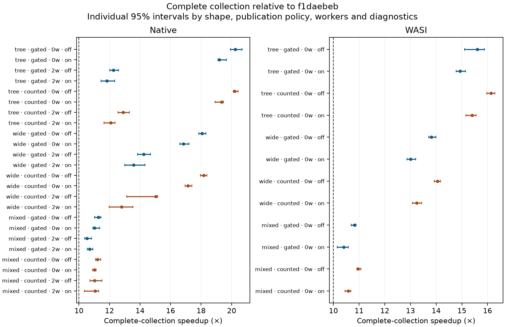
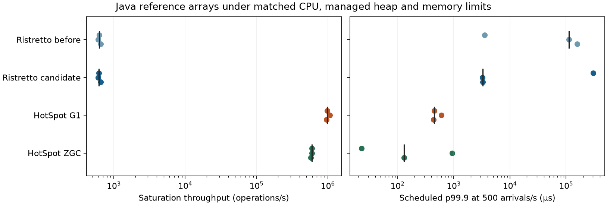

# Returning from a mark step while its child's object shard is held

A Rust payload on the managed heap can contain a `GcRootGuard` that holds its own root. During ordinary marking, tracing the guard resolves its address and birth identity. At `f72a6053` this operation waited for the target object's shard. It also ignored the supplied identity on this path. The test suspended a real parent callback, acquired its child's shard, and let the callback continue. With both publication policies and both marking modes, its assisting step returned only after the shard was released. Supplying the child's identity with an unrelated object's address also retained the unrelated object through that full collection. [Test applied to the parent](control.patch.gz) · [Four observed failures](control.log.gz).

At `46d0afec` the collector resolves a nonzero identity before observing publication visibility. It holds an owning descriptor while checking that the birth is live and applying the existing marking barrier. The unsafe raw-pointer API still requires its caller to keep the original typed allocation live. A trace outside a reserved callback uses the epoch proposal. Old-only collection retains publication admission throughout its cross-generation handoff.

In all 400 parked-shard schedules the assisting step returned before the shard was released, the rooted child survived with its original identity and value, and the unrelated object cleared in the requested full cycle. A separate 200 schedules checked that a stale ID leaves a pending publication on its first attempt. Another 200 checked that a raw handle protected by its rooted owner can mark the child during a young cycle while full sweep prevents resurrection of a logically dead birth. The four-way parked test releases the shard before testing full-ticket completion. [All 300 process receipts](schedules.jsonl.gz).

## Collection and integration

The read-only Neon audit identified two lifetime requirements for address reuse. Nonzero identities must remain unique, and a raw pointer's original owner must remain live. The identity allocator rejects exhaustion without wrapping and never reuses abandoned ranges. Both tests passed on native and WASI, along with the live raw-owner test. The installed Carbon CLI rejected xhigh and reached its high-effort print timeout. [Audit response and tests](validation.json).

Across 2,304 fresh processes, all 36 established complete-collection conditions cleared 10× relative to `f1daebeb`. The lowest individual paired 95% bounds were **10.361× native** and **10.154× WASI**. [Per-condition speedups](cycles/complete-cycles.csv) · [Build identities and settings](cycles/provenance.json).

Native passed 1,037 tests with one ignored, WASI passed 470, and the pending-birth and overlapping-sweep tests each passed under Miri. An initial reused Miri target selected zero tests. The reported runs used a fresh target and verified both test names. Strict Clippy passed for both targets. All 14 shipping dependency graphs resolved to the same collector, both external Cargo consumers built, and the 64 MiB ordinary Java array reproducer completed 8,192 allocations on both targets. Native interpreted, native compiled and WASI Java previews each cleared both weak witnesses and refunded the managed bytes. [Verification receipts](validation.json).

At 2,000 arrivals/s on the Chromium main thread, two candidate forks finished all 4,000 arrivals and one finished 3,999. Candidate p99.9 request-turn work ranged from 46 to 55 µs. The maximum heartbeat gap was 10.0 ms. One unfinished arrival is excluded from its fork's completed-request latency distribution. The scheduled Java workload uses an old-collection interval of four. The reproduced shard wait used the default interval of zero. [Chromium measurements](browser/REPORT.md) · [Graph](browser/browser.png).

## Java reference-array comparison

The native JVM ran the same reference-array classfiles under a 64 MiB managed heap, a 512 MiB cgroup limit and two CPUs. Each of the four runtimes ran three independent ten-second saturation forks and three forks at 500 scheduled arrivals/s. All 24 forks completed. The table gives medians across forks. [Per-fork measurements](java/forks.csv) · [Binary and classfile identities](java/provenance.json).

| JVM | Saturation (operations/s) | Scheduled p99.9 (ms) | Scheduled p99.99 (ms) |
| --- | ---: | ---: | ---: |
| Ristretto before | 626 | 111.616 | 115.712 |
| Ristretto at `46d0afec` | 613 | 3.264 | 4.288 |
| HotSpot G1 | 980,468 | 0.448 | 1.824 |
| HotSpot ZGC | 596,331 | 0.131 | 0.917 |

The short scheduled tails vary substantially between runs. At the preceding revision a separate two-minute run measured 4.480 ms at p99.99. This screen does not attribute the change in the median to one barrier. Whole-JVM throughput and latency still trail both HotSpot collectors. [Preceding sustained run](../predictor-snapshot-reuse/README.md#whole-jvm-reference-arrays) · [Raw processes](java/processes.jsonl.gz).

