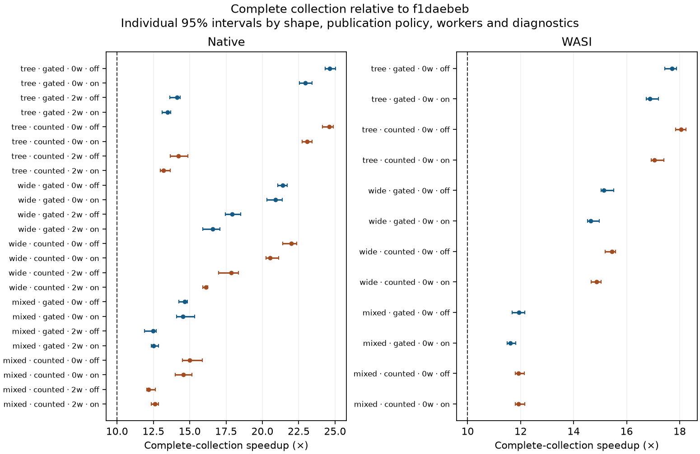

# Construction root handoff, root page retirement and Java array pressure

The native JVM, WASI JVM, browser engine and source preview share
`ristretto_gc::GarbageCollector`. All 14 shipping dependency graphs passed.
Both normalized Cargo consumers built. Interpreted Java on native and WASI
and compiled Java on native each rewired the same VM-owned graph, reached
64, cleared two weak witnesses, and returned the graph's managed charge.
The native compiled run recorded 25 compiled entries and eight backedges.
[Validation and scope](validation.json).

## Collector progress

At `5ffec78b`, removing a root during construction reserves its replacement
before admission. Only a successful detach publishes the exact target and
its deletion barrier. The source stays visible during preparation. This
covered both publication policies and tree, slot and context storage. When a
peer reused the numeric ID for another graph, the stale removal left the new
graph reachable. At `8c1e8924`, generation queries returned with the metadata
shard parked and young array tracing yielded while the card lock was held.
The final child survived the retry and cleared after its owner was dropped.
All four regressions passed in 100 fresh processes each. All 12 parent
controls failed as expected. [Per-process records](forced.jsonl.gz).

At `0b76cfaf`, unlinking an older, now-empty numeric root page happens after
the deletion barrier. The parent exhausted 2,048 polls under both publication
policies. The candidate completed a new full ticket and cleared the removed
object while the unlinker still held its old directory view. A replacement
published at the same numeric ID survived the stale unlink and cleared after
its own removal. The schedule passed on native, WASI and Miri.
[Parent probe](parent-page-test.patch.gz) · [Parent observations](parent-page.log.gz).

| Collection revision | Lowest native 95% bound | Lowest WASI 95% bound |
| --- | ---: | ---: |
| Root handoff and array tracing, `8ef683e7` | 11.62× | 11.56× |
| With older-page unlink, `0b76cfaf` | 11.90× | 11.48× |

Each row used the published `f1daebeb` control, 36 conditions, 4,095 nodes,
16 collections per process and 2,304 fresh processes. Each condition has its
own paired 95% interval. These ratios measure complete collector cycles.
[First comparison](cycles/complete-cycles.csv) · [Latest comparison](page-unlink-cycles/complete-cycles.csv) · [Build receipts](page-unlink-cycles/provenance.json).

## Whole-JVM comparisons

Both screens used the same release Ristretto binary at `41aae6ea`, the same
JDK for G1 and ZGC, a 64 MiB heap, two CPUs and a 512 MiB cgroup per fork.
Each runtime had three forks per arrival rate, with five seconds of warmup
and ten seconds of measurement. Scheduled latency includes backlog.

| Java roots workload | Ristretto | G1 | ZGC |
| --- | ---: | ---: | ---: |
| Median saturation throughput, operations/s | 2,884 | 8,451,353 | 9,506,100 |
| Scheduled p99.9 at 1,000 arrivals/s, µs | 860 | 11 | 23 |
| Scheduled p99.9 at 1,500 arrivals/s, µs | 5,248 | 13 | 19 |

All scheduled roots operations finished. [All roots processes](java/roots/processes.csv) · [Latency and throughput](java/roots/comparison.png).

The new `reference-array` workload allocates 4,097 reference slots, checks
their null defaults, stores the same Java object at the first and last index,
and rotates 32 escaping arrays. All nine Ristretto forks raised Java heap OOM.
All 18 HotSpot forks completed. Median saturation throughput was 629,173
operations/s for G1 and 271,601 for ZGC. No process hit the cgroup OOM killer.
[Raw processes](java/reference-array/processes.jsonl.gz) · [Failure output](java/reference-array/failures.json) · [Comparison](java/reference-array/comparison.png).

An isolated driver failed on allocation 402 even with no retained arrays or
element stores. The same binary completed 650 equal-length-in-bytes primitive
allocations. The instrumented build repeatedly failed to reserve a 131,104-byte
physical block. A Java weak witness to an old array had cleared at failure.
After 100 ms and a collection request the first retry succeeded. These
observations leave premature physical exhaustion under sustained reference
allocation as an alpha blocker.
[Workload variants](pressure/array-pressure-variants.java.gz) · [Observations](pressure/array-pressure-variants.jsonl.gz) · [Physical allocation trace](pressure/physical-allocation.log.gz) · [Weak witness](pressure/weak-witness-result.log.gz).
