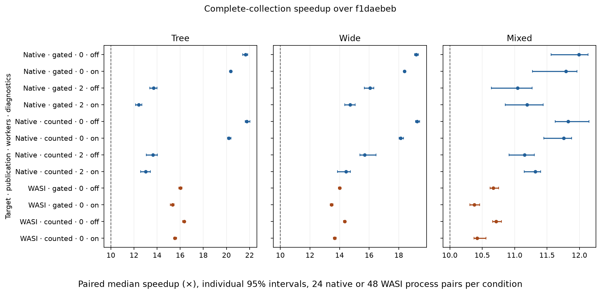
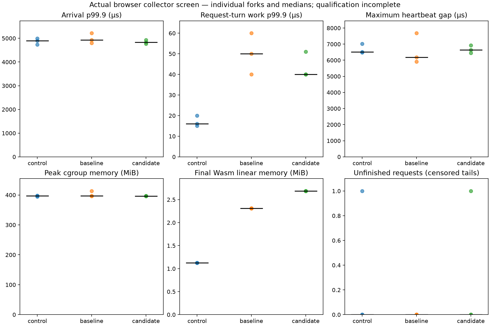

# Java pending-reference publication on the unified heap

At `e0f2b29c`, a collector can stop immediately before or after linking a Java reference's queue entry and another worker can finish the originating collection and a newly requested full collection. The decision still installs a root for the exact Java owner. The cycle retains the prepared append until its link is visible. A peer retries the same append outside the coordinator, phase cursor, slot decision and publication guards. An uncontended entry remains visible within a single budget-one decision step.

| While the first producer remains parked | Parent `444e57b3` | Candidate `e0f2b29c` |
|---|---|---|
| Independent allocation with headroom | Completes in all 16 configurations | Completes in all 16 |
| Peer requests a new full collection | Exhausts 2,048 public polls in all 16 | Ticket completes within 2,048 polls in all 16 |
| Wake a registered Java handler | Only after the producer links the entry | At either park point |
| Transfer queue ownership | Recovers after producer resumes | Transfers the exact owner and then a second, distinct owner while the producer remains parked. Resuming it produces no duplicate. |

The native schedule crosses gated and counted publication, coordinated and independent phases, weak and final reference decisions, and both sides of the predecessor link CAS. All 100 candidate processes and ten test-instrumented parent processes matched those outcomes. After teardown, every heap had zero live objects. Miri passed the native gated, coordinated, weak-reference, post-link case. [Forced schedules](schedules.jsonl.gz) · [Parent test patch](control-tests.patch.gz) · [Build and verification details](validation.json).

## Complete collection

All 36 established complete-collection conditions used the same 4,095-node tree, wide and mixed fixtures and 16 cycles per process. There were 24 randomized process pairs per native condition and 48 per WASI condition, totaling 2,304 processes. Both baseline binaries matched the frozen `f1daebeb` builds. The minimum individual 95% lower speedup bound was **10.64× native** and **10.31× WASI**. [Condition estimates and intervals](complete-cycles.csv) · [Build provenance](cycle-provenance.json) · [Native processes](native.jsonl.gz) · [WASI processes](wasm.jsonl.gz).

The native interpreter, native JIT and WASI interpreter ran the same Java graph, returned 64, and cleared both weak witnesses. The native JIT recorded 25 compiled entries and eight compiled backedges. The ordinary Java Reference suite exercised JDK 8, 11, 17, 21 and 25. Cargo verified the collector package and the normalized native and WASI consumers. Fourteen shipping dependency graphs resolved the same workspace collector.

The nine two-second Chromium trials offered 36,000 requests at 2,000/s per trial and completed 35,998 in their measurement windows. One candidate trial and one control trial each had one request unfinished. Collector trials emptied their managed heaps on teardown. [Per-process measurements](browser.jsonl.gz).

The Carbon review verified that a consumer stamps the linked node before it tombstones the predecessor. A delayed helper cannot reinsert that node after consumption. Neon independently ran the parked-producer regression. Carbon accepted high effort for the focused ordering review.

These schedules park the publisher at queue insertion. Registering the owner's tree root and preparing the queue node still run under phase authority. Synchronous disposal of stale epoch proposals, progress across arbitrary pauses, whole-JVM throughput and scheduled latency against G1/ZGC, and sustained-load qualification remain open. [Java throughput and latency comparison](../../consolidated-java-followups/unified-heap-roots/README.md).
