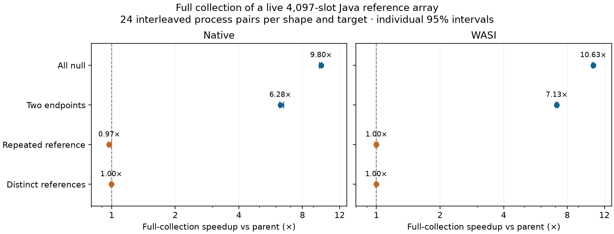
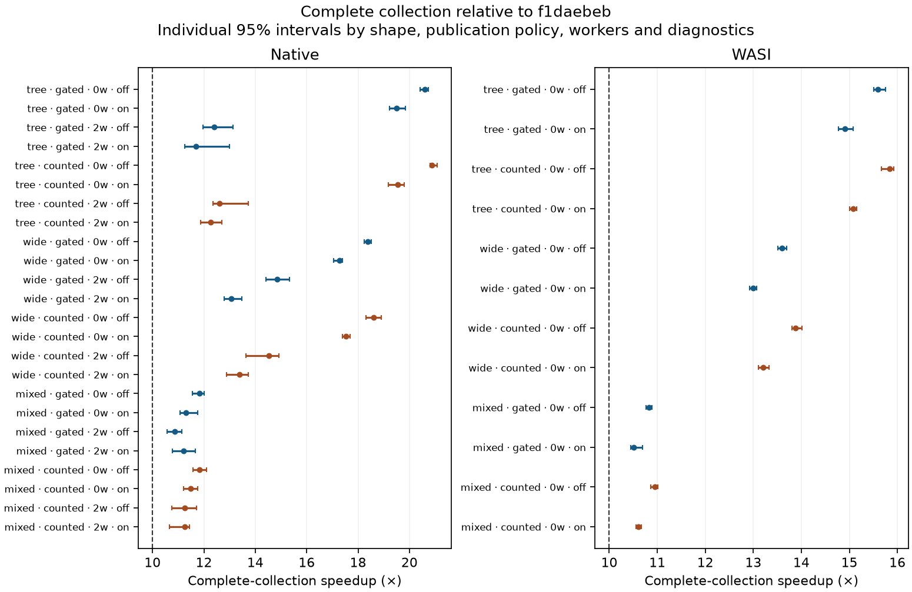
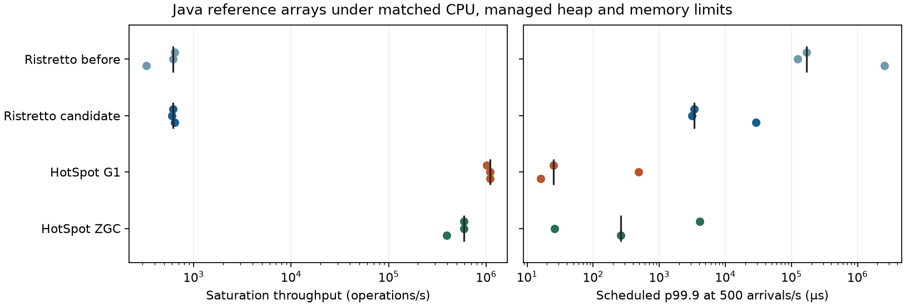
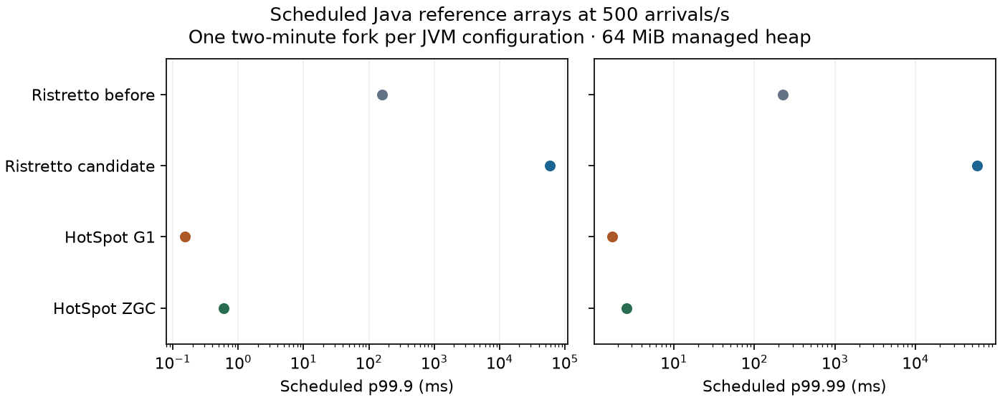
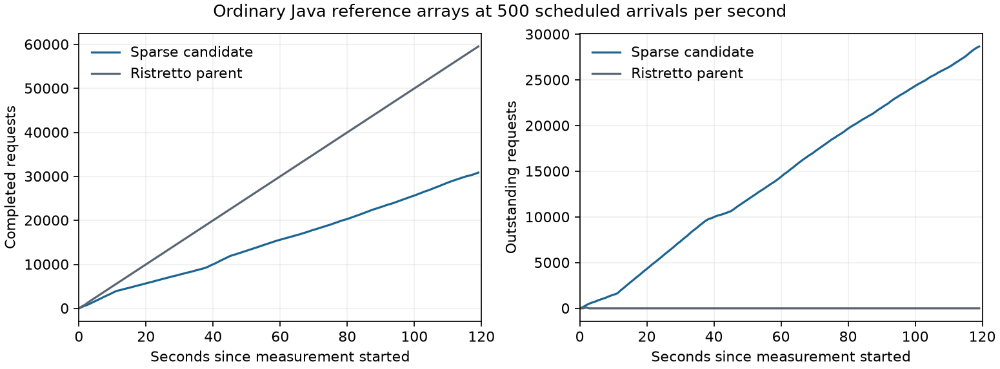

# Sparse Java reference arrays under sustained load

**The candidate is withheld.** The candidate completed 31,096 of 60,000 scheduled Java operations in two minutes. Its parent, G1 and ZGC each completed all 60,000. The shipping PR keeps the current array marker. The measured candidate and its regressions are available for diagnosis. [Candidate source and tests against `db67abeb`](candidate.patch.gz) · [Scheduled results](java/sustained.csv).

The Java reference-array workload allocates 4,097 slots and writes the same reference at slots 0 and 4,096. On the shared JVM heap, the marker used to visit all 129 cards during a full scan. The candidate marker skips cards whose slots have never held a managed reference. The median complete-collection speedup for this shape was **6.28× on native and 7.13× on WASI** against its immediate parent. [Standalone probe and reproduction](direct/README.md) · [Paired intervals](direct/collection.csv).

| Live Java array | Native paired speedup (95%) | WASI paired speedup (95%) |
| --- | ---: | ---: |
| All nulls | 9.80× (9.63–9.87) | 10.63× (10.51–10.69) |
| Two populated endpoints | 6.28× (6.23–6.52) | 7.13× (7.07–7.23) |
| Same reference in every slot | 0.974× (0.966–0.996) | 1.000× (0.983–1.010) |
| Distinct reference in each slot | 0.996× (0.988–1.006) | 0.997× (0.991–1.003) |

The dense repeated-reference case took 2.7% longer on native. It met the preselected maximum 5% time increase. Each target and shape had 24 fresh process pairs. The size of `Reference` was 232 bytes on native and 136 on WASI. The size of `Value` was 32 and 24 bytes respectively. Each shape had the same managed charge before and after the change. [Selection criteria](direct/selection.json) · [Layouts and charges](direct/summary.json).

## Liveness and progress

Each bit in a machine word covers every card with the same index modulo the word width. Point mutation sets the bit before exposing the slot. A mutable slice sets every bit. The bits stay set when a minor collection removes mature edges from its remembered set. The existing payload lock orders both the summary and the data it describes. A set bit may require visiting an empty card. A clear bit permits the marker to skip that entire group.

The parent returned `Continue(1)` for the all-null array at budget one. The candidate marker finishes that trace in the first step. Tests keep distinct referents live across a card-index wrap, prune a mature final card in a young cycle, write behind a partially completed scan, and exercise mutable slice exposure. An independent review requested a test starting partway through an empty card. With one slot of budget, it reaches the first slot of the next occupied card and resumes at slot 65. The named test passed on native and WASI. The read-only Neon reviewer independently ran the native regression after the requested Carbon model and effort combination was unavailable and the Carbon fallback timed out. [Parent regression patch](direct/parent-regression.patch.gz) · [Verification receipts](validation.json).

## Complete collection on the established graph suite

All 36 conditions passed against control `f1daebeb`. Across 2,304 new processes, the minimum individual lower 95% bounds were **10.565× on native** and **10.451× on WASI**. The probe uses 4,095 graph nodes and 16 measured cycles with tree, wide and mixed shapes. It crosses both publication policies, diagnostics on and off, and zero or two native workers. WASI runs cooperatively. This suite measures the accumulated collector changes since the published control. [All 36 conditions](cycles/complete-cycles.csv) · [Toolchain, controls and binary hashes](cycles/provenance.json).

## Other shared-heap checks

The native interpreter, native JIT and WASI interpreter each returned 64 from the same Java graph, cleared the two original weak identities and refunded the graph's managed charge. The capped array reproducer completed 8,192 allocations on native and WASI. Both normalized Cargo consumers built with the same GC archive. The release check also verifies the public class loader independently. Removing its GC dependency while retaining the VM's direct dependency let the enclosing VM graph pass, and the independent class loader check rejected each of the four target and feature combinations. [Verification receipts](validation.json).

At 2,000 scheduled arrivals per second, two Chromium candidate forks completed all 4,000 arrivals and the third completed 3,997. One control fork completed 3,998. The maximum candidate heartbeat gap was 11.505 ms. The browser screen runs the Rust collector engine on the main thread. Its completed-request latency distribution excludes unfinished work. [All forks](browser/REPORT.md) · [Browser graph](browser/browser.png).

## End-to-end Java comparison

The same Java classfiles ran on each JVM with a 64 MiB heap, two pinned CPUs and a 512 MiB cgroup. The short screen used three independent forks per runtime and rate, each with five warmup seconds and ten measured seconds. The medians below use completed requests. One parent fork missed 1,266 of 5,000 scheduled arrivals. The candidate, G1 and ZGC completed all scheduled arrivals in these forks. [Per-fork measurements](java/forks.csv) · [Class and binary hashes](java/provenance.json).

| JVM | Saturation (operations/s) | p99.9 at 500/s (ms) | p99.99 at 500/s (ms) |
| --- | ---: | ---: | ---: |
| Ristretto before | 613 | 169.984 | 178.176 |
| Ristretto candidate | 618 | 3.392 | 4.480 |
| HotSpot G1 | 1,094,847 | 0.025 | 1.152 |
| HotSpot ZGC | 594,433 | 0.263 | 0.938 |

The longer screen offered 60,000 requests to each JVM at 500/s in one two-minute fork after ten warmup seconds. The table retains the deadline backlog and the latency of completed requests for each fork. [Per-fork counts, RSS and OOM events](java/sustained.csv) · [Raw measurements](java/sustained.jsonl.gz).

| JVM | Completed / offered | p99.9 (ms) | p99.99 (ms) | Peak backlog |
| --- | ---: | ---: | ---: | ---: |
| Ristretto before | 60,000 / 60,000 | 159.744 | 223.232 | 115 |
| Ristretto candidate | 31,096 / 60,000 | 58,195.968 | 58,195.968 | 28,905 |
| HotSpot G1 | 60,000 / 60,000 | 0.151 | 1.712 | 1 |
| HotSpot ZGC | 60,000 / 60,000 | 0.595 | 2.592 | 1 |

The two-minute screen has one fork per runtime. Saturation throughput and scheduled tails still trail both HotSpot collectors in the short-run medians. A zero-pause alpha needs bounded progress under the remaining parked-mutator cases and longer native and browser qualification.

At 60 seconds the parent had completed 30,001 requests with zero backlog. The candidate had completed 15,603 with 14,410 outstanding. It continued completing work through the deadline. The candidate used 237 process-group CPU seconds and recorded 3,681 process-wide collections, versus 106 CPU seconds and 1,510 collections on the parent. Neither had a cgroup OOM kill. These counters include warmup and startup. The trace shows the backlog growing throughout the run. Identifying the responsible code requires a measurement inside the affected JVM. Local verification jobs could use sibling hardware threads of the pinned CPUs during this run. [Scheduled timeline](java/sustained-progress.csv) · [Process and cgroup measurements](java/sustained.jsonl.gz).

## Follow-up on the missed deadline

After the local builds finished, both revisions completed 15,000 of 15,000 arrivals in each of two 30-second forks. One candidate fork still recorded 217.088 ms at p99.99. A separate pair then repeated the original two-minute workload with the same seed, classfiles, JVM binaries and limits, running the parent first. Both completed 60,000 requests with a peak backlog of two. Completed-request p99.99 was 3.840 ms on the parent and 4.416 ms on the candidate. A host monitor recorded no Rust compiler processes in 131 samples during that pair. The original loss of capacity was intermittent across the observed runs. Its cause remains open. The shipping decision retains the original failed gate. [Diagnostic fork measurements](diagnostic/forks.csv) · [Protocols, order and artifact hashes](diagnostic/verification.json).

The native thread named `gc-finalizers` used 11.42–12.22 CPU seconds across about 40 seconds of samples in each short fork. It runs reclamation jobs as well as finalizer work. This cost is present on both revisions. Separating queue service, payload clearing and refund notification during a slow fork would locate where that additional CPU time goes. [Per-thread samples](diagnostic/thread-cpu.jsonl.gz).

The class loader fault also reached the normalized Cargo archives. In a disposable checkout, the GC dependency and its forwarded feature were removed from the class loader while the VM kept its direct GC dependency. Both native and WASI external consumers passed the whole-consumer graph check and failed the class loader check before compilation. [Archive rejection receipts](diagnostic/verification.json).
