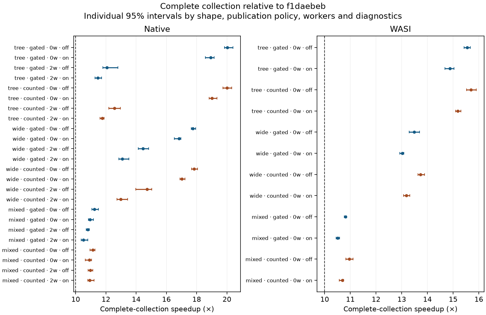
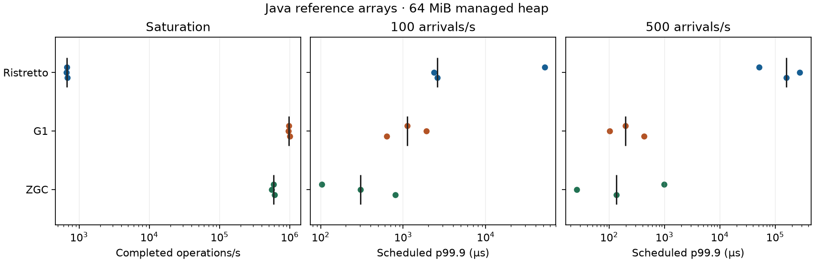

# Collection progress with a parked statistics reader

A thread suspended in `GarbageCollector::statistics()` could hold the statistics mutex across a full collection request. In the 2-object capped heap, a peer could neither finish the ticket nor use the dead object's space before the reader resumed. The parent failed under gated and counted publication with diagnostics both enabled and disabled. [Parent schedule and output](controls/).

The single collector now publishes coherent versions of its cumulative statistics. A reader can keep its version while a peer commits marking work, finishes the collection and refunds managed storage. Retriable updates capture exact deltas and durations once. Interval scheduling and worker notifications use the winning commit. The independently sampled live heap counters can advance while the reader holds its cumulative view.

Where phase diagnostics and statistics measure the same completed work, they now share the same elapsed-time sample. That interval ends before updating statistics. Worker CPU time and intervals that include wake callbacks retain separate measurements. A thread can retain one previous statistics allocation for reuse. Unique ownership must be recovered before copying the current contents and applying a delta. A reader, competing writer or thread teardown can force a fresh allocation. These changes leave the ordinary JVM, preview and browser on the same collector.

## Collection and allocation costs

The frozen control is `f1daebeb`. Each row below contains 2,304 fresh processes, with 24 native and 12 WASI conditions. Each condition varies graph shape, publication policy, diagnostics and applicable worker counts. Each process completes 16 cycles on a 4,095-node fixture. The table gives the lowest **individual** 95% paired speedup bound within each target. The conditions share neither a pooled confidence interval nor a claim about other workloads.

| Change | Native | WASI | Source and process records |
| --- | ---: | ---: | --- |
| Immutable statistics | 10.12× | 10.31× | [Snapshot](snapshot/cycles/) |
| Shared step timing | 10.48× | 10.10× | [Timing](timing/cycles/) |
| Reuse uniquely owned statistics | 10.37× | 10.45× | [Shipping results](reuse/cycles/) |

The reuse decision required every lower bound to exceed 10× and the direct WASI mixed-graph upper elapsed ratio to remain at or below 1.02 with diagnostics enabled under both policies. Against the preceding shared-timing implementation, the median elapsed ratios were 0.9763 [0.9717, 0.9812] with gated publication and 0.9741 [0.9676, 0.9805] with counted publication. Each estimate uses 64 independent pairs. [Direct results](reuse/direct-wasi/summary.json) · [Raw processes](reuse/direct-wasi/raw.jsonl.gz).

In a separate native allocator probe, 256 live rooted integers survived 64 full collections after eight warmup cycles. Each of 12 fresh processes per implementation recorded 1,216 steps. The former mutex collector made 64 host allocation requests for 4,608 bytes. Immutable snapshots with shared timing made 1,408 requests for 316,416 bytes. Reusing uniquely held snapshots restored the original counts of 64 requests and 4,608 bytes on this schedule. Allocation requests include reallocations. They measure allocator traffic during the collection window. [Probe](allocations/probe.rs) · [All 36 observations](allocations/processes.jsonl.gz).

## Progress, shipping paths and boundaries

Each candidate passed 100 independent processes containing all four parked-reader schedules. The replacement allocation and fresh full ticket must finish within 4,096 polls while the old reader is still suspended. The test checks the rooted survivor, donor weak clearing, replacement value, exact managed refund and original cumulative snapshot. Additional tests force a competing commit and hold a snapshot across reuse by two different collectors. Individual writers can retry under contention. Global progress in all other collector paths remains an open gate.

On the final runtime tree, 1,028 native GC tests passed, with one ignored, and 465 WASI tests passed. The three focused Miri cases, strict native/WASI Clippy, browser collector check and Cargo archive verification passed. Fourteen default/all-feature dependency graphs and both normalized Cargo package consumers resolve to the same collector. Interpreted native/WASI and compiled native previews each cleared two weak witnesses. The compiled preview reported 25 entries and eight backedges. The ordinary 64 MiB Java reproducer completed 8,192 allocations in native and WASI runs. A browser dependency check establishes which collector ships. Host-turn latency needs runtime measurement.

The Carbon auditor accepted the uniqueness requirement and identified unbounded per-writer retries and fresh-allocation fallback. This CLI rejected the requested Carbon `xhigh` effort. The successful audit used Carbon `high`. Neon independently ran the competing-commit regression. The measured tree at `c0788307` and the consolidated runtime commit `cc0cd61e` have the same Git tree. [Checks, revisions and audit responses](validation.json).

## Ordinary Java comparison

All 27 fresh processes completed the reference-array workload using the same Java classes, two CPU cores of quota, a 64 MiB logical heap and a 512 MiB cgroup limit. Each fork warmed up for five seconds and measured for ten. All scheduled arrivals completed. Points in the figure represent individual forks and the vertical bars give their medians.

| JVM | Saturation, operations/s | Scheduled p99.9 at 100/s | Scheduled p99.9 at 500/s |
| --- | ---: | ---: | ---: |
| Ristretto | 673 | 2,592 µs | 159,744 µs |
| HotSpot G1 | 974,983 | 1,120 µs | 199 µs |
| HotSpot ZGC | 592,186 | 304 µs | 134 µs |

At 500 arrivals/s the highest sampled Ristretto backlog was 140 operations. These observations cover the complete JVM, including allocation, interpretation, compiled dispatch and collection. The full-cycle speedup above uses a different control and measures collector work only. [Per-fork results](java-screen/processes.csv) · [Histograms and process records](java-screen/processes.jsonl.gz) · [Frozen inputs and limits](java-screen/provenance.json).

