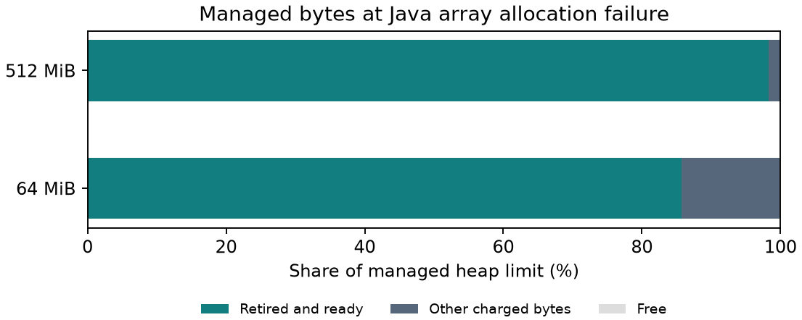

# Stock JVM publication and native array reclamation

Both publication policies use the JVM's single `GarbageCollector`. Commit
`19d3cdb7` adds comparison modes that hold every stock setting fixed except
`concurrent_publication`. The release decision is to retain the current default.
Both native settings hit Java heap-space errors on the reference-array workload.
The native two-worker results provide no throughput or latency estimate.

| Entry point | Heap | Stock | Stock with counted publication |
| --- | --- | --- | --- |
| Native JIT comparison, two workers | 64 MiB | 12/12 Java OOM | 12/12 Java OOM |
| Native release launcher, default workers | 512 MiB | 6/6 Java OOM | 6/6 Java OOM |
| Workerless WASIp2 comparison, short screen | 64 MiB | 10/10 completed | 10/10 completed |
| WASIp2 release launcher, defaults | 256 MiB | 6/6 completed | 6/6 completed |

The 64 MiB cases used a 512 MiB process limit and two CPUs. Five fresh
processes per arm ran at capacity and five at 500 arrivals/s, for ten seconds
after four seconds of warmup. The native counts include two additional
two-minute attempts per arm at 500/s. The release launchers used a 1 GiB
process limit, three forks per arm at each short rate, and the same Java
classfiles. The native and WASI process controllers recorded zero kernel
OOM events. The one-line experimental launcher default was built at
`c7b22b9f`. The stock launcher and the comparison driver were built at
`19d3cdb7`. [Policy, build commands and binary identities](identities.json)

### What remained charged

Two separate debugger runs stopped at the terminal advisory headroom check in
`make_room_async`, called by `allocate_null_reference_array_in_async`.
The Java fixture retains 32 arrays and replaces them with 4,097-slot arrays.
Both snapshots had completed two empty recovery tickets. Every retired object
in the snapshots was ready for cleanup and carried 131,392 managed bytes.

| Managed limit | Request | Free | Ready arrays | Bytes in ready arrays |
| --- | ---: | ---: | ---: | ---: |
| 64 MiB | 131,400 | 101,807 | 438 | 57,549,696 |
| 512 MiB | 131,400 | 6,063 | 4,014 | 527,407,488 |

A single physical array refund would have covered the shortfall at either
observation. Host-backed arrays keep their capacity while incremental clearing
truncates their elements. The regional heap's partial-return counter cannot
observe those host clear steps. A ready count can include a callback that
subsequently blocks. A progress fix must demonstrate a physical refund and
also terminate on a genuinely unavailable donor. Debugger observations describe
the failure state. Timing comes from separate processes.

### Capped native recovery

A separate 16 MiB async allocation workload ran five fresh two-worker
processes per arm and storage mode. All 20 completed and passed the driver's
shutdown accounting checks. Median operation p99.9 on host storage was
340 µs for stock and 345 µs for counted publication, at 107,847 and
107,255 operations/s respectively. On compact storage the medians were
322 and 267 µs, at 141,491 and 146,661 operations/s. Each fork ran for
six seconds. These measurements cover short recovery behavior.
[88 process observations, including errors and latency histograms](observations.jsonl.gz)

Use `--runtimes ristretto-stock-jit ristretto-stock-counted-jit` with the
comparison runner on native. Use `--runtimes wasm-stock wasm-stock-counted`
with the WASIp2 binary. Both arms share the same executable within each target.

### Exact-fit Java allocations

At `227708b2` Java field and array preflight uses the collector’s actual
published charge. The prior estimate added one alignment unit to every Java
header. On an empty heap capped at the measured charge of a 4,097-slot
reference array, the previous code threw Java OOM. The corrected array and
an ordinary Java instance publish at their exact limits and refund their
charges after full collection. The array still throws Java OOM when the cap
is one byte smaller. This corrects the size estimate. The measured retirement
backlog exhausted much more than eight bytes of headroom.
[Native and WASI tests, Clippy and package verification](exact-charge.json)

## Snapshot-start progress

Completing a short counted root publication during snapshot preparation can
force a restart. A candidate fixed that schedule while preserving ticket and
weak-identity checks. Native Java capacity reached 94.1% of control, below
the 95% release floor, so the change remains experimental.
[Native and WASI gates, complete-cycle graph and candidate patches](snapshot-start/README.md)

### Complete-cycle qualification of the exact-charge revision

At `227708b2`, 19 of 24 native conditions and all 12 WASIp2 conditions
cleared the 10× individual lower 95% speedup requirement against `f1daebeb`.
The lowest bounds were 7.024× native and 10.424× WASIp2. Native compilation
overlapped some benchmark cores during this run. The native release gate is
open. [All 36 estimates](exact-charge-cycles/complete-cycles.csv) ·
[Speedup graph](exact-charge-cycles/speedup.png) · [Run identities](exact-charge-cycles/provenance.json)
