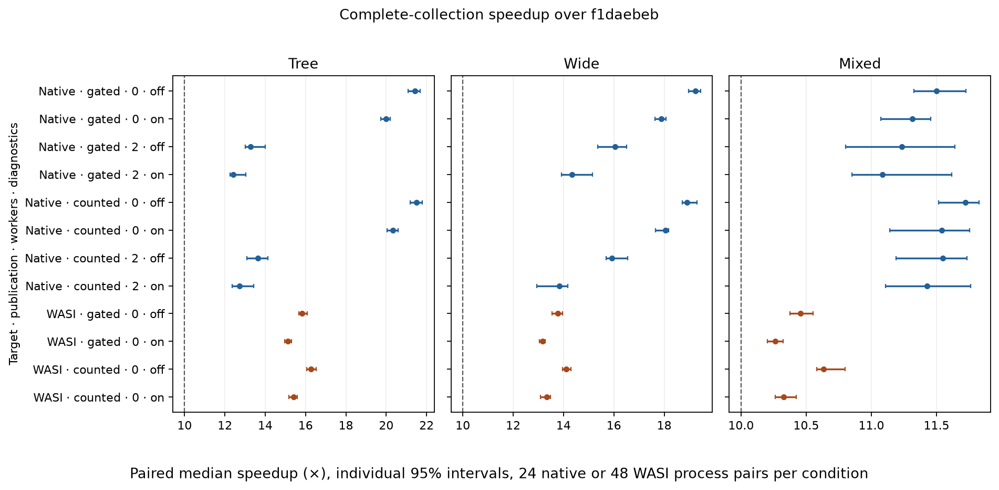
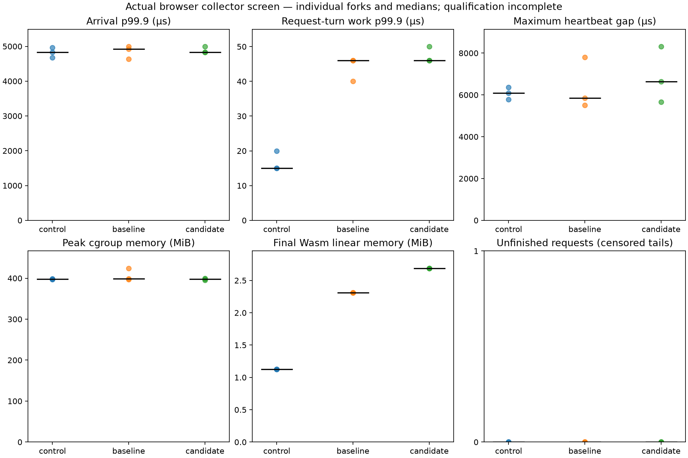

# Sleeping terminal allocations on the shared JVM heap

At `b65722a0` a native allocator issued **zero executor wakes in 2,048 forced polls** while a published donor remained charged and its dispatch worker was paused. The test then stopped polling and required an actual wake before resuming the allocator. The earlier implementation issued 2,048 wakes in the same poll budget in 100 of 100 processes. [Earlier wake counts](../independent-native-callbacks/README.md#remaining-executor-wake-ups).

## Reclamation under contention

Seven schedules passed in **700 fresh processes**. They cover an available donor, a silent last claim, publication after the last claim was observed, shutdown with a replacement pool, a fitting refund behind 33 larger requests, cancellation and delivery past a parked executor. An independent competitor took an offered refund before the allocator could spend it. The allocator slept again until it acquired a real reservation.

| Source | Forced condition | Result |
|---|---|---|
| `64a6660c` | Stable published donor and paused assistant | All 10 processes violated the quiet-wait assertion. |
| `5061a647` | Another callback became public after the last claim was observed and before the executor repolled | All 100 processes waited again on the completed turn. |
| `b65722a0` | Same replacement schedule | All 100 processes reported exhaustion with both donor charges still outstanding. |

A pool-scoped turn records observed completion before the notifier delivers a wake. The allocator can then try one additional collection. If headroom is the only change, the allocating task must obtain its own reservation. A competing allocation can consume the offer first. The native notifier scans at most 32 terminal registrations per pass, with timed rechecks while registrations exist.

To reproduce, run `cargo test --locked -p ristretto_gc --lib native_callbacks::tests`. For the negative controls, apply each decompressed test-only patch at its listed revision and run the named schedule. One early full-suite run on `c4e9dfb1` received a delayed collection-ticket wake in the channel used to count terminal wakes. The final fixture assigns the observed destination after dispatch enrollment. [Process outcomes](schedules.jsonl.gz) · [Control for self-waking](self-wake-control.patch.gz) · [Control for republished work](unlatched-control.patch.gz) · [Binary identities and functional checks](validation.json).

## Complete collections

All **36 conditions** exceeded 10× against frozen Ristretto `f1daebeb`. The smallest individual 95% lower bounds were **10.80× native** and **10.20× WASI**. All 2,304 processes passed their marking and reclamation checks. Each process collected a 4,095-node fixture for 16 timed cycles. The 24 native conditions used 24 randomized pairs each. The 12 WASI conditions used 48 pairs each. The compiler receipts match the controls and reproduce both frozen baseline binaries.

[All 36 intervals](cycles/complete-cycles.csv) · [Build receipts](cycles/cycle-provenance.json) · [Native observations](cycles/native.jsonl.gz) · [WASI observations](cycles/wasm.jsonl.gz).

The separate native callback fixture compares with the prior shipping collector at `29634965`. Across 24 pairs per condition, five of the six original intervals included parity. With 64 callbacks and two workers the candidate took 0.938× the prior elapsed time. In the extended controls, 1,025 callbacks with one worker took 1.018× the prior time, with a 95% interval of 1.0005–1.0311. [All 12 conditions](callback-cost.csv) · [Individual process timings](callback-cost.jsonl.gz).

A fresh 48-pair comparison repeated 1,024 and 1,025 callbacks with both worker counts. All four intervals included parity. At 1,025 callbacks and one worker the median ratio was 1.0022, with a 95% interval of 0.9931–1.0160. [Repeat estimates](callback-repeat.csv) · [Repeat timings](callback-repeat.jsonl.gz).

## Native and Wasm execution

The native interpreter, native compiled tier and WASI interpreter each returned **64**, cleared both weak witnesses and refunded the full two-node Java cycle. The native JIT recorded 25 compiled entries and eight backedges. The native GC suite passed 980 tests with one ignored. WASI passed 448. Strict all-target, all-feature Clippy passed on both targets. The shipping browser engine type-checked for `wasm32-unknown-unknown`. All 14 release dependency graphs resolved the workspace collector. Native and WASI consumers of the normalized Cargo archives resolved every collector dependency to the unpacked archive, including with a symlinked temporary directory.

Nine foreground headless Chromium processes ran the bare-Wasm collector fixture and its allocation-free observer. Each completed all 4,000 scheduled requests in the two-second measurement window at 2,000 requests per second. Both allocation policies ended every trial with zero managed bytes. These short main-thread measurements leave sustained browser responsiveness and whole-JVM latency against HotSpot open.

[Browser observations](browser.jsonl.gz) · [Java receipts, browser binary and asset identities](validation.json) · [Whole-JVM G1 and ZGC measurements](../../consolidated-java-followups/null-local-roots/README.md).
