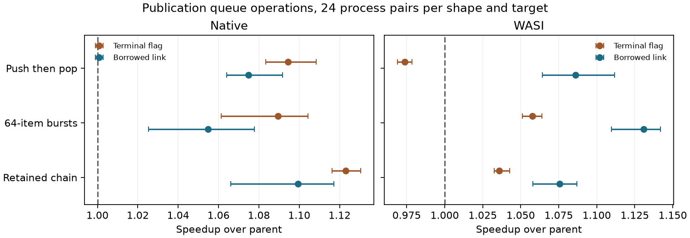
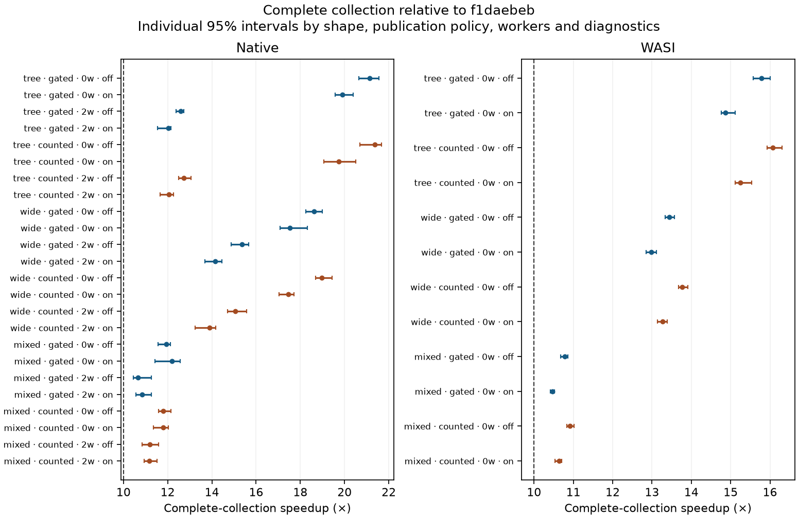
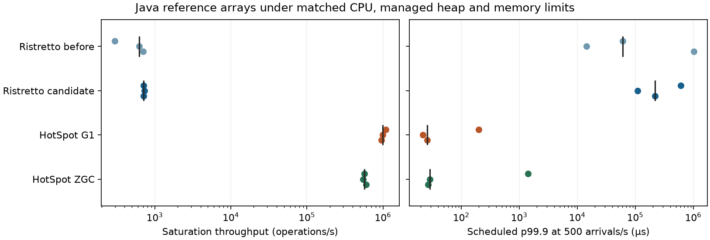
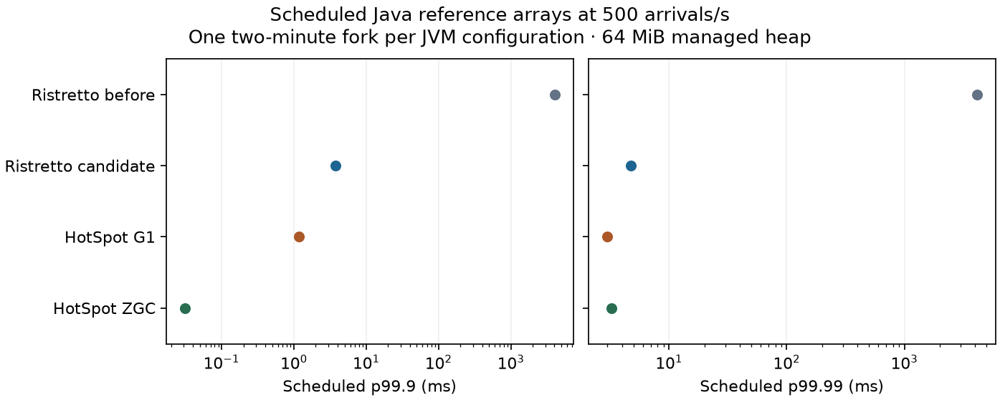

# Releasing terminal publication queue nodes

At `ab7a3000`, dropping the last owner of a detached node borrows its next link. An empty link or the immutable retirement sentinel ends the chain. Longer live chains still use iterative teardown. A producer must own the predecessor to change its link. On a 128 KiB native stack the lifetime test kept 100,000 payload references through queue destruction and released them all when the last live predecessor was dropped.

## Direct queue cost

Both candidates removed all 1,024 explicit link clears observed in the 1,024-pop control on each target. The variant adding a terminal flag failed its alternating-push/pop WASI gate, with a median speedup of 0.974×. The borrowed check added no node storage. Against the immediate parent, alternating operations improved 1.075× on native and 1.086× on WASI. The individual lower 95% bounds were 1.064× on each target.

Each variant ran 24 randomized pairs per target and shape, totaling 576 fresh processes across the two comparisons. Absolute costs differed between the two experiments. Compare each variant with its own paired control. [Measured pairs](queue/pairs.csv) · [Fixture](queue/queue_probe.rs) · [Instrumented counts](queue/explicit-clears.json) · [Borrowed check inputs](queue/borrow-inputs.json) · [Flag inputs](queue/flag-inputs.json).

## Complete collection

The established 36-condition matrix used 2,304 fresh native and WASI processes. Every condition cleared 10× versus `f1daebeb`. The smallest individual lower 95% bounds were **10.449× native** and **10.419× WASI**. This is an end-to-end collection result for the established graph workloads. [Condition results](cycles/complete-cycles.csv) · [Inputs and binary hashes](cycles/provenance.json).

## Java reference arrays

On two CPUs with a 64 MiB Java heap and a 512 MiB process cap, the median across three ten-second saturation forks was 714 operations/s for the candidate, 622 for the previous JVM, 992,086 for G1 and 569,701 for ZGC. At 500 scheduled arrivals/s, the candidate finished every arrival in the three short forks. Its median scheduled p99.9 was 219 ms. The previous JVM recorded 60 ms among completed requests and left 268 arrivals unfinished across those forks.

| Two-minute fork at 500 arrivals/s | Completed / offered | Scheduled p99.9 | Scheduled p99.99 |
|---|---:|---:|---:|
| Previous JVM | 57,935 / 60,000 | 4,030 ms | 4,129 ms |
| Candidate | 60,000 / 60,000 | 3.744 ms | 4.736 ms |
| HotSpot G1 | 60,000 / 60,000 | 1.168 ms | 2.976 ms |
| HotSpot ZGC | 60,000 / 60,000 | 0.031 ms | 3.264 ms |

Each sustained result is one fork after ten seconds of warmup. Tails for an incomplete fork cover completed arrivals only. The candidate passed the prespecified completion and capacity gates. G1 and ZGC retained higher saturation throughput and lower sustained tails. The previous JVM binary was frozen at `46d0afec`. [Short forks](java/forks.csv) · [Short-run inputs](java/provenance.json) · [Sustained results](java/sustained.csv) · [Sustained inputs](java/sustained-inputs.json).

## Browser, packaging and correctness

Each of three Chromium candidate forks finished 4,000 scheduled requests. Request-turn p99.9 ranged from 46 to 51 µs and the maximum observed heartbeat interval was 6.575 ms. The browser benchmark exercises the Rust collector on the main thread. [Browser results](browser/REPORT.md) · [Graph inputs](browser/graph-provenance.json).

The all-feature class loader and collector suites passed 1,828 native and 1,233 WASI tests including documentation tests. Strict Clippy passed on both targets. Eight queue Loom models and the named stale-record Miri test passed. The Cargo package built, all 18 dependency graphs selected one collector and both normalized Cargo consumers built. The ordinary Java workload completed 8,192 allocations on each target. Native interpreted, native compiled and WASI interpreted previews each rewired the Java graph, cleared both exact weak witnesses and refunded the allocation charge. [Validation counts and tier receipts](validation.json).
