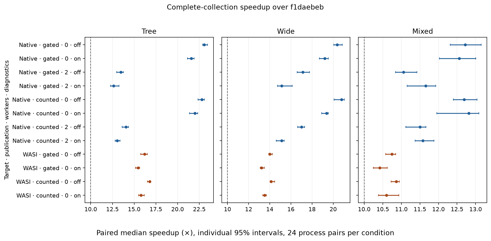

# Shared JVM heap and complete-collection comparison

At `fe7d8c39` the native interpreter, native compiled preview and WASI
interpreter executed the Java graph on the same collector implementation. All
three returned **64**. A separate two-node Java cycle in each VM repaid its
entire managed charge after its last roots dropped.

| Tier | Interpreted entries | Compiled entries | Compiled backedges | Cleared witnesses | Full collections | Managed bytes refunded |
|---|---:|---:|---:|---:|---:|---:|
| Native interpreted | 25 | 0 | 0 | 2 | 1 | 768 |
| Native compiled | 0 | 25 | 8 | 2 | 1 | 768 |
| WASI interpreted | 25 | 0 | 0 | 2 | 1 | 480 |

The worker was stopped for the preview accounting check. A separate native
integration test ran the cooperative and concurrent worker configurations. It
held a Java reference in a suspended compiled frame, collected, resumed the
frame on another thread, and tested both return and cancellation.
[Preview receipts](preview.json) · [Run the tiers](../../../../../../GC_PREVIEW.md) ·
[Compiled frame test](../../../../../../ristretto_vm/tests/experimental_jit.rs).

## Complete collection

Across all 36 conditions, the smallest individual 95% lower speedup bound
against frozen Ristretto `f1daebeb` was **10.84× native** and **10.24× WASI**.
Each condition used 24 randomized pairs of fresh processes, 4,095 nodes and
16 measured collection cycles. All 1,728 processes passed their mark and
reclamation checks. The baseline binaries reproduced the frozen hashes on both
targets. The build receipts match Cargo's compiled dependencies, features,
profiles and registry checksums across the change in workspace membership.

This fixture exercises slots, 16 metadata shards, independent marking and
work stealing. Whole-JVM capacity and latency against HotSpot are measured
separately. [All 36 estimates](cycles/complete-cycles.csv) ·
[Build identities](cycles/cycle-provenance.json) · [Native observations](cycles/native.jsonl.gz) ·
[WASI observations](cycles/wasm.jsonl.gz) · [Java G1 and ZGC comparison](../../consolidated-java-followups/null-local-roots/README.md).
