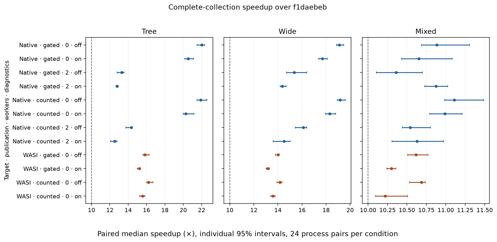

# WASM guard allocations and complete-collection time

At `2c2cffcb`, a projected raw WASM read or write guard keeps the original standard-library lock guard inline. Each further projection moves that same guard. Rejecting a projection returns the previous guard, and dropping the last guard releases the lock. The adapter also drops its unused upgradable guard and its pseudo-recursive read method.

## Allocation counts

| WASI build | Successful projections | Heap allocations | Rejected projections | Heap allocations on rejection |
|---|---:|---:|---:|---:|
| Parent `c3542120` | 16,384 | 16,384 | 8,192 | 0 |
| Candidate `2c2cffcb` | 16,384 | 0 | 8,192 | 0 |

Each row gives the counts for one process. Three fresh processes per build gave identical results. The fixture counts calls to the global allocator around four successful operations per iteration and two rejected ones. It uses both read and write guards and checks that both writes reached the protected fields. To reproduce it, use the fixture as the main program of a Rust 2024 crate with a path dependency on the selected checkout's `ristretto_gc`. Build with Rust 1.100.0 using `cargo build --release --target wasm32-wasip2` and execute the resulting module with Wasmtime. [Fixture](projection_allocations.rs) and [six process measurements with module hashes](allocation-counts.csv).

All 333 WASI GC library tests passed, including the chained-projection test that checks lock exclusion before and after dropping the last guard. That test also passed under Miri's Stacked Borrows and Tree Borrows on a native host using the same WASM adapter source.

## Complete-collection comparison

The complete-collection fixture cleared the 10× threshold against frozen Ristretto `f1daebeb` in all 36 conditions. The smallest individual 95% lower speedup bounds were **10.107× on native** and **10.098× on WASI**. The mixed graph set both minima. Each condition used 24 randomized pairs of fresh processes, 4,095 nodes and 16 measured cycles. All 1,728 processes passed their mark and reclamation checks. Both baseline executables reproduced their frozen hashes.

The panels use separate horizontal scales. The dashed line marks 10×. Both arms use the fixture's slots, 16 metadata shards, independent marking and work stealing. This comparison measures complete collection and reclamation under those settings. For ordinary launchers, see the separate [Java roots capacity and scheduled latency comparison with G1 and ZGC](../../consolidated-java-followups/null-local-roots/README.md).

[All 36 estimates](cycles/complete-cycles.csv), [build identities](cycles/cycle-provenance.json), [native observations](cycles/native.jsonl.gz) and [WASI observations](cycles/wasm.jsonl.gz).
