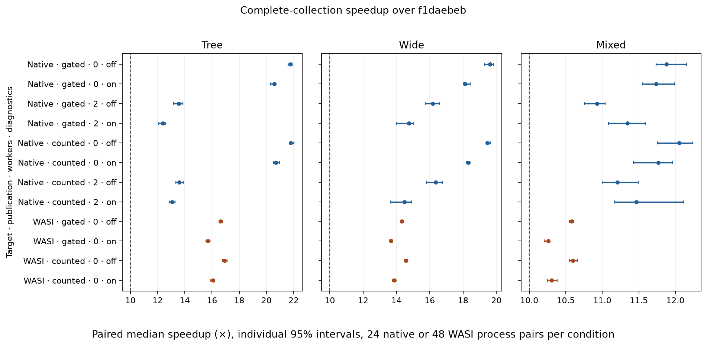

# Conditional tree-root preparation and weak-reference progress

Parking a weak-reference upgrade while the shipping JVM prepared its owning tree root prevented a peer from finishing a fresh full collection. The peer consumed its entire budget of 2,048 public GC polls in all six schedules on the `8c215619` control. Both gated and counted publication exhibited the stall. [Control patch](control.patch.gz) · [Observed schedules and poll counts](control.log.gz).

At `c4f527d1` the upgrader reserves its numeric position before entering publication or taking the weak-slot decision. A scan sees no live root in that position. Under the original guards the upgrader rereads the weak slot, checks clearing, and resolves the same collector, address, non-reused object ID, type and logical liveness. A successful upgrade publishes the root and shades both collection domains. A failed upgrade drops its own vacant position. Slot and context storage keep their existing reservation protocol.

| While the upgrader is parked | Result before or after resume |
|---|---|
| Keep the target rooted | The peer completes a full collection before resume. The upgrade returns the original ID and value. |
| Explicitly clear the weak reference | The peer completes a full collection before resume. The upgrade returns empty. |
| Drop the last strong target | The peer completes a full collection before resume. The upgrade returns empty. |

The test checked root counts and final heap refunds in each schedule. Ten fresh control processes and 100 fresh candidate processes exercised both publication policies. A cooperative test completed a whole ticket from inside reservation on native, WASI and Miri. Native interpreter, native compiled and WASI interpreter previews each produced 64 and cleared both weak witnesses. Strict native/WASI Clippy and both packaged consumers passed. In nine Chromium trials, 35,993 of 36,000 offered operations completed. [All forced schedules](forced.jsonl.gz) · [Browser trials](browser.jsonl.gz) · [Source identities, tests and qualification](validation.json).

The full all-feature WASI suite exposed an existing compaction test boundary on the unchanged parent. At a budget of one work unit per poll its young collection finished on poll 101 in each of 16 configurations. The full collection was still outstanding in every case. The test now allows that final poll and still checks the young and full collection counts separately. [Parent observations](parent-wasi-compaction.log.gz).

## Complete collection

All 36 complete-collection conditions exceeded the 10× lower-bound gate against frozen Ristretto `f1daebeb`. The lowest individual 95% lower bound was **10.75× on native** and **10.20× on WASI**. Each native condition used 24 fresh process pairs and each WASI condition used 48. The 2,304 processes exercised tree, wide and mixed heaps with the benchmark's graph, reclamation and accounting checks. [Condition-level results](cycles/complete-cycles.csv) · [Source and artifact hashes](cycles/cycle-provenance.json) · [Native records](cycles/native.jsonl.gz) · [WASI records](cycles/wasm.jsonl.gz).

These schedules establish progress for an upgrader parked in tree-root preparation. Global pause freedom, sustained service latency and endurance remain open. The end-to-end Java comparison uses a separate workload and source revision. [Whole-JVM results against G1 and ZGC](../../consolidated-java-followups/shipping-heap-roots/README.md).
