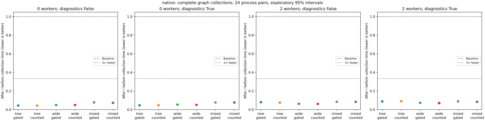
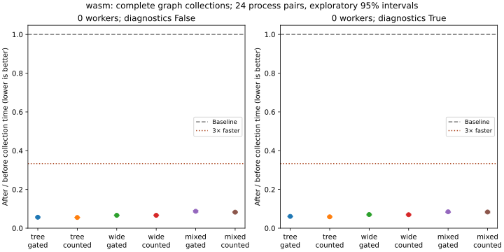

# Complete collection on the consolidated GC branch

Collector revision `280ad63d` exceeded the 10× full-collection target against `f1daebeb` in all 36 conditions.

| Target | Conditions | Lowest paired median speedup | Lowest individual 95% lower bound |
| --- | ---: | ---: | ---: |
| Native | 24 | 11.14× | 10.69× |
| WASI (wasm32-wasip2) | 12 | 11.45× | 10.97× |

Each condition used 24 freshly launched, randomly ordered process pairs with seed `251126280`. Tree, wide and mixed graphs contained 4,095 live nodes. Each process performed three warmups and 16 timed full collections. The mixed graph added 1,023 unreachable scalars per collection. Both binaries passed the graph checksum and finished with zero live objects and zero managed bytes in all 1,728 processes. The native minimum occurred with two workers and diagnostics enabled on the gated mixed workload. The WASI minimum occurred on the gated mixed workload with diagnostics disabled.

The measurement includes mark, sweep, reclamation, and time waiting for each full cycle. Construction and teardown take place outside the timer. The individual bootstrap intervals describe the tested machine and workload. Whole-JVM latency and browser execution have separate qualification gates.

[All paired intervals](summary.json) · [Ordered process records](processes.csv) · [Build, source, host and runner provenance](provenance.json)

The [reproduction commands](../tenfold-complete/README.md) apply with the candidate checkout at `280ad63d` and seed `251126280`. Keep its manifests and example in both checkouts and restore only `ristretto_gc/src` from `f1daebeb` in the control. The driver verified the sources and binaries used by both arms.
