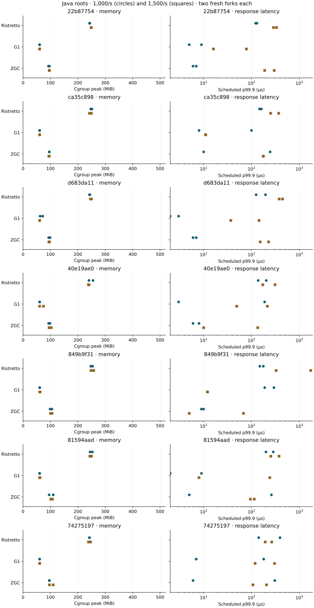

# Java latency and memory across address-registry revisions

Each row compares two fresh forks per rate. The table gives the median of their scheduled-response p99.9 values and the highest cgroup memory across both rates. Each runtime completed every offered request.

| Ristretto revision in campaign | Runtime | 1,000/s p99.9 (µs) | 1,500/s p99.9 (µs) | Peak memory (MiB) |
| --- | --- | ---: | ---: | ---: |
| `22b87754` | Ristretto | 126 | 311.5 | 249.0 |
| `22b87754` | G1 | 7 | 47 | 60.5 |
| `22b87754` | ZGC | 6.5 | 243 | 96.5 |
| `ca35c898` | Ristretto | 154 | 310.5 | 251.4 |
| `ca35c898` | G1 | 54 | 11 | 60.7 |
| `ca35c898` | ZGC | 127.5 | 176.5 | 96.0 |
| `d683da11` | Ristretto | 160.5 | 413 | 249.6 |
| `d683da11` | G1 | 2.5 | 90.5 | 71.9 |
| `d683da11` | ZGC | 6.5 | 189.5 | 98.8 |

The unchanged Java roots workload used a 64 MiB managed heap, two CPUs, a two-CPU quota, a 512 MiB cgroup, a five-second warmup and a 60-second measurement. The [earlier integrated run](../consolidated-java/README.md) reached 397.9 MiB on Ristretto. These short runs characterize latency and memory at fixed demand. Endurance, maximum sustainable throughput and global mutator pauses have separate gates.

[Process records](processes.csv) · [Histograms and memory samples](measurements.jsonl) · [Build and campaign provenance](provenance.json) · [Complete collection comparisons](../consolidated-collection-followups/README.md)
