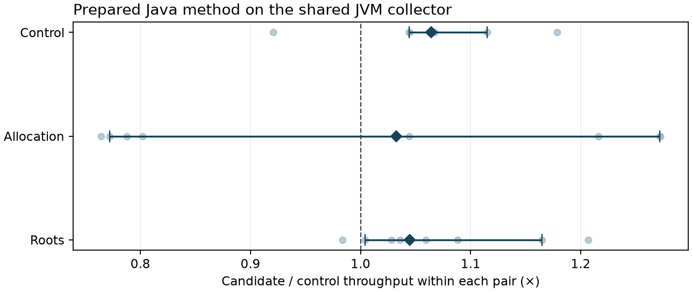

# Compiled frame-root publication on the JVM heap

Reusing identical root publications improved throughput on the prepared Java roots method. Across nine process pairs, its median candidate/control ratio was **1.045×** with an individual 95% bootstrap interval of **1.004–1.165×**. Byte-array allocation missed the required lower bound of 0.95. The JIT change stays out of the alpha.

| Workload | Control ops/s | Candidate ops/s | Paired ratio | Individual 95% interval |
|---|---:|---:|---:|---:|
| Control | 206,126 | 216,412 | 1.064× | 1.044–1.115× |
| Byte-array allocation | 29,291 | 30,024 | 1.032× | 0.772–1.272× |
| Java roots | 3,594 | 3,724 | 1.045× | 1.004–1.165× |

The throughput columns give medians across processes. Ratios are medians of within-pair ratios. Each bootstrap sample draws nine whole pairs with replacement. The policy required the roots lower bound to exceed 1.0 and both sibling lower bounds to reach 0.95. All 54 forks completed their checks. [Policy](policy.json) · [Schedule](schedule.json) · [Paired estimates](screen.json) · [Process table](processes.csv) · [Raw histograms, resource observations and checksums](processes.jsonl.gz).



## What was executed

Both versions used the same Java classfiles and the same JVM collector. A test-only driver placed the result of the ordinary native compiler for `GcBench.operation(IJI)I` in the normal dispatch cache. Java main, method calls, allocations, field and array operations, and frame ownership went through the VM. Ordinary automatic JIT eligibility rejects this method at bytecode offset 51 (`new`). The shipping JVM's comparison with G1 and ZGC is measured separately. [Shipping Java results](../shipping-heap-roots/README.md).

The candidate skips a publication only in the private basic block entered after the previous successful publication, with the same ordered SSA reference values and no intervening call. A machine-code test added 128 no-ops while a reference stayed live. The control made 130 callbacks with the padding and two without it. The candidate made two in both cases. A separate suspension test inserted a helper-owned reference while the frame was parked and checked that resumption discarded it while preserving the live Java reference. Four VM tests exercised suspended references across collection, calls and cancellation. [Candidate source and regression tests](candidate.patch.gz).

Separate instrumented runs observed one compiled entry per completed operation on all four Java branches. Roots took 32 backward branches and 72 resumes per operation on both builds. For this same method the instrumented native code size fell from 27,056 to 21,024 bytes. The release timing binaries had execution profiling disabled. [Dispatch observations](dispatch.json) · [Toolchain, input and build identities](provenance.json).

Each new process warmed for two seconds and measured four seconds in closed loop with seed 251129103, two workers, a 64 MiB managed heap, CPU affinity 4 and 6, two CPUs of quota, a 512 MiB cgroup memory limit and swap disabled. Every fork validated the Java workload checksum, histogram counts and retained graph. Each roots process reported 8–13 completed collections over its lifetime, including warmup and the post-measurement graph audit. [Per-process JVM diagnostics](stderr.jsonl.gz). Other verification work used separate CPUs for part of the run. These short native measurements cover prepared-method throughput. The ordinary JVM, scheduled latency, WASI throughput and endurance have separate qualification gates.

## Reproduce

Create two clean worktrees at `c411fbc387410ef62485c266c30a500e8d098595`. Apply the decompressed driver patch in both and the decompressed candidate patch in the candidate worktree. Keep a separate Cargo target directory for each. Build each VM test executable and use the executable path from the Cargo compiler-artifact record for the `ristretto_vm` library test. [Test-only driver](driver.patch.gz) · [Candidate patch](candidate.patch.gz).

```sh
cargo test --release --locked -p ristretto_vm --no-default-features --lib --no-run --message-format=json
"$JAVA_HOME/bin/javac" --release 8 -Xlint:-options -d "$CLASSES" benchmarks/gc/GcBench.java benchmarks/gc/GcTelemetry.java
python3 "$REPORT/run_screen.py" --before "$CONTROL_TEST" --after "$CANDIDATE_TEST" \
    --jdk "$JAVA_HOME" --classes "$CLASSES" --cgroup-parent "$DELEGATED_CGROUP" --output "$NEW_RESULTS"
```

Use JDK 25 and a delegated Linux cgroup with CPU and memory controllers and the listed CPUs available. Set `REPORT` to this report directory and create the classes directory first. For the separate dispatch observation, build the same test with `--features execution-profile` in the debug profile, then run `frozen_java_operation_backend_probe --nocapture` with `GC_PROBE_CLASSES`, `GC_PROBE_WORKLOAD`, `GC_PROBE_MS=250`, `GC_PROBE_WARMUP_MS=0` and `JAVA_HOME` set. The published dispatch counts use one fresh process per workload and build.
