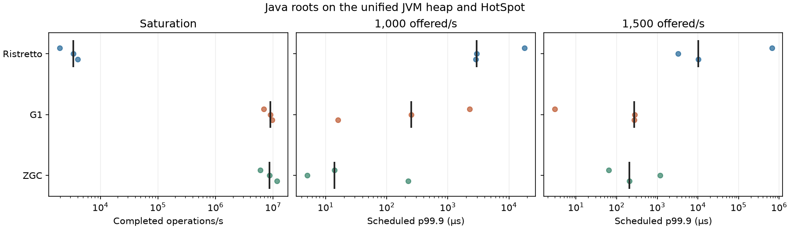

# Java roots on the shipping collector, G1 and ZGC

Ristretto at `31537fbf` ran the Java roots workload at a median 3,375 operations/s at saturation. G1 reached 8.90 million/s and ZGC 8.68 million/s on the same classfiles. Each operation allocates, publishes and traverses a 16-node list. The Ristretto JVM used its candidate policy with native JIT enabled. The timed method ran through the ordinary runtime entry point. [Per-process throughput and response tails](processes.csv).

| Runtime | Saturated operations/s | p99.9 at 1,000/s (µs) | p99.9 at 1,500/s (µs) | Unfinished scheduled operations |
|---|---:|---:|---:|---:|
| Ristretto | 3,375 (1,969–4,002) | 2,976 (2,848–17,920) | 10,240 (3,264–663,552) | 721 |
| G1 | 8,902,030 (6,943,225–9,594,905) | 252 (16–2,272) | 271 (3–277) | 0 |
| ZGC | 8,675,791 (6,021,820–11,617,691) | 14 (5–224) | 205 (64–1,168) | 0 |

Values are medians and ranges across three fresh forks. Of 225,000 scheduled operations, 224,279 completed inside the windows. The tail is measured from intended arrival for completed operations. The 721 unfinished operations censor the Ristretto tail at 1,500/s. All 27 processes passed the graph and accounting checks and reported GC activity. Other verification tasks ran on the host during this screen. Endurance, sustainable load and global GC pause time require separate measurements.

Each fork had five seconds of warmup, ten seconds of measurement, CPU affinity 4 and 6, two CPUs of quota, a 64 MiB heap and a 512 MiB cgroup memory limit with swap disabled. An earlier 27-fork run was excluded because a test-only source edit invalidated the input-integrity check. The same executable and seed were rerun from a clean checkout pinned to the build revision. Source, JDK, classfile and executable hashes passed the final integrity check. Reproduce with the [shipping comparison command](../unified-heap-roots/README.md#reproduction) at `31537fbf` using seed `251130057`. [Raw records and histograms](processes.jsonl.gz) · [Build and environment hashes](provenance.json).
