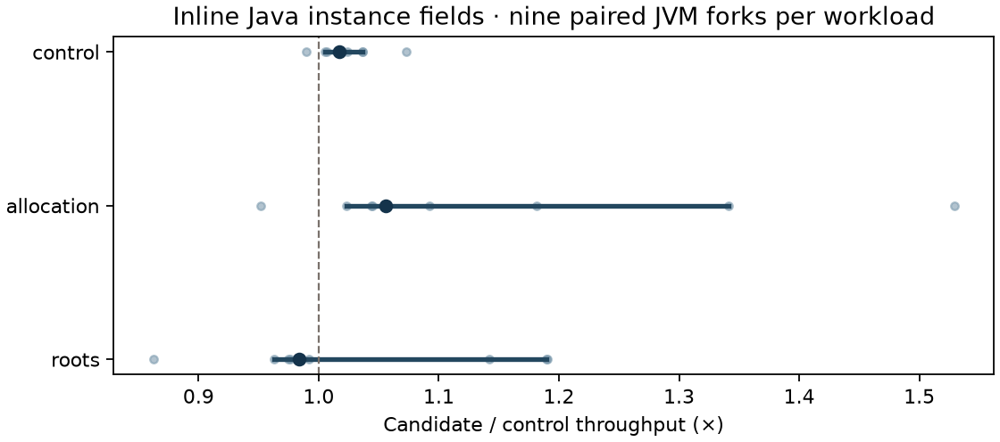

# Inline storage for small Java instances

Storing up to two Java instance fields inside the owning object removed their separate backing allocation. In nine paired runs of the Java roots workload, the median candidate/control throughput ratio was **0.984×** (individual 95% bootstrap interval **0.963–1.189×**). The release gate required its lower bound to exceed 1.0. The candidate remains an archived experiment.

| Workload | Control operations/s | Candidate operations/s | Median paired ratio | 95% interval |
|---|---:|---:|---:|---:|
| Control | 319,074 | 322,885 | 1.017× | 1.005–1.037× |
| Byte-array allocation | 55,895 | 63,791 | 1.056× | 1.023–1.341× |
| Java roots | 4,712 | 4,734 | 0.984× | 0.963–1.189× |

The operations/s columns are medians across processes. Pairing candidate and control within each randomized block gives the ratios in the last two columns. Each roots operation builds and traverses a 16-node list. The median process peak on that workload was 272 MiB for the control and 317 MiB for the candidate. All 54 forks completed their checks under the 512 MiB memory limit.



## Method

Each fresh native JVM ran the same Java bytecode with candidate GC policies and JIT enabled, two workers, a two-CPU quota on cores 4 and 6, a 64 MiB managed heap and swap disabled. Each measurement ran closed-loop for four seconds after two seconds of warmup. We resampled nine paired ratios with replacement 20,000 times per workload, using the registered seed and workload order, and took the 2.5th and 97.5th percentiles. The two sibling workloads required lower bounds of at least 0.95. These short runs measure whole-JVM throughput. [Registered policy](policy.json) · [Schedule](schedule.json) · [Paired results and binary identities](screen.json) · [All process rates](processes.csv) · [Checksums, histograms and resource records](processes.jsonl.gz).

## Storage and qualification

The archived patch applies to `880cce88`. Native `Object` and `Reference` each stayed at 232 bytes. On WASI `Object` stayed at 128 bytes and `Reference` fell from 136 to 128 bytes. Ordinary arrays and instances with more than two fields kept their existing backing. Native tests covered exact heap limits, held guards, reference retention and final refunds. The native interpreter, compiled preview and WASI interpreter each returned 64 and cleared both witnesses. The two Miri tests covered a held array projection and conditional-reference processing. Rebuilding the complete-collection fixtures produced the same binaries as the queue-root qualification on both targets. The performance observations above come from separate JVM binaries. [Candidate patch](candidate.patch.gz) · [Validation and fixture hashes](validation.json) · [Complete-collection qualification](../../consolidated-collection-followups/java-queue-root-preparation/README.md).

To reproduce, build the default-feature `ristretto_vm` example `gc_compare` in release mode at `880cce88`, save its executable and source receipt, apply the patch and build and freeze the candidate separately. Run the harness with the JDK and delegated cgroup paths for the host, the two frozen binaries and the registered policy.

```sh
python3 benchmarks/gc/run.py --jdk "$JDK_HOME" \
  --ristretto-before "$BEFORE" --ristretto "$AFTER" \
  --runtimes ristretto-candidate-jit-before ristretto-candidate-jit \
  --workloads control allocation roots --rates 0 --seconds 4 --warmup 2 --repeats 9 \
  --workers 2 --cpus 4 6 --cpu-quota 2 --heap-mib 64 --rss-mib 512 \
  --cgroup-parent "$CGROUP_PARENT" --timeout 90 --seed 251127977 --output "$RESULTS"
```
