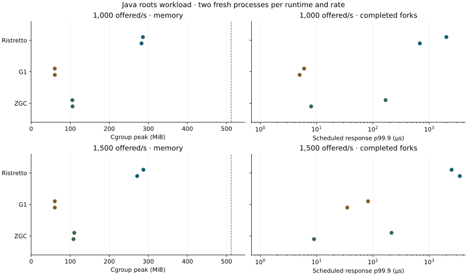

# Java roots workload after the native cleanup changes

The JVM built from `a0eba4e2` completed every scheduled request at both offered rates, as did HotSpot G1 and ZGC. Each process ran for 60 seconds after five seconds of warmup, with a 64 MiB managed heap, two pinned cores, a two-CPU quota and a 512 MiB process-group limit. The host also ran development workloads.

| Runtime | Offered requests/s | Scheduled p99.9 by fork (µs) | Median of fork p99.9 (µs) | Maximum cgroup memory (MiB) |
| --- | ---: | ---: | ---: | ---: |
| Ristretto | 1,000 | 2,016 and 681 | 1,348.5 | 286.1 |
| Ristretto | 1,500 | 2,496 and 3,488 | 2,992 | 287.3 |
| G1 | 1,000 | 6 and 5 | 5.5 | 60.6 |
| G1 | 1,500 | 82 and 35 | 58.5 | 60.5 |
| ZGC | 1,000 | 168 and 8 | 88 | 106.0 |
| ZGC | 1,500 | 214 and 9 | 111.5 | 110.4 |

At 1,500 requests/s, the Ristretto forks had scheduled p99.9 of 2.496 and 3.488 ms. All four HotSpot forks were below 0.22 ms at that rate. This two-fork fixed-rate comparison leaves sustainable throughput and the collector’s contribution to application latency unresolved. The full performance gate calls for capacity searches, independent paired runs and pause telemetry. [Measurement policy](../../../../../../ristretto_gc/PLAN.md#measurement-and-acceptance-policy)

The process records include completions, backlog and resource usage. The build and driver archives matched on all 2,673 individual file digests. [Process records](processes.csv) · [Response histograms and memory samples](measurements.jsonl) · [Build, JDK and run provenance](provenance.json)
