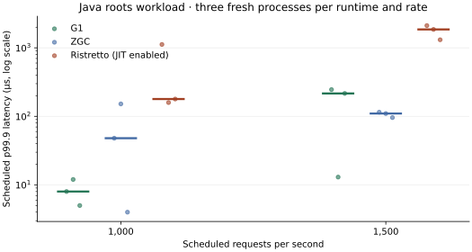
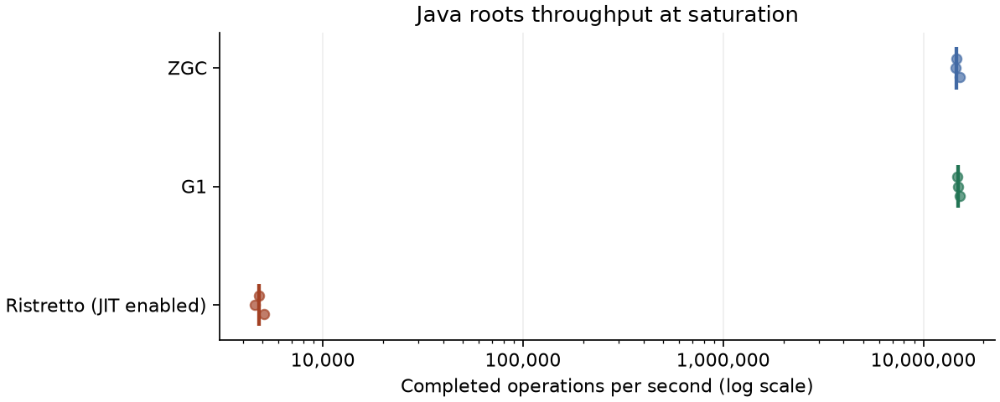

# Java roots latency after null-local JIT admission

At `2616e035`, Ristretto, G1 and ZGC completed every request with matching checksums at both offered rates. The table reports the median scheduled-response p99.9 across three independent processes per runtime and rate. Each point in the graph represents one process.

| Offered requests/s | Ristretto JIT enabled | G1 | ZGC |
|---:|---:|---:|---:|
| 1,000 | 179 µs | 8 µs | 48 µs |
| 1,500 | 1,856 µs | 216 µs | 110 µs |

Each fork used a 64 MiB heap, CPUs 4 and 6, a two-CPU quota, a 512 MiB process budget, five seconds of warmup and ten seconds of measurement. All eighteen reported processes observed GC activity. An initial launch overlapped removal of a retired local build directory and was stopped during its first fork. The complete schedule was restarted after cleanup. Absolute latency varied across revisions and forks. These independent schedules do not isolate the effect of the JIT change.

The [timed execution capture](../null-local-dispatch/README.md) identifies which methods entered compiled code. The roots operation still executed in the interpreter. [Process results](processes.csv), [scheduled and service histograms](histograms.jsonl.gz), [runtime and JDK identities](provenance.json).

## Saturated throughput

Nine additional processes used the same frozen runtime, JDK, CPU, memory and heap controls. Each ran the Java roots operation continuously for ten seconds after five seconds of warmup. All nine passed the workload checks, recorded GC activity and finished normally. Throughput is completed operations divided by the actual measured interval.

| Runtime | Median completed ops/s | Range across three processes |
|---|---:|---:|
| Ristretto JIT enabled | 4,798 | 4,579–5,086 |
| G1 | 14,865,550 | 14,817,151–15,156,288 |
| ZGC | 14,613,853 | 14,489,092–15,210,096 |

These rates include Java execution, allocation, barriers and collection. They establish a whole-JVM throughput gap on this workload. The trials leave sustained capacity, overload recovery and the endurance gates open. [All process rates and checksums](saturation.csv), [measurements and GC observations](saturation.jsonl.gz), [inputs and schedule hash](provenance.json).
