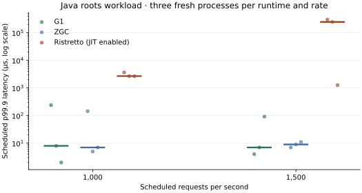

# Java roots latency after ordinary static long stores

At `7a441c48`, Ristretto completed all 10,000 scheduled requests in each
1,000/s process. At 1,500/s it completed 15,000, 15,000 and 14,922 of 15,000
requests. G1 and ZGC completed every request at both rates. The table reports
the median of three process-level scheduled p99.9 values in microseconds.

| Offered requests/s | Ristretto, JIT enabled | G1 | ZGC |
|---:|---:|---:|---:|
| 1,000 | 2,688 | 8 | 7 |
| 1,500 | 245,760 | 7 | 9 |

Each of the 18 fresh processes used the same Java classfiles, two assigned
CPUs, two CPUs of quota, two GC workers, a 64 MiB Java heap and a 512 MiB
process limit. The workload warmed for five seconds and measured ten seconds.
The harness randomized launch order. Every process exited successfully and
observed collection. Completed runs at the same rate produced matching
checksums. The short runs establish neither sustainable capacity nor a pause
bound. Enabling the Ristretto JIT leaves bytecodes outside its admission set
in the interpreter.

[Per-process results](processes.csv) · [Histograms, outcomes and cgroup limits](histograms.jsonl.gz) · [Build and workload identities](provenance.json)
